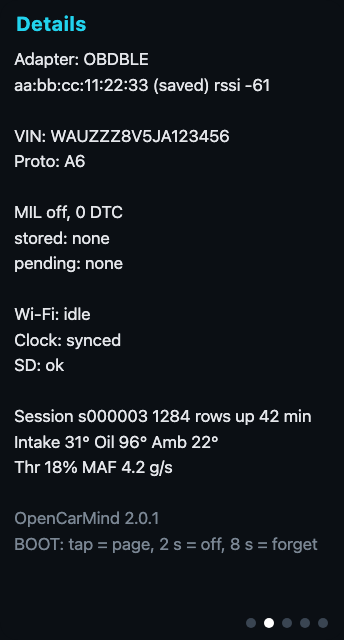

<p align="center"></p>

OpenCarMind turns an ESP32-S3 board and a Bluetooth OBD-II adapter into a car data logger that runs a neural network on the board. It needs no phone, no account and no internet connection. Everything it records stays on an SD card in your car.

Version 2.0.1. Licence: MIT.

## What you get

- Every standard Mode 01 field the car reports (70 are decoded), battery voltage, the VIN, and stored, pending and permanent trouble codes. One CSV row is written per poll cycle.
- A small neural network on the chip. Each time a row arrives it classifies the last 30 seconds of driving as stopped, braking, accelerating or cruising. It also estimates three values the OBD port does not report: brake pressure, flywheel torque and fuel rate.
- A save to the SD card every 10 seconds. Page 3 of the screen shows "Safe to turn off" each time, so you can pull the plug without losing the drive.
- A fault engine that ranks trouble codes by severity and groups codes that share a cause.
- A soft real-time scheduler that times every job against its deadline and restarts the board if a step hangs.
- Optional Wi-Fi, used only to set the clock.
- A local dashboard: a script turns the card's sessions into reports, and the open-source Dashy shows them.

## Local-first

<p align="center"></p>

Most car loggers stream your driving to a server and do the thinking there. OpenCarMind does the thinking on the board. The model is 93 KB, runs in a few milliseconds and needs no network. Your data is plain CSV, JSON and text on a card you hold. Nothing leaves the car unless you copy it yourself.

Wi-Fi is the only radio besides Bluetooth, and it has one job: reading the time from a public time server so your sessions carry real timestamps. You can compile it out with one setting (`OCM_WIFI_CLOCK_SYNC`).

## How it works

<p align="center"></p>

The board asks the engine computer for every field it supports, shows the live values on its screen and writes each drive to the SD card as its own session. The model runs on the chip while you drive. When you get home, take the card out and open the files on your computer.

### On-board inference

<p align="center"></p>

When an OBD row arrives, the board cuts the last 30 seconds into thirty one-second bins that end at that moment. Each bin takes the latest value, held for up to 3 seconds if a channel was not read in time. The model runs in its own task, so logging never waits for it. Every row adds one line to the drive's `.ml.csv` file, and the newest answer shows on page 5.

On the author's car, a row arrived every 1.35 to 1.65 seconds and one model run took about 9 ms on average (6 ms on the bench, 180 ms at worst), which is about 0.6 % of one core. These numbers come from one car and one adapter. Yours will differ.

### Scheduler and safety

<p align="center"></p>

Open-source loggers usually treat timing as someone else's problem. Here every periodic job (the OBD poll and the model) has a period and a deadline. The scheduler in `main/sched_mon.c` records each run's response time and CPU time, counts misses and stalls, and once a minute checks per-core load against the rate-monotonic bound (Liu and Layland, 1973) and the worst-case response time of each job (Joseph and Pandya, 1986). Steps that talk to the adapter feed the task watchdog, so a step that never returns resets the board. After three abnormal resets in a row the board starts in safe mode: the model stays off and logging keeps going.

## The screens

<p align="center">




</p>

Tap BOOT to change page. Hold it for 2 seconds to power off, or for 8 seconds to forget the saved adapter. Between 06:00 and 17:00 local time, once the clock is set, the screen uses a light theme. The pictures in `docs/images` are rendered from `docs/screens/screens.html` with `sh docs/screens/render.sh`.

1. Dashboard: RPM, speed, coolant, battery, load and fuel, plus Bluetooth, SD and Wi-Fi icons.
2. Details: adapter, VIN, protocol, trouble codes, clock and SD state, session counters.
3. Internals: twelve extra fields (timing, fuel trims, baro, boost, catalyst temperature, rail pressure, fuel rate and more), up to eight custom PIDs, and the recent events, including "Safe to turn off".
4. Faults: ranked trouble codes with severity, description and likely cause.
5. System: CPU and memory, link states, the job list with deadlines, what the model sees and its three estimates.

## Dashboard

`tools/ocm_report.py` reads a session folder from the SD card and writes one HTML report per drive (charts of speed, engine speed, coolant and throttle, and the model's manoeuvre classes) plus a summary. [Dashy](https://github.com/Lissy93/dashy), an open-source self-hosted dashboard, shows the latest drive and links to every report. Both run on your own computer or home server with Docker, and nothing is sent to the internet.

```sh
python3 tools/ocm_report.py /Volumes/<card name>/obd dashboard/site
cd dashboard && docker compose up -d      # Dashy on http://localhost:4000
```

The board never talks to Dashy: the data moves by SD card. [docs/DASHBOARD.md](docs/DASHBOARD.md) has the setup, the details of how the data reaches Dashy, and what has and has not been tested.

## Hardware

- Board: Waveshare ESP32-S3-LCD-1.47B (the pin map in `main/board.h` matches it). Other ESP32-S3 boards need that file edited. There is no build without the display yet.
- Adapter: a Bluetooth LE ELM327-style adapter. It was tested with a LELink only. The firmware tries these GATT profiles in turn: FFE0/FFE1, FFF0/FFF1/FFF2, 18F0/2AF0/2AF1 and the Nordic UART service, then falls back to the first service that has a notify and a write characteristic. Classic Bluetooth adapters will not work, because the S3 has no classic radio.
- A FAT-formatted SD card.

## Build and flash

You need ESP-IDF v6.1 and Python 3.

```sh
. $IDF_PATH/export.sh
idf.py set-target esp32s3
idf.py build
idf.py -p /dev/cu.usbmodemXXXX flash monitor
```

The first build downloads ESP-DL, LVGL, led_strip and cJSON through the IDF component manager. The NimBLE helper comes from the `examples` folder of your ESP-IDF install, so keep that folder. If you built an earlier version in the same folder, delete `sdkconfig` first. If the board stays in download mode after flashing, reset it with `esptool.py --chip esp32s3 -p <port> --after watchdog_reset chip_id`.

On first boot the board pairs with the first adapter whose name starts with `OBDBLE`, or that advertises the configured service. It stores the address and uses only that adapter afterwards. Change the name prefix in `idf.py menuconfig` under OBD Logger Configuration.

Settings, SD card files, the Wi-Fi list and the CSV columns are in [docs/CONFIGURATION.md](docs/CONFIGURATION.md).

## The model

<p align="center"></p>

A 1-D convolutional network with 38,679 parameters, quantised to 8-bit weights and 16-bit activations (`w8a16`) and run by ESP-DL. It reads thirty one-second steps of seven channels (rpm, speed, load, throttle, both fuel trims and coolant temperature) and feeds two heads that share one trunk. On held-out drives of the HCRL KIA Soul data, the version on the chip scores a manoeuvre macro-F1 of 0.912 and a mean estimator R² of 0.830 (brake pressure 0.56, flywheel torque 0.94, fuel rate 0.99). When the test windows are thinned to mimic a slow adapter, the refined model scores 0.874 and 0.792. [docs/MODEL.md](docs/MODEL.md) has the inputs, outputs, labels and limits. The training code is in [ml/training](ml/training) and the shipped files are in [ml/onboard](ml/onboard).

### From training to the board

<p align="center"></p>

Training runs on a Mac. The network is trained quantisation-aware (QAT) from the start: in every forward pass its weights and activations are rounded to the int8 grid with power-of-two scales, the same scheme ESP-DL uses, so the float network that reaches the converter already lives on that grid. A refinement step then fine-tunes it, still with QAT, on dense one-second windows that mimic a slow adapter. The test split is read once.

Deployment is a chain with two checks. The trained network is exported to ONNX and quantised by ESP-PPQ (`w8a16`, calibrated on 256 windows). The exporter scores the int8 graph on the same test windows, and if the score drops you go back to refinement. `tools/gen_ml_params.py` then writes `main/ml_params.h` with the channel order, normalisation, class names and the model's hash, the firmware embeds the model, and the board runs its own self-test at boot. Commands for every step are in [ml/training](ml/training/README.md).

What the model does not do yet:

- It was trained on one car, a KIA Soul. Other cars shift the input distributions, and nobody has measured accuracy on them.
- Brake pressure is the weakest estimate. Torque and fuel rate are strong.

## Status

Checked on the bench or in the code: the build (with Wi-Fi clock sync on and off), the model's identity hash, the host unit tests (56 checks), the 10-second save and the "Safe to turn off" event on a board with an SD card.

Not checked: other boards, other adapters, a power-off test during a real drive, and what the screens do on a board without a panel.

## Planned

- Support for more boards, including one without a display.
- A faster version built on a Jetson.

## Repository layout

| Path | What it holds |
|---|---|
| `main/` | firmware source |
| `ml/onboard/` | the shipped model, its normalisation and export record |
| `ml/training/` | training, refinement and export code, and the model report |
| `samples/replay/` | three replay sessions from public datasets, in the board's file format |
| `schema/` | JSON schema of the session files |
| `tests/host/` | unit tests that run on a computer |
| `tools/` | `ocm_report.py` (SD card sessions to reports) and the generator for `main/ml_params.h` |
| `dashboard/` | Docker Compose file and Dashy configuration |
| `docs/` | configuration, model notes, screen designs and figures |

## Credits and licence

OpenCarMind is released under the MIT licence (see `LICENSE`). ESP-IDF, ESP-DL, LVGL and NimBLE keep their own licences.

The model was trained on the HCRL Driving Dataset (Hacking and Countermeasure Research Lab, Korea University), which its authors released for academic purposes and ask users to cite. The data is not part of this repository. If you plan commercial use of the weights, ask the HCRL authors first.

- B. I. Kwak, J. Woo and H. K. Kim, "Know Your Master: Driver Profiling-based Anti-theft Method," PST 2016.
- The replay samples also use the carOBD dataset, <https://github.com/eron93br/carOBD>. See `samples/replay/README.md` for its terms.
