<p align="center">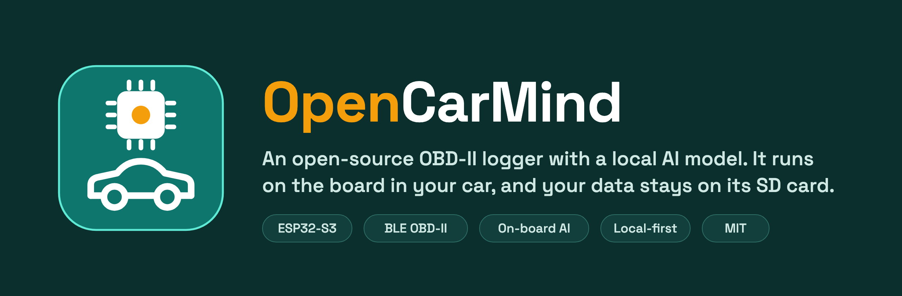</p>

<p align="center">
<a href="https://github.com/AlveeeRahman/OpenCarMind/actions/workflows/ci.yml"></a>
<a href="https://scorecard.dev/viewer/?uri=github.com/AlveeeRahman/OpenCarMind"></a>
<a href="LICENSE"></a>


</p>

OpenCarMind is an open-source OBD2 logger and dashboard for the ESP32, with TinyML on the board. It turns an ESP32-S3 board and a Bluetooth OBD-II adapter into a car data logger that runs a neural network on the chip. It needs no phone, no account and no internet connection. Everything it records goes to an SD card in the car and, if you pair the board, to the desktop app on your own computer.

It ships two on-board models, and you choose between them in the desktop app. CarMind E.V is fixed and tested. CarMind R.E.V is my first model that keeps learning in your car: the board itself updates part of the model from what your car reports while you drive, with no computer or cloud in the loop.

Version 2.5.1. Licence: MIT. Website: <https://alveeerahman.github.io/OpenCarMind/>. Downloads for the firmware and the desktop app are on the [Releases page](https://github.com/AlveeeRahman/OpenCarMind/releases/latest).

The same firmware also runs on Espressif's ESP-Mosaico touch-screen board. Its next version, [OpenCarMind EdgeOS 2.0.0](#opencarmind-edgeos-200-esp-mosaico), adds a small operating-system layer: a boot health check, refusals of risky changes while you drive, model admission by response-time analysis and battery protection. [User manuals](#user-manuals) for both boards are in [docs/manual](docs/manual).

## Contents

<ol type="I">
<li><a href="#choose-your-model">Choose your model</a></li>
<li><a href="#what-you-get">What you get</a></li>
<li><a href="#local-first">Local-first</a></li>
<li><a href="#how-it-works">How it works</a>
<ol type="A">
<li><a href="#on-board-inference">On-board inference</a></li>
<li><a href="#scheduler-and-safety">Scheduler and safety</a></li>
</ol>
</li>
<li><a href="#the-screens">The screens</a></li>
<li><a href="#dashboard">Dashboard</a></li>
<li><a href="#desktop-app">Desktop app</a></li>
<li><a href="#hardware">Hardware</a>
<ol type="A">
<li><a href="#adapter-compatibility">Adapter compatibility</a></li>
</ol>
</li>
<li><a href="#build-and-flash">Build and flash</a></li>
<li><a href="#user-manuals">User manuals</a></li>
<li><a href="#the-models">The models</a>
<ol type="A">
<li><a href="#the-test-drives">The test drives</a></li>
<li><a href="#carmind-rev-results-so-far">CarMind R.E.V results so far</a></li>
<li><a href="#how-the-models-are-made">How the models are made</a></li>
<li><a href="#what-rev-learns">What R.E.V learns</a></li>
<li><a href="#how-rev-learns-on-the-board">How R.E.V learns on the board</a></li>
<li><a href="#looking-inside-rev-with-explainable-ai">Looking inside R.E.V with explainable AI</a></li>
<li><a href="#how-rev-got-better-step-by-step">How R.E.V got better, step by step</a></li>
</ol>
</li>
<li><a href="#status">Status</a></li>
<li><a href="#opencarmind-edgeos-200-esp-mosaico">OpenCarMind EdgeOS 2.0.0 (ESP-Mosaico)</a>
<ol type="A">
<li><a href="#what-it-is">What it is</a></li>
<li><a href="#the-parts-and-why-each-exists">The parts and why each exists</a></li>
<li><a href="#services-and-runlevels">Services and runlevels</a></li>
<li><a href="#model-admission-by-response-time-analysis">Model admission by response-time analysis</a></li>
<li><a href="#what-it-costs">What it costs</a></li>
<li><a href="#what-you-see-on-the-board">What you see on the board</a></li>
<li><a href="#changes-after-the-board-check">Changes after the board check</a></li>
<li><a href="#flash-it-or-go-back-to-mossrev-120">Flash it, or go back to mossREV 1.2.0</a></li>
<li><a href="#prepared-but-off-ab-rollback-and-the-battery-as-a-ups">Prepared but off: A/B rollback and the battery as a UPS</a></li>
<li><a href="#what-is-verified-on-the-board">What is verified on the board</a></li>
</ol>
</li>
<li><a href="#limitations-and-future-work">Limitations and future work</a></li>
<li><a href="#planned">Planned</a></li>
<li><a href="#references">References</a></li>
<li><a href="#repository-layout">Repository layout</a></li>
<li><a href="#credits-and-licence">Credits and licence</a></li>
</ol>

## Choose your model

| | CarMind E.V | CarMind R.E.V |
|---|---|---|
| Status | released in 2.4.0, the default in the 2.5.1 release | new in 2.5.0, improved in 2.5.1, the default on a new board with the firmware from `main` |
| Size on the chip | about 89 KB | about 66 KB |
| Parameters | 38,679 | 19,815 |
| Time per run on the ESP32-S3 | about 3.5 ms in the car, 2.9 ms on the bench | about 2.9 ms in the car (median), 2.2 ms on the bench |
| Learns in your car | the model is fixed. The tank size and fill-up calibration learn with either model | its fuel estimate and an airflow constant that also gives the engine size, so its torque estimate learns your engine too. Plus the tank size and fill-up calibration, like E.V |
| Steady cruising with your foot on the gas | can be shown as braking | corrected in 2.5.1 |
| Fill-up calibration | yes | yes |
| Best for | a fixed, tested model | older cars, roughly pre-2020, that have no fuel-rate PID and can lose the airflow (MAF) reading |
| On the ESP-Mosaico (OpenCarMind EdgeOS 2.0.0, mossREV 1.2.0) | included, switch in Settings > MODEL | included, the default on a new board |

<p align="center"></p>

From E.V to R.E.V in seven steps, each with the number it moved. How each was measured is in the [detailed README](https://github.com/AlveeeRahman/OpenCarMind/blob/rev-c2/README.md#how-rev-got-better-step-by-step).

Many older cars do not report their fuel rate, so the board works it out from the airflow sensor. When that reading is missing, a fixed model can only offer its factory estimate. R.E.V learns your car while a fuel-rate or airflow reading is there and uses what it learned when it is not.

To switch, connect the board to the desktop app with its USB cable while the car is parked, open the Board page and pick the model under "On-board model". The board keeps the choice after a restart, and what R.E.V learned stays on the SD card while E.V runs. More in [What R.E.V learns](#what-rev-learns).

<p align="center">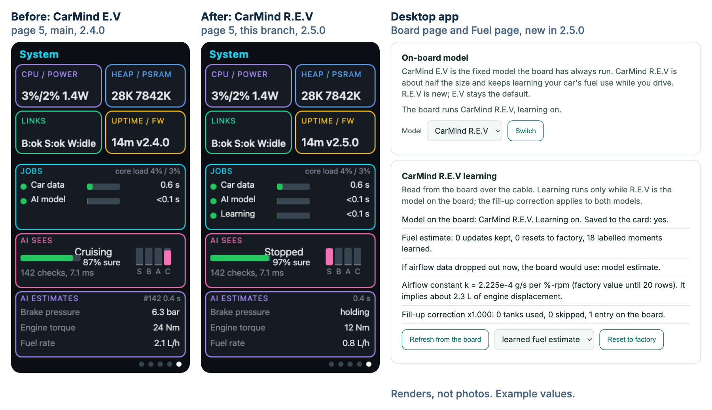</p>

Renders, not photos, with example values. Left: page 5 with E.V. Middle: page 5 with R.E.V, which adds a third job, "Learning". Right: the model selector on the app's Board page and R.E.V's learning status on its Fuel page.

## What you get

- **Every standard Mode 01 field** the car reports (70 are decoded), battery voltage, the VIN, and stored, pending and permanent trouble codes. One CSV row per poll cycle.
- **A small neural network on the chip.** It classifies the last 5 seconds of driving as stopped, braking, accelerating or cruising, and estimates three values the OBD port does not report: brake pressure, flywheel torque and fuel rate.
- **A save to the SD card every 10 seconds** and a **power-off line** on page 3: green "Safe to turn off" once everything is on the card, red with the reason otherwise. The drive ends by itself 15 seconds after the engine computer stops answering.
- **Fuel economy** in km/L, or mpg in the US and the UK, from the best source your car has. A car that gives nothing shows "--", never a made-up number.
- **Units that follow you.** The first time the board joins Wi-Fi it reads the country of the access point and switches to miles and mpg in the US or the UK.
- **Fill-up calibration.** Enter fill-ups in the desktop app, and the board corrects its fuel figures from what you actually pumped.
- **A fault engine** that ranks trouble codes by severity and groups codes that share a cause.
- **Dark and light screen themes**, by time of day or fixed.
- **A soft real-time scheduler** that times every job against its deadline and restarts the board if a step hangs.
- **Optional Wi-Fi, for the clock only**: one HTTPS request to one time server you can choose.
- **A desktop app** for Windows, macOS and Linux that imports drives, charts them, shows fuel per drive, switches the model and takes your fill-ups.

## Local-first

<p align="center">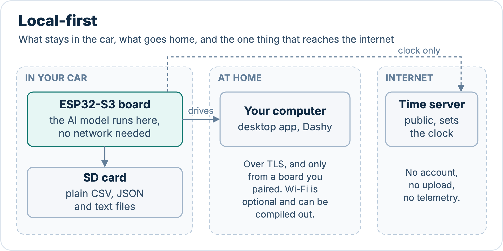</p>

Most car loggers stream your driving to a server and do the thinking there. OpenCarMind does the thinking on the board, the way TinyML work runs networks on microcontrollers<sup>[[1]](#ref-1)–[[3]](#ref-3)</sup>. R.E.V's learning also happens on the board, and what it learns stays on your SD card. Your data is plain CSV, JSON and text on a card you hold.

Wi-Fi is optional and does one thing: while the car is parked on a known network, the board asks one HTTPS time server for the time. It checks the server's certificate, sends nothing else, and listens on no port. You can compile Wi-Fi out with `OCM_WIFI_CLOCK_SYNC`. On the ESP-Mosaico you can also search for a network and join it from the touch screen, for the same clock sync.

## How it works

<p align="center">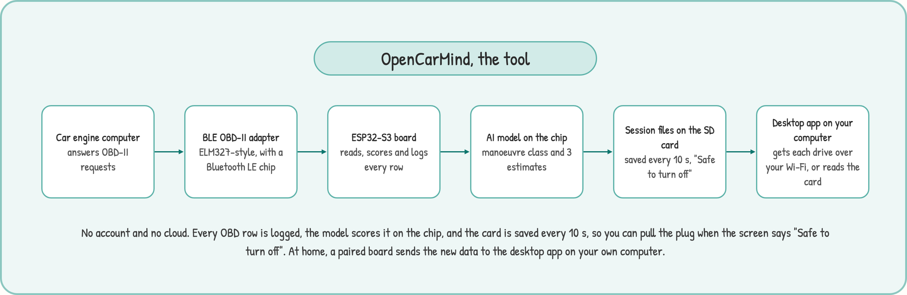</p>

The board asks the engine computer for every field it supports, shows the live values on its screen and writes each drive to the SD card as its own session. At home, the desktop app imports new drives over the USB cable, or you take the card out.

### On-board inference

<p align="center">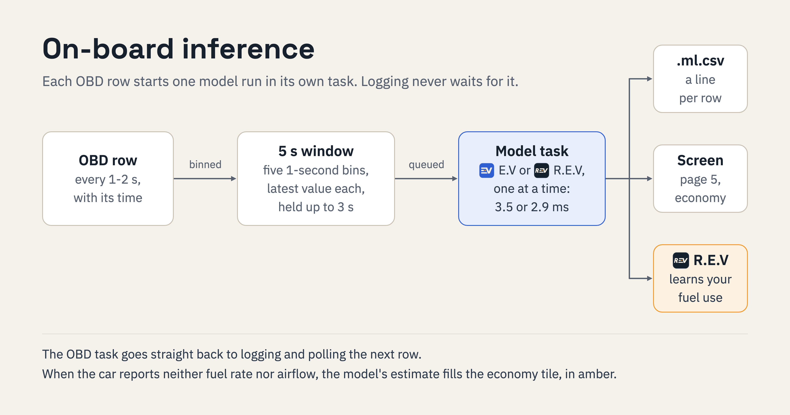</p>

When an OBD row arrives, the board cuts the last 5 seconds into five one-second bins and runs the model in its own task, so logging never waits for it. Every row adds a line to the drive's `.ml.csv` file, and the newest answer shows on page 5. With R.E.V, the same run also feeds its learner.

### Scheduler and safety

<p align="center">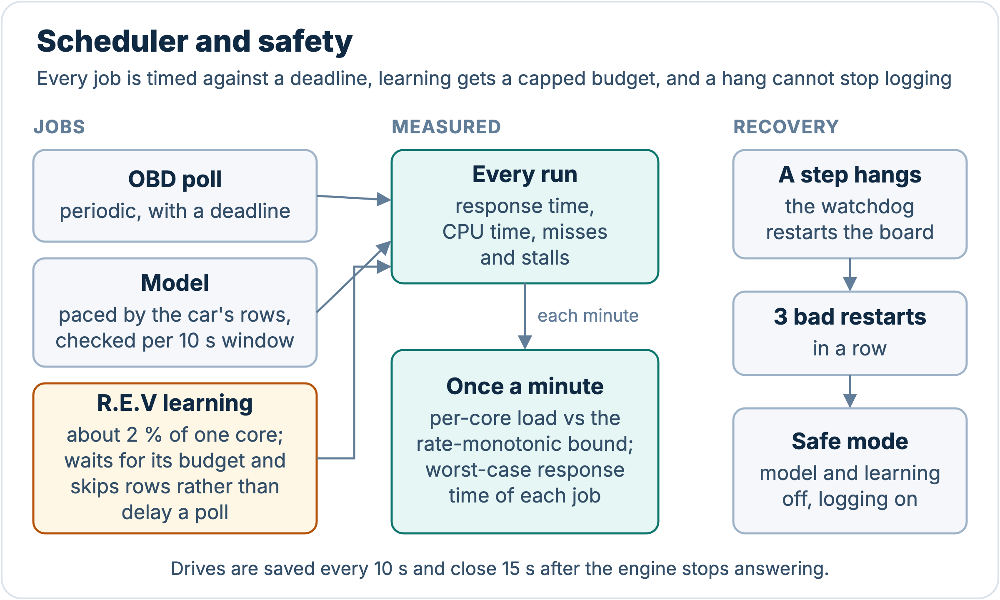</p>

Every periodic job has a period and a deadline. The scheduler in `main/sched_mon.c` times each run and, once a minute, checks the load against the rate-monotonic bound<sup>[[4]](#ref-4)</sup> and each job's worst-case response time<sup>[[5]](#ref-5)</sup>. A step that never returns resets the board, and after three bad restarts in a row it starts in safe mode with logging still on. R.E.V's learning runs at the lowest priority on a small budget of about 2 % of one core, so it never holds up the OBD poll or the model.

## The screens

<p align="center"></p>

<p align="center">
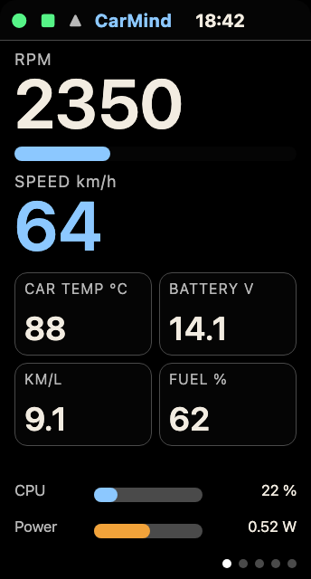
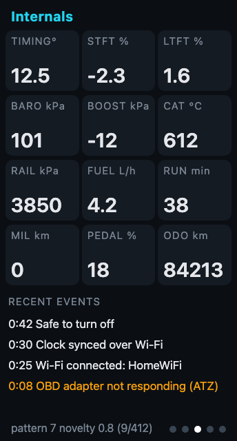
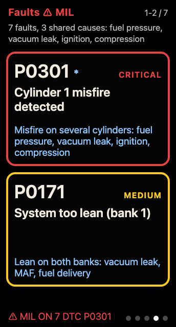
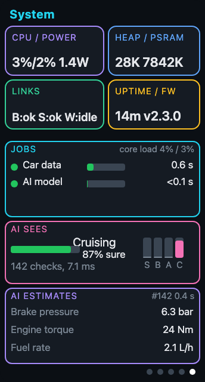
</p>
<p align="center">
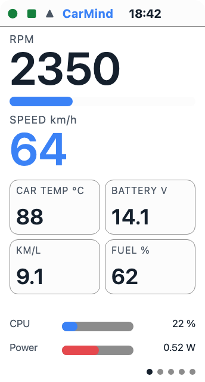
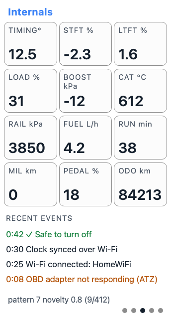
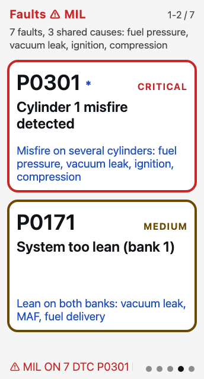
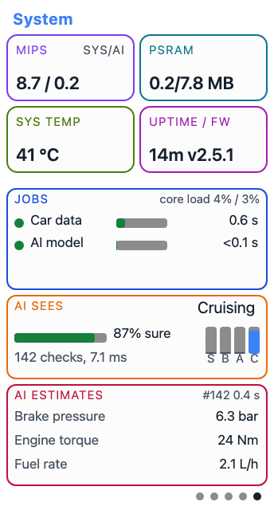
</p>

Pages 1, 3, 4 and 5 in the dark and light themes (renders, not photos). Page 2 is plain text and has its own picture at [docs/images/details.png](docs/images/details.png).

The dark theme is pure black, because on an LCD any tint in the background glows through the backlight. Text and colours are bright enough to read at a glance, and every status colour comes with a word.

Tap BOOT to change page. Hold it for 2 seconds to power off. The screen says "Turning off" while it saves and closes the drive, then "Off, safe to unplug", and the backlight and LED go dark. Hold it for 8 seconds to forget the saved adapter.

1. Dashboard: RPM, speed, engine temperature, battery, fuel economy and fuel level, with a CPU bar and an estimated power bar.
2. Details: adapter, VIN, protocol, trouble codes, clock, SD state and fuel used.
3. Internals: twelve extra fields, up to eight custom PIDs, and recent events, including "Safe to turn off".
4. Faults: ranked trouble codes with severity, description and likely cause, plus the connection and MIL status line.
5. System: instructions per second on each core (hardware counters), PSRAM in use, chip temperature, uptime, the jobs and their deadlines, what the model sees and its three estimates.

The screen is light from 06:00 to 17:00 and dark otherwise. `theme_mode`, the hours and the time zone are set in `config.json` (see [docs/CONFIGURATION.md](docs/CONFIGURATION.md)).

## Dashboard

`tools/ocm_report.py` turns a session folder from the SD card into one HTML report per drive, and [Dashy](https://github.com/Lissy93/dashy) shows them on your own computer or home server. Nothing is sent to the internet.

```sh
python3 tools/ocm_report.py /Volumes/<card name>/obd dashboard/site
cd dashboard && docker compose up -d      # Dashy on http://localhost:4000
```

## Desktop app

<p align="center">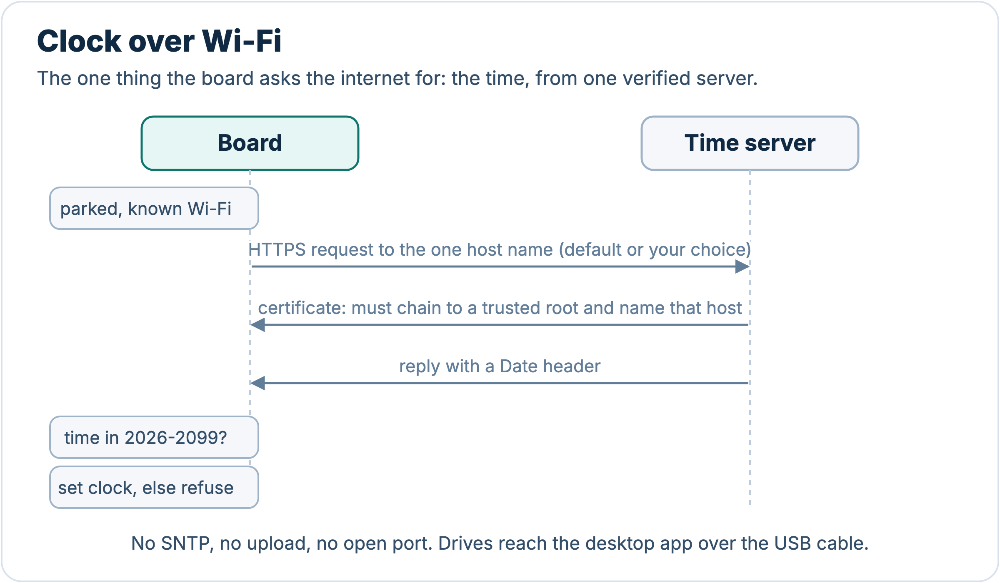</p>

The app in [desktop/](desktop/README.md) runs on Windows, macOS and Linux. Over the board's USB cable it pairs with the board (you type a code from the board's screen once), sets Wi-Fi, time zone, time server and settings, imports drives and flashes new firmware, so the SD card never has to come out. It also switches the on-board model and keeps your fill-up log. [docs/DASHBOARD.md](docs/DASHBOARD.md) has the setup.

## Hardware

- Board: Waveshare ESP32-S3-LCD-1.47B (the pin map in `main/board.h` matches it).
- Or the Espressif ESP-Mosaico V1.2 (ESP32-S31) with the OpenCarMind EdgeOS 2.0.0 build (called mossREV up to 1.2.0). It needs no SD card: see [docs/MOSAICO.md](docs/MOSAICO.md#the-hardware).
- Adapter: a Bluetooth LE adapter that speaks ELM327 commands (see below). Classic Bluetooth adapters will not work, because the S3 has no classic radio.
- A FAT-formatted SD card.

### Adapter compatibility

Only the LELink has been driven with this board. The other rows come from vendor documents and other open-source OBD projects. [docs/ADAPTERS.md](docs/ADAPTERS.md) has prices and sources. The Amazon links are plain product pages with no affiliate tag, all opened on 3 November 2026.

| Adapter | Bluetooth | Built-in profile | Status | Amazon |
|---|---|---|---|---|
| LELink², LELink | LE | FFE0 / FFE1 | tested | [B0755N61PW](https://www.amazon.com/dp/B0755N61PW), [B00QJRYMFC](https://www.amazon.com/dp/B00QJRYMFC) |
| Veepeak OBDCheck BLE+, BLE | LE | FFF0 / FFF1 / FFF2 | expected | [B076XVQMVS](https://www.amazon.com/dp/B076XVQMVS), [B073XKQQQW](https://www.amazon.com/dp/B073XKQQQW) |
| OBDLink CX (sold as the Bimmercode edition, which is the only CX model) | LE 5.1, encrypted | FFF0 / FFF1 / FFF2, pairs on demand | expected | [B08NFLL3NT](https://www.amazon.com/dp/B08NFLL3NT) |
| Carista OBD2, Carista EVO | LE | FFF0 / FFF1 / FFF2 | expected | [B00YVHGTBM](https://www.amazon.com/dp/B00YVHGTBM), [B0CM9W4MCW](https://www.amazon.com/dp/B0CM9W4MCW) |
| Vgate iCar Pro BLE 4.0 | LE | 18F0 / 2AF0 / 2AF1 | expected | [B06XGB4873](https://www.amazon.com/dp/B06XGB4873) |
| Vgate vLinker MC+ | LE and Classic | E7810A71 / BEF8D6C9 | expected | [B088LW211V](https://www.amazon.com/dp/B088LW211V) |
| Vgate vLinker FS, MS | LE and Classic | E7810A71 / BEF8D6C9 | switch to "BLE+BT" in the VgateFwUpdater app first | [B0BZTXV6MZ](https://www.amazon.com/dp/B0BZTXV6MZ), [B0D6YQX4R8](https://www.amazon.com/dp/B0D6YQX4R8) |
| Panlong OBD2 Scanner (PL-B04) | LE, works with Car Scanner on iOS | generic fallback | expected for the "For iOS Android" option only. The "For Android Only" option is likely Classic. The page title does not name the model | [B0C1GDJ9ZJ](https://www.amazon.com/dp/B0C1GDJ9ZJ) |
| DA200 (Bluetooth 5.4, "AI Repair Tips") | LE, PIC18F25K80 ELM327-type chip (maker's spec sheet) | generic fallback | expected. The page title does not name the model, check for DA200 on the box | [B0FH2GJTP8](https://www.amazon.com/dp/B0FH2GJTP8) |
| ELM327 BLE clones (for example RODEDIO) | LE on iOS | FFF0 or FFE0 | expected for most. Buy one whose listing says Bluetooth LE for iOS | [B0GWQKLTMR](https://www.amazon.com/dp/B0GWQKLTMR) |
| Adapters running the Deep OBD firmware | LE | FFE0 / FFE1 / FFE2 | expected | not sold on Amazon. Layout from the Deep OBD source, [BtLeGattSppAndroid.cs](https://github.com/uholeschak/ediabaslib/blob/master/EdiabasLib/EdiabasLib/BtLeGattSppAndroid.cs) |
| FIXD | Bluetooth | unknown | unverified | [B013RIQMEO](https://www.amazon.com/dp/B013RIQMEO) |
| BlueDriver | Bluetooth | private protocol | not expected | [B00652G4TS](https://www.amazon.com/dp/B00652G4TS) |
| V800 full-system scanners (Panlong PL-V800 and white-label copies) | Bluetooth | private app (INNOOBD+) | not expected. The title says "Engine Transmission ABS SRS", not V800 | [B0GQ3D57PK](https://www.amazon.com/dp/B0GQ3D57PK) |
| OBDLink MX+, OBDLink LX, KONNWEI KW902 | Classic only (LX: Bluetooth 3.0, KW902: Android and Windows only) | none | will not work. The KW902 listing showed "currently unavailable" on 3 Nov 2026 | [B07JFRFJG6](https://www.amazon.com/dp/B07JFRFJG6), [B00H9S71LW](https://www.amazon.com/dp/B00H9S71LW), [B073F57QT3](https://www.amazon.com/dp/B073F57QT3) |

## Build and flash

You need ESP-IDF v6.1 and Python 3.

```sh
. $IDF_PATH/export.sh
idf.py set-target esp32s3
idf.py build
idf.py -p /dev/cu.usbmodemXXXX flash monitor
```

For the ESP-Mosaico, build with `idf.py --preview set-target esp32s31` and flash as [docs/MOSAICO.md](docs/MOSAICO.md#flashing) describes (no buttons, esptool 5.6.0 or later).

The first build downloads ESP-DL, LVGL, led_strip and cJSON through the IDF component manager. If you built an earlier version in the same folder, delete `sdkconfig` first. If the board stays in download mode after flashing, reset it with `python -m esptool --chip esp32s3 -p <port> --after watchdog-reset chip-id`.

On first boot the board connects to the strongest nearby adapter that looks like an OBD adapter and remembers it. In the next S3 release this changes: a new adapter is offered only at -70 dBm or better, and saved only when you tap BOOT within 5 s. That is built and host-checked, not yet tested on a board. If yours is not found, add its name to `OBD_BLE_NAME_PREFIXES` in `idf.py menuconfig` under OBD Logger Configuration. Settings, SD card files, the Wi-Fi list and the CSV columns are in [docs/CONFIGURATION.md](docs/CONFIGURATION.md).

## User manuals

Two user manuals for drivers and test users, each as Markdown here and as a page on the website:

- [OpenCarMind 2.5.1 on the ESP32-S3 board](docs/manual/esp32-s3.md) ([web page](https://alveeerahman.github.io/OpenCarMind/manual/esp32-s3.html)): the five pages, the BOOT button, the two models, Wi-Fi for the clock and the desktop app.
- [OpenCarMind EdgeOS 2.0.0 on the ESP-Mosaico](docs/manual/edgeos-2.0.0.md) ([web page](https://alveeerahman.github.io/OpenCarMind/manual/edgeos-2.0.0.html)): the 16 apps, Settings, Wi-Fi, the two models, the health check and every message the board shows.

Both come from one source each in [docs/manual/src](docs/manual/src), built by [docs/manual/build.py](docs/manual/build.py).

## The models

<p align="center">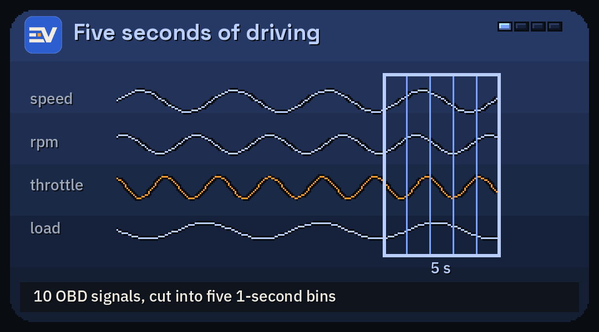</p>

Both models are small quantised 1-D convolutional networks run by ESP-DL<sup>[[6]](#ref-6)</sup>: 8-bit weights and 16-bit activations, which makes them small and fast enough for a microcontroller. With every OBD row the selected model classifies the last 5 seconds and estimates brake pressure, flywheel torque and fuel rate. They were trained on public data, the HCRL Driving Dataset<sup>[[7]](#ref-7)</sup> and the Vehicle Energy Dataset<sup>[[8]](#ref-8)</sup>, plus drives from my own car. Scores on held-out drives and unseen cars are in the [detailed README](https://github.com/AlveeeRahman/OpenCarMind/blob/rev-c2/README.md#the-models).

The [model card](MODEL_CARD.md) puts every step from E.V to the final R.E.V in one table: size, speed, classifier and fuel-learner scores, before and after, with a key to each metric and where it was measured.

### The test drives

Two additional drives serve as a held-out test set. They cover frequent stops, an extended idle, steady cruising with and without cruise control, and hard acceleration and braking. No model on `main` saw these drives during training or tuning. They are scored as data from an unseen vehicle: no per-vehicle settings carry over, and every learner starts from its factory state.

<p align="center">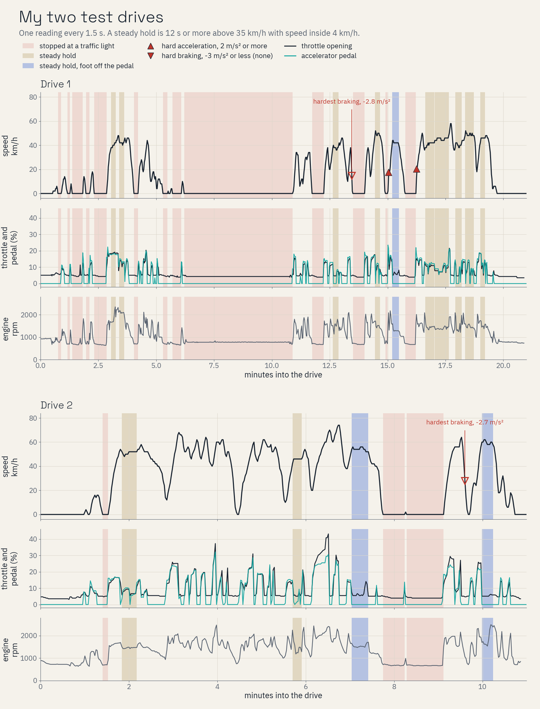</p>

Method and a comparison with routine driving: [docs/TEST_DRIVES.md](docs/TEST_DRIVES.md).

### CarMind R.E.V results so far

<p align="center">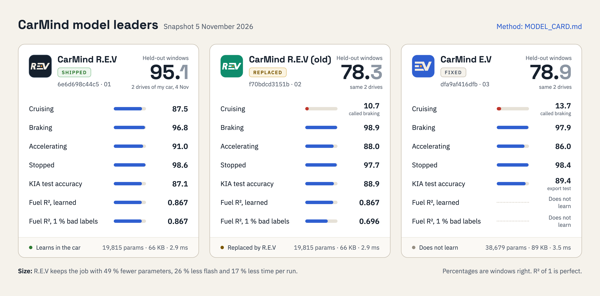</p>

<p align="center">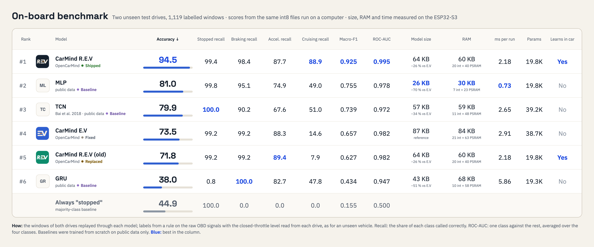</p>

<p align="center">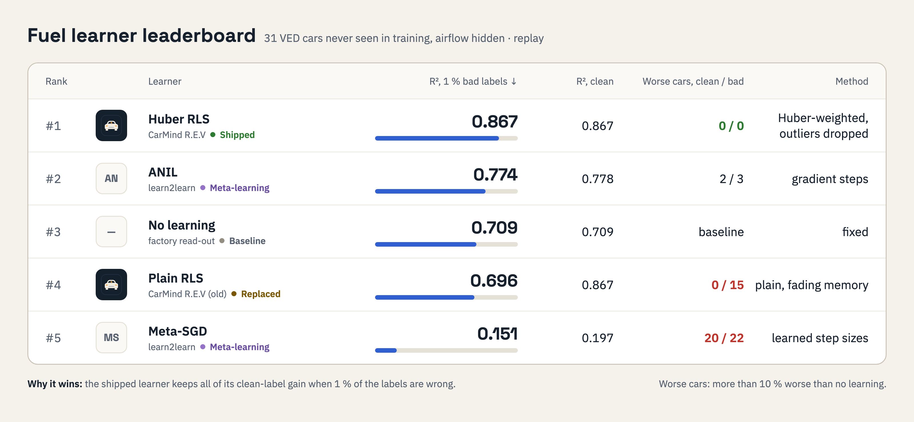</p>

R.E.V's learners have been tested in replay on recorded drives from public test cars, through the firmware's own code with faulty readings mixed in, and on two drives in my car. On cars it never saw, learning in the car made its fuel estimate clearly better than the factory one when the airflow reading was missing. The tables are in the [detailed README](https://github.com/AlveeeRahman/OpenCarMind/blob/rev-c2/README.md#carmind-rev-results-so-far).

### How the models are made

<p align="center">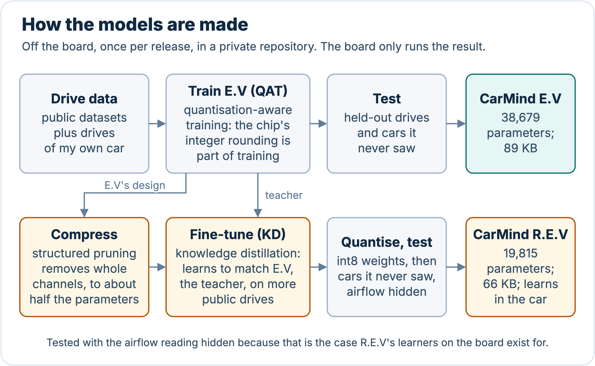</p>

E.V is trained so that the version on the chip scores like the one on a computer. R.E.V starts from E.V's design, is pruned to about half the parameters, and learns from E.V as its teacher on a wider set of public drives. The training code and data stay in a private repository. The shipped files are in [ml/onboard](ml/onboard) and [ml/onboard/rev](ml/onboard/rev), and [docs/MODEL.md](docs/MODEL.md) lists their inputs and outputs.

### What R.E.V learns

<p align="center">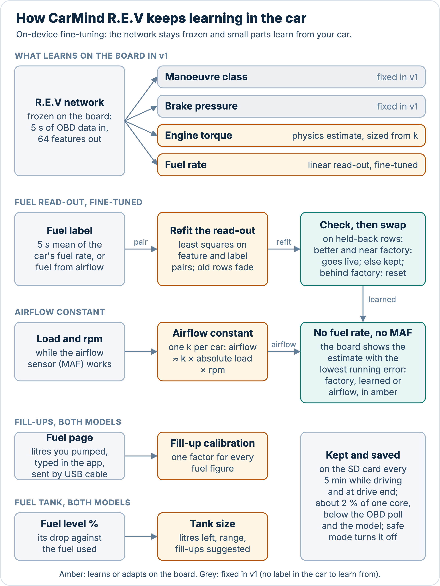</p>

The network itself never changes in the car, which protects it from forgetting what it learned in training<sup>[[9]](#ref-9)</sup>. Small parts on top of it learn, each only from something the car gives it to check against.

| Output | In the car | Learns from |
|---|---|---|
| Fuel rate | learns | the car's own fuel rate, or fuel worked out from the airflow sensor |
| Airflow constant (also the engine size) | learns | airflow, engine load and rpm while the airflow sensor works |
| Fill-up calibration, both models | learns | the litres you pump, entered in the app |
| Fuel tank size, both models | learns | the fuel used against the drop in the fuel level |
| Engine torque | learns, through the engine size | the energy in the fuel minus friction, using the engine size R.E.V learns. Planned: a learned torque read-out on cars that report torque (see Limitations) |
| Manoeuvre class | fixed | nothing yet: the car gives no label for it |
| Brake pressure | fixed | nothing: no car reports it |

### How R.E.V learns on the board

<p align="center">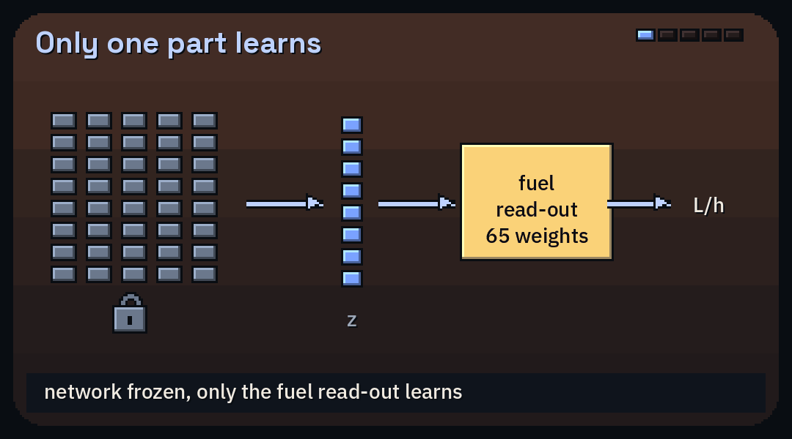</p>

The last layer, which turns the network's features into a fuel rate, is refit from your car's own readings. A refit goes live only if it beats the current one on recent driving, and the board goes back to the factory version if learning ever makes things worse. Since 2.5.1 the learner ignores implausible readings and gives less weight to unusual ones<sup>[[10]](#ref-10)</sup>, so a faulty sensor cannot spoil what it learned. When the car reports neither fuel rate nor airflow, the board uses whichever estimate has been most accurate on your car so far and shows it in amber. What R.E.V learned is saved to the SD card while you drive.

### Looking inside R.E.V with explainable AI

On R.E.V's first drives in my car, the screen said "braking" while I held a steady speed with my foot on the gas. E.V does the same. I opened up R.E.V with explainable-AI methods, Grad-CAM<sup>[[11]](#ref-11)</sup> and a probe on its internal features, and found that the network's features already told cruising from braking. Only the last layer that picks the class had it wrong. Correcting that one layer fixed it, and everything R.E.V had already learned in the car stayed valid.

<p align="center">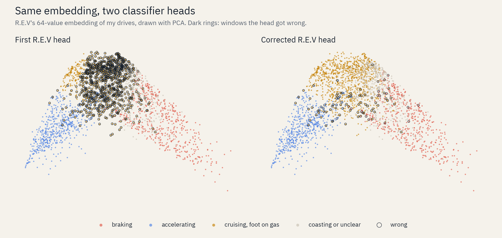</p>

Each dot is a 5-second window of my driving, placed by what the network sees. The points are the same on both sides. Only the layer that reads them changed. The Grad-CAM maps and the scores are in the [detailed README](https://github.com/AlveeeRahman/OpenCarMind/blob/rev-c2/README.md#looking-inside-rev-with-explainable-ai).

### How R.E.V got better, step by step

1. **2.5.0.** R.E.V ships: half of E.V's size, and it learns your car's fuel use, airflow and tank in the car.
2. **First drives.** The learners worked, and the classifier called steady cruising "braking".
3. **Explainable AI** showed the error was in the classifier's last layer, not in what the network sees.
4. **A corrected last layer** fixed it without touching what R.E.V had learned.
5. **Fault tests** showed that a few bad sensor readings could stop the fuel learner.
6. **A fuel learner that shrugs off bad readings**, checked on public cars and against two published meta-learning methods. It came out ahead, so it ships in 2.5.1.

The numbers for each step are in the [detailed README](https://github.com/AlveeeRahman/OpenCarMind/blob/rev-c2/README.md#how-rev-got-better-step-by-step).

## Status

Checked on the bench or in code: the build, the host unit tests (including R.E.V's learners with faulty readings), the switch to miles and mpg, the 10-second save, "Safe to turn off" and the time server rules. CI builds the desktop app on Windows, macOS and Linux. I have driven the board with the drive-end, power-off, fuel economy and units features, and R.E.V on two drives in my car.

Not checked yet: R.E.V over many drives and other cars, the corrected R.E.V on the road, the HTTPS clock on the board, other boards, and any adapter other than the LELink. The checks that need a car are in [docs/FIELD_CHECKS.md](docs/FIELD_CHECKS.md), with tables for you to fill in. Known security limits are in [SECURITY.md](SECURITY.md#known-limits).

## OpenCarMind EdgeOS 2.0.0 (ESP-Mosaico)

<p align="center">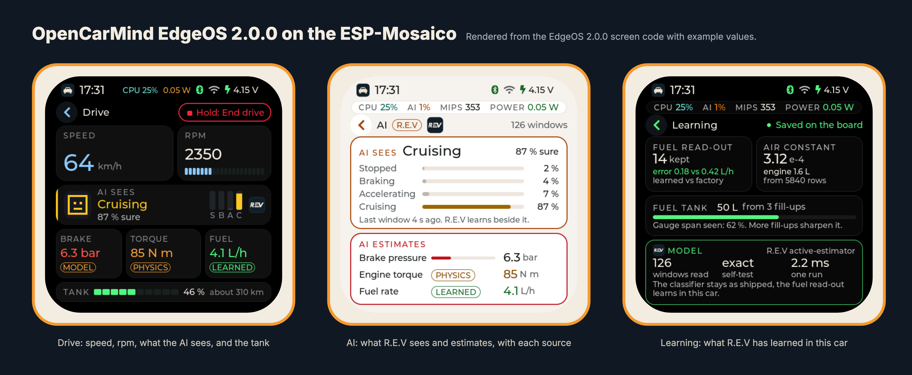</p>

OpenCarMind also runs on Espressif's ESP-Mosaico<sup>[[12]](#ref-12)</sup>, an ESP32-S31 board with a 480 × 480 AMOLED touch screen, 32 MB of PSRAM and a 128 MB NAND for the drive logs. Up to version 1.2.0 that build was called mossREV. Version 2.0.0 is called OpenCarMind EdgeOS 2.0.0, or Edge OS for short. It is not related to Ubiquiti's EdgeOS router software.

Edge OS comes from the same source tree as the S3 version and keeps everything mossREV 1.2.0 has: both models (CarMind R.E.V, the default on a new board, and CarMind E.V, each re-quantized for the S31), the 16 apps on the touch screen with Wi-Fi search and join, a light and a dark theme, and per-drive event logs. What 2.0.0 adds is a small operating-system layer, described below. The image above is a render with example values. The OS layer does not change the S3 build. Up to 4aeff43, every byte the S3 chip loads was the same as in the mossREV 1.2.0 tree. The pairing change merged after the board check is shared code, so it does change the next S3 image (see [Changes after the board check](#changes-after-the-board-check)).

Edge OS 2.0.0 has been through most of its board check, on build 4aeff43. The soak and a few parts are still open, and four changes merged after the check have not been on a board yet. Until those are done, mossREV 1.2.0 stays the Mosaico release. The [status table](#what-is-verified-on-the-board) at the end of this section says what the board showed.

The full guide is [docs/MOSAICO.md](docs/MOSAICO.md): the hardware, flashing, every app, the two models, Smart swipe and Smart UI, the storage, the NAND, the OS layer and the known limits. The [Edge OS user manual](docs/manual/edgeos-2.0.0.md) explains every screen and message for a driver.

### What it is

Edge OS is not a new kernel. FreeRTOS, as ESP-IDF 6.1 ships it, still schedules the tasks on the S31's two cores. Edge OS is a set of rules on top of it that decide what may run, when and how fast, and what happens when something goes wrong. It adds no task of its own. Its code runs inside the tasks that already exist: the board task every 2 s, the screen task, the USB door and the scheduler monitor.

The rules live in one plain C file, `main/os_core.c`, with no ESP-IDF calls in it, so the host tests on a computer check every rule. `main/os.c` connects the rules to the firmware. Files that the S3 build shares call the OS through macros in `main/os_hooks.h`, which turn back into the old S3 statement on the same line. That is how the OS layer leaves the S3 image as it was.

### The parts and why each exists

| Part | What it does | Why it is there |
|---|---|---|
| One service table | Eight services (model switch, clock, format, Wi-Fi edit, Wi-Fi radio, the USB door's commands, the model, the R.E.V learner) each have a mask of the runlevels they may run in. Each model and learner also declares its period, deadline, stall limit, CPU share, self-test and fallback model in one contract table. | Before 2.0.0 these rules were separate `if` checks spread over the screen, the USB door and the board task. Now one table holds them, and a source audit in the host tests fails if a file decides a refusal by itself. |
| Runlevels | Boot, Safe, Parked, Driving, Saving and Update. Several can hold at once, and a service runs only if every active runlevel allows it. | In the middle of a drive, a model switch would mix two models' answers in one log, a clock change would break its timestamps, and a format would erase the drive being written. The board refuses them in one place and says why. |
| Boot health check | About 65 s after a start the board rates itself good, degraded or bad from the model self-test, the flash FAT check, the NAND, the first screen update, the touch controller and the scheduler's misses, stalls and response times. | It gives you one line to read on the Board page. It is also the signal an A/B rollback needs to keep or reject a new image. |
| Model admission | A model loads only if response-time analysis says every job on its core still meets its deadline (see [below](#model-admission-by-response-time-analysis)). | A model that is too slow would make the OBD poll or the learner miss deadlines. The check refuses it before it loads, and the old model stays. |
| Degradation ladder | When the model misses deadlines, the board steps down: the screen refreshes every 33 ms instead of 16 ms, then the R.E.V learner pauses, then the model's inference pauses. A minute without misses steps back up. | Screen frames and learning are worth less than the log and the model during a drive, so they go first. The ladder never swaps models. |
| Battery protection | Every 2 s it reads the gauge's voltage, current and temperature. At 45 °C on USB it sheds load, at 60 °C it stops safely, and at 4.25 V or more it reports a charger fault and stops. | The TP4057 charger has no enable pin and no thermistor input, and its supply comes from USB through diodes. The firmware cannot stop charging, so it watches and stops cleanly instead. The thresholds are placeholders until the cell's datasheet is known. |
| Wi-Fi boot hold | No Wi-Fi starts at boot. The automatic start waits for the health verdict and goes ahead on good or degraded. Your own start in the Wi-Fi app is never held. | On mossREV 1.2.0 rc3 the boot window was the internal-RAM low point, 57.7 KB free while the Wi-Fi driver started (measured on the board). |
| One reset path | Every reset the firmware asks for goes through `sys_reset(reason)`: mark it as asked for, flush and lock the flash FAT and the NAND, then reset. The screen stall guard and the hung-job restart skip the mark, so three of them in a row still start safe mode. | A reset between a sector's erase and its write had torn the FAT and lost the whole volume twice on the bench, before the storage fixes. Now no asked-for reset skips the flush. |
| Feature gate | One OS service runs the A/B test for Smart swipe and the Smart UI prefetch: the 50/50 split, the Mann-Whitney test, the Holm correction and the verdict per firmware version. | Each feature had its own copy of the same statistics. Now the thresholds sit in one place that no feature can change, and Smart swipe gave back 776 bytes of internal RAM. |
| PPA and 2D-DMA graphics | The launcher slide's window copies, the page pictures' byte swap and large opaque LVGL fills and image copies run on the S31's pixel-processing accelerator and 2D-DMA, with a CPU fallback. | The CPU did these copies row by row. The chip has engines for them. A full frame still needs 23.6 ms on the panel's QSPI link, so the gain is in composing, not in sending. |

### Services and runlevels

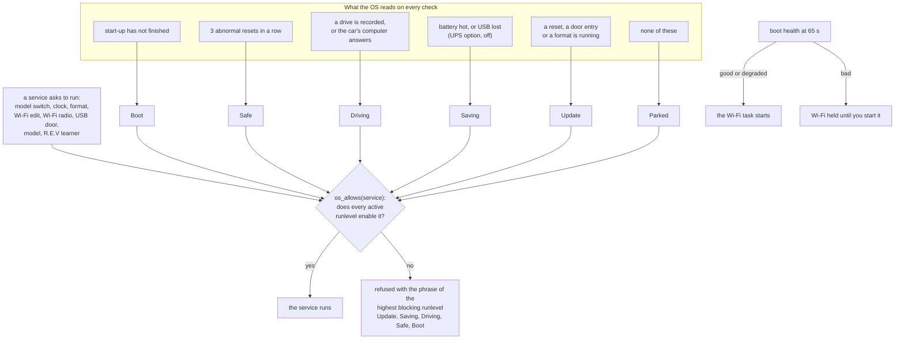

Which runlevels each service may run in, from the mask table in `main/os_core.c`:

| Service | Boot | Safe | Parked | Driving | Saving | Update |
|---|---|---|---|---|---|---|
| Model switch (screen, desktop app) | no | no | yes | no | no | no |
| Set the clock by hand | yes | yes | yes | no | no | no |
| Format storage | no | yes | yes | no | no | no |
| Add or forget a Wi-Fi network | yes | yes | yes | no | no | no |
| Wi-Fi radio (search, join, clock sync) | yes | yes | yes | no | no | no |
| USB door commands after pairing | yes | yes | yes | no | no | no |
| Load the model at boot | yes | no | yes | yes | yes | no |
| R.E.V learner | yes | no | yes | yes | no | no |

Safe still allows a format, the clock, the door and Wi-Fi, so a board in safe mode can always be repaired.

### Model admission by response-time analysis

A model is a real-time job. It has to answer once per second while the OBD poll and the learner share its core. When a model loads at boot or on a switch, the OS takes its self-test run time, doubles it (one measured run is not a worst case), and uses that as the model's worst-case CPU time C. Then it runs the response-time analysis of Joseph and Pandya<sup>[[5]](#ref-5)</sup> for every job on that core:

$$
R_i = C_i + \sum_{j \in hp(i)} \left\lceil \frac{R_i}{T_j} \right\rceil C_j
$$

R<sub>i</sub> is job i's worst-case response time, the longest it can take from its release to its finish. C<sub>i</sub> is its worst-case CPU time. The sum runs over hp(i), the jobs on the same core with a higher priority. T<sub>j</sub> is the period of such a job j, so ⌈R<sub>i</sub> / T<sub>j</sub>⌉ counts how many times j can start, and take its C<sub>j</sub>, while job i waits. R<sub>i</sub> appears on both sides, so the OS starts from R<sub>i</sub> = C<sub>i</sub> and repeats the sum until the value stops changing. Job i meets its deadline when R<sub>i</sub> ≤ D<sub>i</sub>. If any job on the core would miss, a switch is undone like a failed load and the screen says, for example, "Not switched: CarMind E.V refused: ml would miss its deadline." (`ml` is the models' job.) A boot load that fails leaves the model off, with an error event.

On the board, the first boot of a 2.0.0 build before the rename (09ec8f5) logged `admission CarMind R.E.V: C 4472 us (self-test 2236 us x 2.0) on core 1, R: ml 4.5/1000 ms, margin 995.5 ms (ml): admitted`. The log lists only the `ml` job: the other jobs on core 1 had no measured run yet at 4.3 s, so this first check held the model alone. Host tests pass for the textbook three-job set (C 3, 3, 5 and T 7, 12, 20 give R 3, 6, 20) and for 90,013 random job sets compared with the scheduler monitor's own loop.

### What it costs

Measured with `idf.py size` against mossREV 1.2.0 rc3 (8b0b96f), on the S31 build at 09ec8f5:

| | Edge OS 2.0.0 | Change from 1.2.0 |
|---|---|---|
| App image | 4,798,464 B, 76.3 % of the 6 MB app slot | +45,744 B |
| Static internal RAM (DIRAM) | | +1,874 B: PPA and 2D-DMA +2,380 B (mostly IRAM code), the OS parts +84 B, the feature gate −590 B |
| Static PSRAM | | +1,480 B, mostly the admission's buffers (1,352 B) |
| Tasks | | none added |

Most of the app growth is the graphics work (+37,312 B). The OS parts together add about 9 KB to the app image. With the UPS option switched on, the deep-sleep path alone would add about 12 KB of IRAM, which is one reason that option stays off.

The target for internal RAM at run time is more than 60 KB free in every phase. This was measured on the board, EdgeOS 2.0.0 4aeff43, with a debug build of that code that adds a RAM monitor. Each figure is the lowest free internal RAM in that phase, all internal heaps added up:

| Phase | Lowest free internal RAM |
|---|---|
| The first minute after a start, before Wi-Fi | 127,407 B |
| The first Wi-Fi round, with the automatic adapter search | 82,907 B |
| An adapter search alone | 112,935 B |
| An adapter search and Sync clock now together | 82,883 B |
| Sync clock now alone | 82,907 B |
| Wi-Fi search | 88,791 B |
| A theme switch | 112,799 B |
| A switch to E.V | 102,383 B |
| A launcher slide | 112,599 B |

The lowest is 82,883 B, about 81 KB, with an adapter search and a clock sync running at once. Every phase stays above 60 KB. Two parts of that total were never used in any phase: the 32 KB internal reserve (32,031 B free) and the LP RAM (31,948 B free). The main heap alone went down to 18,900 B.

Before 4aeff43, the Board page's "lowest" read 32 KB too low. A photo showed 49 KB. ESP-IDF sets the minimum of a heap added after start-up to 0 (`heap_caps_init.c`, lines 325 to 332, in ESP-IDF 6.1). The 32 KB internal reserve is added that way, so the summed minimum always counted that pool as empty. 4aeff43 restarts the minimum count early in the boot. RAM use stays the same. Only the figure changes.

### What you see on the board

- The firmware reads "OpenCarMind EdgeOS 2.0.0" on the boot line, in Settings and on the Board page. The desktop app sees `fw=EdgeOS-2.0.0`.
- The Board page's header shows the runlevel and the health at the top right, for example "Parked, health good" in green. Degraded is amber and bad is red. The events list gets "Boot health: good" or the reasons, such as "Boot health: degraded: NAND not mounted".
- Wi-Fi stays off for about the first minute after a start. Then the automatic clock sync runs, and on a board whose clock is not set the first sync follows about 20 s later.
- A refused change says why. During a drive: "A drive is active. End the drive first, then switch models." For other actions during a drive: "Not now: a drive is running. Try again later." When the car's computer answers but no drive is recorded yet: "Not now: the car link is up. Try again later." The USB door answers "ERR busy: a drive is running, try again when parked".
- The ladder and the battery write events such as "Model deadlines: UI slowed", with the miss count, or "Battery hot (45.0 C on USB): load shed".
- The Board page's battery card shows the current, "on USB" or "on battery", the gauge temperature, and "uncalibrated" with the cycle count until the gauge is set up for the 65 mAh cell.

The [user manual](docs/manual/edgeos-2.0.0.md#os) lists every message with what to do about it.

### Changes after the board check

Four changes were merged after the board check, at 06ddf1d. Each is built and host-checked, not yet seen on the board.

- **Pairing asks you first, and only at a strong signal.** On the bench, the board kept trying a neighbour's adapter at -88 to -90 dBm: 35 connect attempts in about 16 minutes, all failed. With no saved adapter, the old rule took any device that looked like an OBD adapter at -90 dBm or better and saved the first one that answered. Now a new adapter is offered only at -70 dBm or better (`CONFIG_OBD_BLE_PAIR_MIN_RSSI`), and nothing is saved until you say yes. The Mosaico shows "OBD adapter found: <name>, signal strong. Use this adapter?" with "Not this one" and "Use this adapter", and counts down 30 s. The S3 shows "Use <name>?" and "Strong. Tap = use it", and you tap BOOT within 5 s. The automatic search never replaces a saved adapter. The paired adapter still connects down to -90 dBm, so it works at the edge of range. The S3 shares this code, so the next S3 image changes too.
- **Driving starts only when the car's computer answers.** The same neighbour's adapter kept putting the board into Driving for short spells, a median of about 4 s and at most 14 s, because connect attempts counted as Driving. Now the board is Driving only once the car's computer answers and rows are logged. Searching, connecting and an adapter in a parked car with the engine off keep it Parked.
- **Model names on the screen.** The model's file shows as "ev-frozen" for E.V and "active-estimator" for R.E.V, where the screen showed a 12-character hash before. The hash stays in the logs, the session files and the USB door.
- **No text smaller than 16 px.** The screen used 12 px and 14 px text in places. NHTSA's driver-interface guidance (DOT HS 812 360)<sup>[[14]](#ref-14)</sup>, following ISO 15008, asks for capital letters of at least 16 arcminutes for urgent text and 12 arcminutes for the rest, with 20 arcminutes as the best size. On this 2.16 inch, 480 × 480 screen, 16 px text has capitals about 1 mm tall. At about 65 cm from your eyes, that is about 5 arcminutes. So 16 px is the smallest size the screen uses, and even that is small for a driver. That is why the Drive screen and the alarm banner keep a few big items. The alarm banner's headline is now 32 px. The Board page now scrolls.

### Flash it, or go back to mossREV 1.2.0

Flashing needs no buttons. Open the board's USB port at 1200 baud, then write the merged image with esptool 5.6.0 or later. [docs/MOSAICO.md](docs/MOSAICO.md#flashing) has the commands. The merged image erases the NVS partition, so the pairing with the desktop app, the saved Wi-Fi networks and the settings go, and you pair again. The drive logs on the NAND and the flash FAT's state files are not written.

The board-checked image is `EdgeOS-2.0.0-esp32s31-merged.bin`, built from 4aeff43, with a SHA-256 that starts `a225125d27f3906c`. It is not published yet. The merged branch tip (06ddf1d) has no released image yet. The release image will be rebuilt from the branch tip, and it gets a new SHA-256.

To go back, flash the mossREV 1.2.0 merged image the same way. Going back is not yet verified on the board.

### Prepared but off: A/B rollback and the battery as a UPS

Two parts are built into 2.0.0 and switched off by default.

- A/B rollback (`CONFIG_OCM_APP_ROLLBACK`). The flash has two 6 MB app slots. With ESP-IDF's app rollback, a new image gets one boot to confirm itself. A good or degraded health verdict would confirm it, and a bad one would reset into the other slot through `sys_reset`. It stays off because today's flashing writes slot 0 with esptool and leaves otadata erased, so no image is ever in the state that arms the rollback. Turning it on needs a change to the flashing flow first, and that is the owner's decision.
- The battery as a UPS (`CONFIG_OCM_UPS`). Two gauge readings in a row at or below −20 mA would mean USB is gone: flush the logs, dim the screen, refuse changes, and wait 15 s, because cranking the engine drops the car's USB for a few seconds. Then quiesce the storage and pull GPIO57 low, the board's power-switch request. At 3.4 V on battery it would act at once. It stays off until the board's real draw and the gauge's current sign are measured. The power-off through GPIO57 for the battery protection (`CONFIG_OCM_BATSAFE_POWER_OFF`) waits for the same check.

### What is verified on the board

The board check ran on EdgeOS 2.0.0 4aeff43, the image `EdgeOS-2.0.0-esp32s31-merged.bin` (SHA-256 `a225125d27f3906c...`). The owner stopped it before the soak. VERIFIED means a board log line shows it. Some rows ran on a scratch build of the 2.0.0 code with one test switch on, and the row says so. A scratch build is never shipped. Host tests pass for every part: `make os` (41,635 checks at 4aeff43, 41,719 with the pairing change), `make pair`, `make ppa`, `make uimetrics` and the source audits in `tests/host/os_audit.sh`.

| Part | Result | What the board showed | Build |
|---|---|---|---|
| Boot and name | VERIFIED | `OpenCarMind EdgeOS 2.0.0 running` at 4.3 s after a power-on, 0 USB drops in 185 s | 4aeff43 |
| Boot health, good | VERIFIED | `boot health good \| model self-test 1, flash FAT 1 (0 repaired), NAND 1, first UI tick 1365 ms, touch ok, 0 misses, 0 stalls, schedulable, runlevel Parked` at 68.0 s | 4aeff43 |
| Boot health, bad | VERIFIED | `boot health bad: safe mode`, then `Wi-Fi held: boot health bad`. Sync clock now still started Wi-Fi by hand | scratch, forced bad |
| Wi-Fi boot hold | VERIFIED | held at 4.3 s with no driver, released at 68.0 s with 131,975 B of internal RAM free, driver up at 88.1 s and down again at 106.5 s | 4aeff43 |
| No addresses in the log | VERIFIED | no access-point address and no board address in the boot and Wi-Fi log | 4aeff43 |
| Model admission, admitted | VERIFIED | `C 4248 us (self-test 2124 us x 2.0) on core 1, R: ml 4.2/1000 ms, margin 995.8 ms (ml): admitted` | 4aeff43 |
| Model admission, refused | VERIFIED | the boot load logged `REFUSED`, and a switch to E.V got `ERR CarMind E.V refused: ml would miss its deadline` while R.E.V stayed | scratch, safety factor raised from 2 to 2,000 |
| Service contract | VERIFIED | `service R.E.V learner: job rev, T 1000 ms, D 30000 ms, stall 60000 ms, CPU 20 per mille in 30 ms bursts, prio 2 core 1` | 4aeff43 |
| Runlevels and refusals during a drive | VERIFIED | `runlevel Driving (active 0x08)` and back to `runlevel Parked`. The USB door answered `ERR busy: a drive is running, try again when parked`. The screen showed "Not now: a drive is running. Try again later." for the clock sync and Format | scratch, forced drive |
| Degradation ladder | VERIFIED | events "UI slowed (2 misses)", "learner paused (6 misses)", "model paused (10 misses)", then one step back at a time to "normal" | scratch, extra model load |
| Battery protection | VERIFIED, test limits | "Battery hot (34.2 C on USB): load shed" with Wi-Fi off, the learner paused and the screen dimmed, runlevel Saving, then "Battery cooled (33.7 C)" and Parked, and "Battery over-voltage (4188 mV): charger fault, stopped". The real limits (45 °C, 60 °C, 4.25 V) were not reached | scratch, test limits |
| Desktop app | VERIFIED | connect with `fw=EdgeOS-2.0.0`, a wrong token refused, a model switch both ways, two files read at their listed sizes | 4aeff43 |
| Internal RAM above 60 KB | VERIFIED | lowest 82,883 B over 9 phases (see [What it costs](#what-it-costs)) | debug build of 4aeff43 |
| PPA and 2D-DMA | PARTLY | on at boot, `failures dma 0 ppa 0` in all 18 reports over 185 s. The speed A/B test gave no clean number | 4aeff43 |
| Resets through `sys_reset` | PARTLY | `the last run ended with sys_reset(REBOOT: door REBOOT)` after a door REBOOT. The line after a download-door entry was not captured | 4aeff43 |
| Feature gate | PARTLY | the gate starts and Smart swipe's warm-up runs. No verdict yet | 4aeff43 |
| Version on screen | PARTLY | the boot line and the door's `fw=EdgeOS-2.0.0`. Settings and the Board footer were not checked | 4aeff43 |
| 10-minute soak | NOT | stopped by the owner before it ran | |
| 60 °C stop | NOT | built, not run | |
| Where the gauge temperature comes from | NOT | not checked | |
| Board page "lowest" after the fix | NOT | no photo of the fixed Board page yet | |
| Wi-Fi with no known network in reach | NOT | not run | |
| Going back to mossREV 1.2.0 | NOT | not tried | |
| A/B rollback, UPS, GPIO57 power-off | NOT | off in this release | |
| Pairing, Driving rule, model names, 16 px text | NOT | merged after the check (06ddf1d). Built and host-checked, not yet seen on the board | 06ddf1d |

## Limitations and future work

- **Torque is a physics estimate, not a measurement**, checked against one public car and for petrol engines only. R.E.V learns the engine size it uses, about 2.1 L from my car's last two drives, but not the torque itself. Cars that report torque (PIDs 0x62 and 0x63) could give a learned torque read-out its label, the way the fuel read-out learns now, and then the physics would not be needed. That is planned, not built or tested. My Sentra and most pre-2020 cars report no torque, so there is no label, and physics, or the ESP-Mosaico's accelerometer as a label, stays needed there.
- **The classifier and brake pressure do not learn in the car yet.** Accelerometer labels on the ESP-Mosaico and a self-check that forecasts the next moment are the routes being worked on.
- **No Wi-Fi upload yet.** It is being reworked so a lost packet on weak home Wi-Fi does not stall every file, as in QUIC<sup>[[13]](#ref-13)</sup>. Until then drives come over the USB cable.
- **The clock is only as exact as one second**, and it needs a known Wi-Fi network within reach.

## Planned

- A build without a display.
- Code-signed installers.
- A test drive of the corrected R.E.V, and learning each car's closed-throttle position on the board.
- A manoeuvre forecast as a self-check, so the classifier can learn in the car.
- More regularised models, to fit more cars.

## References

<a id="ref-1"></a>[1] J. Lin, W.-M. Chen, Y. Lin, J. Cohn, C. Gan and S. Han, "MCUNet: Tiny deep learning on IoT devices," in *NeurIPS*, 2020. [arXiv:2007.10319](https://arxiv.org/abs/2007.10319)

<a id="ref-2"></a>[2] R. David *et al.*, "TensorFlow Lite Micro: Embedded machine learning on TinyML systems," in *Proc. MLSys*, 2021. [arXiv:2010.08678](https://arxiv.org/abs/2010.08678)

<a id="ref-3"></a>[3] C. Banbury *et al.*, "MLPerf Tiny benchmark," in *Proc. NeurIPS Datasets and Benchmarks Track*, 2021. [arXiv:2106.07597](https://arxiv.org/abs/2106.07597)

<a id="ref-4"></a>[4] C. L. Liu and J. W. Layland, "Scheduling algorithms for multiprogramming in a hard-real-time environment," *Journal of the ACM*, vol. 20, no. 1, pp. 46–61, 1973. [doi:10.1145/321738.321743](https://doi.org/10.1145/321738.321743)

<a id="ref-5"></a>[5] M. Joseph and P. Pandya, "Finding response times in a real-time system," *The Computer Journal*, vol. 29, no. 5, pp. 390–395, 1986. [doi:10.1093/comjnl/29.5.390](https://doi.org/10.1093/comjnl/29.5.390)

<a id="ref-6"></a>[6] Espressif Systems, "ESP-DL: Espressif deep-learning library for AIoT applications." [github.com/espressif/esp-dl](https://github.com/espressif/esp-dl)

<a id="ref-7"></a>[7] B. I. Kwak, J. Woo and H. K. Kim, "Know your master: Driver profiling-based anti-theft method," in *Proc. PST*, 2016, pp. 211–218. [arXiv:1704.05223](https://arxiv.org/abs/1704.05223)

<a id="ref-8"></a>[8] G. Oh, D. J. LeBlanc and H. Peng, "Vehicle Energy Dataset (VED), a large-scale dataset for vehicle energy consumption research," *IEEE Transactions on Intelligent Transportation Systems*, 2020. [arXiv:1905.02081](https://arxiv.org/abs/1905.02081), data and licence (Apache-2.0) at [github.com/gsoh/VED](https://github.com/gsoh/VED)

<a id="ref-9"></a>[9] J. Kirkpatrick *et al.*, "Overcoming catastrophic forgetting in neural networks," *PNAS*, vol. 114, no. 13, pp. 3521–3526, 2017. [arXiv:1612.00796](https://arxiv.org/abs/1612.00796)

<a id="ref-10"></a>[10] B. Kovačević, Z. Banjac and I. Kostić Kovačević, "Robust adaptive filtering using recursive weighted least squares with combined scale and variable forgetting factors," *EURASIP Journal on Advances in Signal Processing*, 2016. [doi:10.1186/s13634-016-0341-3](https://doi.org/10.1186/s13634-016-0341-3)

<a id="ref-11"></a>[11] R. R. Selvaraju, M. Cogswell, A. Das, R. Vedantam, D. Parikh and D. Batra, "Grad-CAM: Visual explanations from deep networks via gradient-based localization," in *Proc. ICCV*, 2017. [arXiv:1610.02391](https://arxiv.org/abs/1610.02391)

<a id="ref-12"></a>[12] Espressif Systems, "ESP-Mosaico," esp-dev-kits documentation. [docs.espressif.com](https://docs.espressif.com/projects/esp-dev-kits/en/latest/esp32s31/esp-mosaico/index.html)

<a id="ref-13"></a>[13] J. Iyengar and M. Thomson, Eds., "QUIC: A UDP-based multiplexed and secure transport," RFC 9000, IETF, 2021. [rfc-editor.org](https://www.rfc-editor.org/rfc/rfc9000)

<a id="ref-14"></a>[14] J. L. Campbell *et al.*, "Human factors design guidance for driver-vehicle interfaces," Report DOT HS 812 360, National Highway Traffic Safety Administration, 2016. [nhtsa.gov](https://www.nhtsa.gov/sites/nhtsa.gov/files/documents/812360_humanfactorsdesignguidance.pdf)

## Repository layout

| Path | What it holds |
|---|---|
| `main/` | firmware source |
| `ml/onboard/` | the shipped models (CarMind E.V, and CarMind R.E.V in `rev/`) |
| `samples/replay/` | two replay sessions from a public dataset, in the board's file format |
| `schema/` | JSON schema of the session files |
| `tests/host/` | unit tests that run on a computer, including R.E.V's learners |
| `tools/` | `ocm_report.py` and the model header generator |
| `desktop/` | the desktop app (Rust and Tauri) |
| `dashboard/` | Docker Compose file and Dashy configuration |
| `docs/` | configuration, model notes, field checks, screen designs and figures |
| `docs/manual/` | the user manuals, their sources and the script that builds them |

## Credits and licence

OpenCarMind is released under the MIT licence (see `LICENSE`). ESP-IDF, ESP-DL, LVGL and NimBLE keep their own licences. The training data of the shipped models is not part of this repository. The replay samples also use the carOBD dataset, <https://github.com/eron93br/carOBD>. See `samples/replay/README.md` for its terms.
