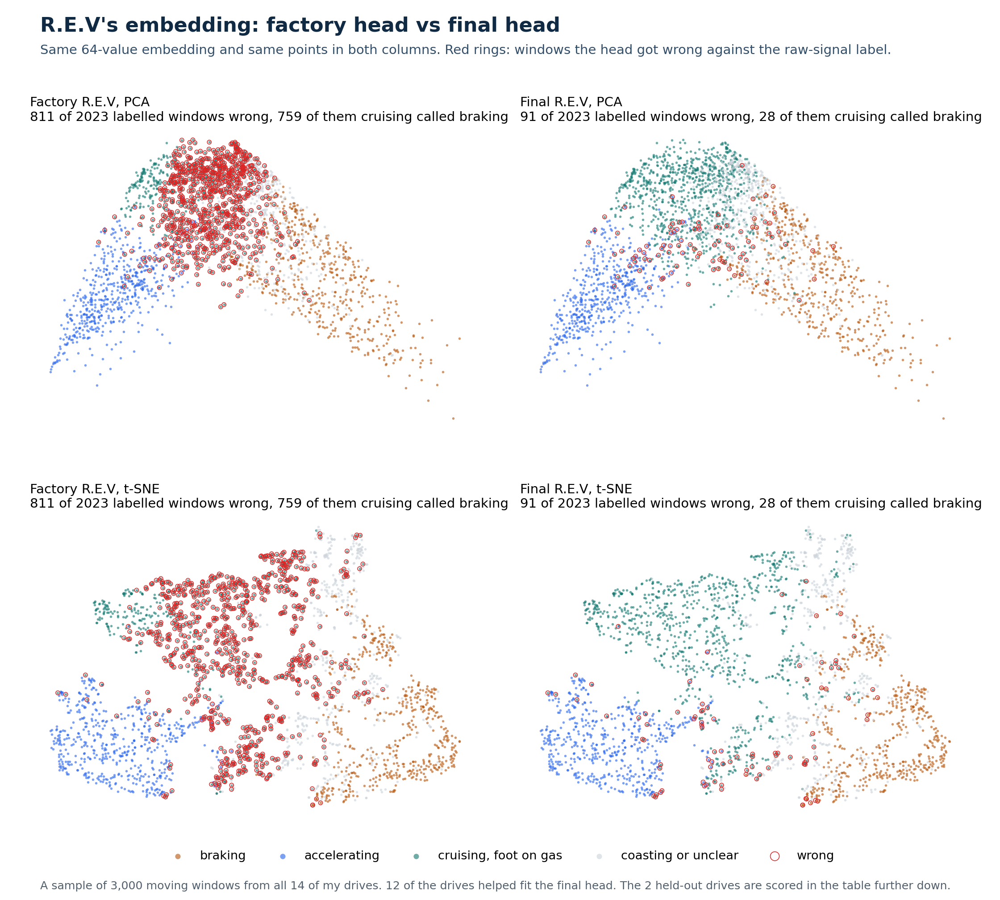
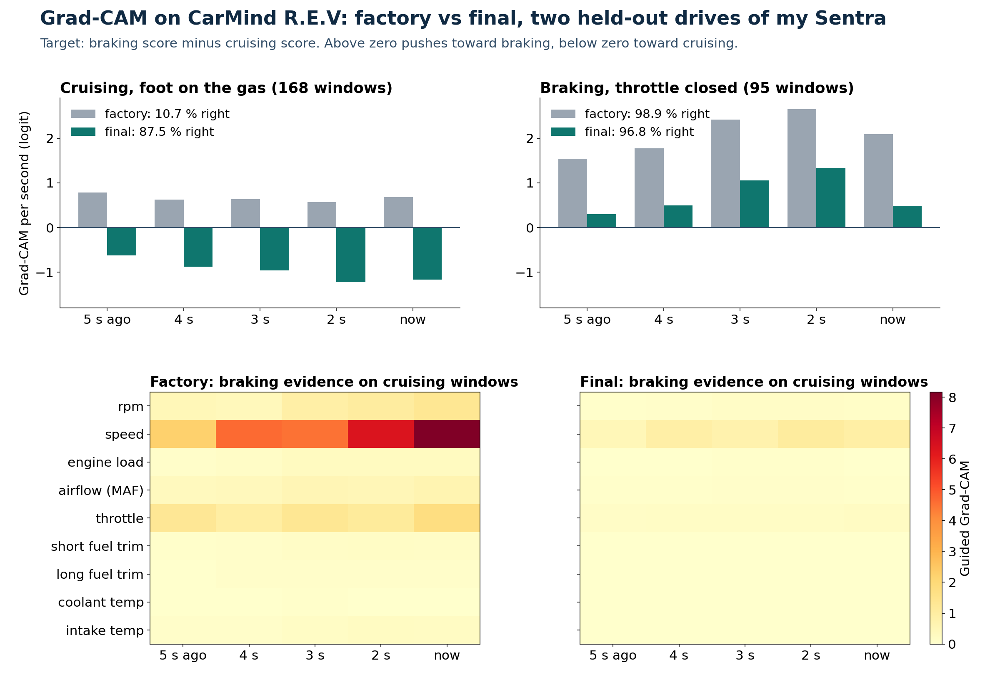

<p align="center"></p>

<p align="center">
<a href="https://github.com/AlveeeRahman/OpenCarMind/actions/workflows/ci.yml"></a>
<a href="https://scorecard.dev/viewer/?uri=github.com/AlveeeRahman/OpenCarMind"></a>
<a href="LICENSE"></a>


</p>

OpenCarMind turns an ESP32-S3 board and a Bluetooth OBD-II adapter into a car data logger that runs a neural network on the board. It needs no phone, no account and no internet connection. Everything it records goes to an SD card in the car and, if you pair the board, to the desktop app on your own computer.

It ships two on-board models, and you choose between them in the desktop app. CarMind E.V is fixed and tested. CarMind R.E.V is my first model that keeps learning in your car. It uses on-device learning, which means the board itself updates part of the model from what your car reports while you drive, with no computer or cloud in the loop.

Version 2.5.0. Licence: MIT. Website: <https://alveeerahman.github.io/OpenCarMind/>. Downloads for the firmware and the desktop app are on the [Releases page](https://github.com/AlveeeRahman/OpenCarMind/releases/latest).

## Choose your model

| | CarMind E.V | CarMind R.E.V |
|---|---|---|
| Status | released in 2.4.0, the default | new in 2.5.0, in its first drives |
| Size on the chip | 89,152 bytes (about 89 KB) | 65,648 bytes (about 66 KB) |
| Parameters | 38,679 | 19,815 |
| Arithmetic on the chip | int8 weights, int16 activations | int8 weights, int16 activations |
| Time per run on the ESP32-S3 | about 3.5 ms, measured at the boot self-test | about 2.9 ms at the boot self-test, plus a second run with airflow hidden while the car reports MAF |
| Learns in your car | nothing, the model is fixed | its fuel-rate read-out (the last layer, which turns the network's features into a fuel rate), an airflow constant that also gives the engine size, and the fuel tank size. Engine torque comes from physics sized to your engine |
| Fill-up calibration | yes | yes |
| Best for | a fixed, tested model | older cars, roughly pre-2020, that have no fuel-rate PID and can lose the airflow (MAF) reading |
| Model hash | `dfa9af416dfb` | `6e6d698c44c5` |

Many older cars do not report a fuel-rate PID (0x5E), so the board works out the fuel rate from the airflow sensor. When that reading is missing, a fixed model can only offer its factory estimate. R.E.V learns your car while a fuel-rate or airflow reading is there and uses what it learned when it is not. A car that reports neither from the start gives R.E.V nothing to learn from. It then runs its factory read-out, corrected by your fill-ups like E.V.

To switch, connect the board to the desktop app with its USB cable while the car is parked, open the Board page and pick the model under "On-board model". The board keeps the choice after a restart, and you can switch back at any time. What R.E.V learned stays on the SD card while E.V runs. More on what it learns is in [What R.E.V learns](#what-rev-learns).

<p align="center"></p>

Renders, not photos. Left: page 5 with CarMind E.V in 2.4.0. Middle: page 5 in 2.5.0 with R.E.V selected. It adds a third job, "Learning". On 2.5.0, with either model, the AI ESTIMATES header shows only the time since the model's last answer, and the brake row reads "holding" while the model sees the car stopped. Right: the model selector on the desktop app's Board page and R.E.V's learning status on its Fuel page, shown after a board's first minute on R.E.V. All values are examples.

## What you get

- **Every standard Mode 01 field** the car reports (70 are decoded), battery voltage, the VIN, and stored, pending and permanent trouble codes. One CSV row is written per poll cycle.
- **Two small neural networks on the chip**, CarMind E.V and CarMind R.E.V, one running at a time. Each time a row arrives the model classifies the last 5 seconds of driving as stopped, braking, accelerating or cruising. It also estimates three values the OBD port does not report: brake pressure, flywheel torque and fuel rate. With R.E.V, the board also fine-tunes its fuel estimate, which means it keeps adjusting the trained estimate to your car while you drive.
- **A save to the SD card every 10 seconds**, and a live **power-off line** on page 3: green "Safe to turn off" only once car data has stopped, everything is on the card and nothing is uploading, red with the reason (logging, saving, upload) otherwise. When the ignition goes off, the drive ends 15 seconds after the engine computer stops answering: the board saves and closes the session, even if the adapter stays powered, and starts a new session if the engine comes back.
- **Fuel economy** on the first screen: km/L, or mpg in the US and the UK. The fuel rate comes from the best source the car has: its own fuel-rate PID (common on newer cars), the airflow sensor with the commanded air-fuel ratio, or, on cars with neither, an estimate shown in amber. With E.V that is the model's estimate. With R.E.V it is whichever of its estimates has had the lowest error on your car. A car that gives nothing shows "--", never a made-up number.
- **Units that follow you.** The board starts in km. The first time it joins Wi-Fi it reads the country code the access point broadcasts, switches to miles and mpg in the US or the UK, and keeps that choice. Tested on the board: a US access point switched it to miles and mpg, and the choice stayed after a reboot. `units` in `config.json` overrides it.
- **Fill-up calibration** for both models. You enter fill-ups on the desktop app's Fuel page, and the board compares the fuel you pumped with the fuel it counted, tank to tank, and corrects its figures with one factor.
- **A fault engine** that ranks trouble codes by severity and groups codes that share a cause.
- **Dark and light screen themes**, switched by time of day or fixed in a settings file.
- **A soft real-time scheduler** that times every job against its deadline and restarts the board if a step hangs.
- **Optional Wi-Fi, for the clock only**: one HTTPS request to one time server, with its certificate checked. The default is a public server, and you can choose your own in the desktop app. Drives reach your computer over the USB cable while the Wi-Fi upload is reworked (see [Limitations and future work](#limitations-and-future-work)).
- **A desktop app** for Windows, macOS and Linux that receives the drives, charts them, shows fuel and economy per drive, switches the on-board model, takes your fill-ups, and lists every value the car reported, including what the screen has no room for (odometer, oil temperature, hybrid battery and more on newer cars).

## Local-first

<p align="center"></p>

Most car loggers stream your driving to a server and do the thinking there. OpenCarMind does the thinking on the board, in the way TinyML work runs networks on microcontrollers<sup>[[1]](#ref-1)–[[3]](#ref-3)</sup>. The models are 89 KB (E.V) and 66 KB (R.E.V), one run takes about 3.5 ms (E.V) or 2.9 ms (R.E.V), and neither needs a network. R.E.V's learning also happens on the board, and what it learns stays on your SD card. Your data is plain CSV, JSON and text on a card you hold. Nothing leaves the car unless you copy the card or pair the board with your own computer.

Wi-Fi is the only radio besides Bluetooth, and it is optional. In 2.5.0 it does one thing: while the car is parked on a known network, the board sends one HTTPS request to one time server and reads the time from the reply. The server must present a certificate for exactly that host name, chained to a trusted root, and a time outside 2026 to 2099 is refused. Apart from joining the network (DHCP) and looking up that one host name (DNS), it sends nothing, and it listens on no port. Nothing goes to a cloud. You can compile Wi-Fi out with one setting (`OCM_WIFI_CLOCK_SYNC`).

## How it works

<p align="center"></p>

The board asks the engine computer for every field it supports, shows the live values on its screen and writes each drive to the SD card as its own session. The model runs on the chip while you drive. At home, the desktop app imports new drives over the USB cable, or you take the card out and open the files on your computer.

### On-board inference

<p align="center"></p>

When an OBD row arrives, the board cuts the last 5 seconds into five one-second bins that end at that moment. Each bin takes the latest value, held for up to 3 seconds if a channel was not read in time. The model runs in its own task, so logging never waits for it. Every row adds one line to the drive's `.ml.csv` file, and the newest answer shows on page 5.

Only one of the two models runs at a time, E.V or R.E.V. With R.E.V selected, the same run also feeds its fuel learner, described [below](#how-rev-learns-on-the-board). When the window holds an airflow reading, R.E.V runs the network a second time with that reading hidden, so the learner sees the case it exists for.

On my car, a row arrives every 1.35 to 1.65 seconds, so a 5 s window holds about three rows. One run of E.V takes about 3.5 ms on the ESP32-S3 and one run of R.E.V about 2.9 ms, both measured at the boot self-test.

### Scheduler and safety

<p align="center"></p>

Open-source loggers usually treat timing as someone else's problem. Here every periodic job (the OBD poll and the model) has a period and a deadline. The scheduler in `main/sched_mon.c` records each run's response time and CPU time, counts misses and stalls (a job is stalled when it misses three periods, or for the model, which the car's row rate paces, a whole 10-second window), and once a minute checks per-core load against the rate-monotonic bound of Liu and Layland<sup>[[4]](#ref-4)</sup> and the worst-case response time of each job from the analysis of Joseph and Pandya<sup>[[5]](#ref-5)</sup>. Steps that talk to the adapter feed the task watchdog, so a step that never returns resets the board. After three abnormal resets in a row the board starts in safe mode: the model stays off and logging keeps going.

R.E.V adds a third job, its learning. It has no deadline the car depends on, so it runs on a budget instead: it earns about 2 % of one core over time and spends it in short bursts. It also runs at a lower priority than the OBD poll and the model on the same core, so either of them takes the core back at once. When the budget runs out, the learner waits, and rows that arrive meanwhile are dropped from its small queue: learning loses a sample rather than holding anything up. The same once-a-minute check covers it, and safe mode turns learning off along with the model.

## The screens

<p align="center">


</p>
<p align="center">


</p>

Pages 1, 3, 4 and 5 in the dark and light themes, with CarMind E.V. The R.E.V version of page 5 is in [Choose your model](#choose-your-model). Page 2 is plain text (adapter, VIN, protocol, codes, clock and SD state) and has its own picture at [docs/images/details.png](docs/images/details.png). Page 3 turns its power line green only when car data has stopped, everything is on the card and no upload is running, and red with the reason otherwise ([red example](docs/images/internals-logging.png)).

By default the screen switches by time of day. It is light from 06:00 to 17:00 and dark otherwise, in the board's time zone. Set `timezone` in `config.json` (the desktop app fills it in from your computer), because the build default is UTC. Before the clock is known the screen stays dark. Set `theme_mode` in `config.json` to 1 for always dark or 2 for always light, and `day_start_hour` and `day_end_hour` to change the hours (see [docs/CONFIGURATION.md](docs/CONFIGURATION.md)). The pictures are renders, not photographs of a panel. They come from `docs/screens/screens.html` with `sh docs/screens/render.sh`, which applies the same light colour table the firmware uses.

Tap BOOT to change page. Hold it for 2 seconds to power off: logging stops as soon as the hold reaches 2 seconds, and on release the board saves and closes the drive before it turns off. Hold it for 8 seconds to forget the saved adapter instead, and logging carries on.

1. Dashboard: RPM, speed, engine temperature, battery, fuel economy and fuel level, plus Bluetooth, SD and Wi-Fi icons.
2. Details: adapter, VIN, protocol, trouble codes, clock and SD state, session counters, and the fuel used this drive and in total, with the fill-up factor.
3. Internals: twelve extra fields (timing, fuel trims, engine load, boost, catalyst temperature, rail pressure, fuel rate and more), up to eight custom PIDs, and the recent events, including "Safe to turn off".
4. Faults: ranked trouble codes with severity, description and likely cause.
5. System: CPU and memory, link states, the job list with deadlines (with R.E.V, a third job, "Learning"), what the model sees and its three estimates. Beside AI ESTIMATES is the time since the model's last answer, amber when the model has paused. The brake row reads "holding" while the model sees the car stopped, because the pressure a driver holds at a standstill cannot be read from OBD. The fuel rate follows the display units, L/h or gal/h.

## Dashboard

`tools/ocm_report.py` reads a session folder from the SD card and writes one HTML report per drive (charts of speed, engine speed, coolant and throttle, and the model's manoeuvre classes) plus a summary. [Dashy](https://github.com/Lissy93/dashy), an open-source self-hosted dashboard, shows the latest drive and links to every report. Both run on your own computer or home server with Docker, and nothing is sent to the internet.

```sh
python3 tools/ocm_report.py /Volumes/<card name>/obd dashboard/site
cd dashboard && docker compose up -d      # Dashy on http://localhost:4000
```

The board never talks to Dashy. Data reaches your computer by SD card or through the desktop app.

## Desktop app

<p align="center"></p>

The app in [desktop/](desktop/README.md) runs on Windows, macOS and Linux. Over the board's USB cable it pairs with the board (you type a code from the board's screen once), sets its Wi-Fi networks, time zone, time server and settings, imports drives from the card and flashes new firmware, so the SD card never has to come out. The app shows the drives and their charts. Pairing also protects these USB commands: the board answers only an app it has paired with. The time server is any host name you trust that serves HTTPS. Type "default" to go back to the built-in one. In 2.5.0 the Board page also switches the on-board model, and a Fuel page keeps your fill-up log, shows the fuel used per drive and in total, and reads what R.E.V has learned from the board. GitHub Actions builds the installers. [docs/DASHBOARD.md](docs/DASHBOARD.md) has the setup, the details of how the data reaches Dashy, and what has and has not been tested.

## Hardware

- Board: Waveshare ESP32-S3-LCD-1.47B (the pin map in `main/board.h` matches it). Other ESP32-S3 boards need that file edited. There is no build without the display yet.
- Adapter: a Bluetooth LE adapter that speaks ELM327 commands (see the table below). Classic Bluetooth adapters will not work, because the S3 has no classic radio.
- A FAT-formatted SD card.

### Adapter compatibility

The firmware has built-in profiles for the serial layouts below. Other BLE adapters are found by name or advertised service, and the board falls back to any service it can subscribe to and write. It pairs only when the adapter asks. Only the LELink has been driven with this board. The other rows come from vendor documents and other open-source OBD projects. [docs/ADAPTERS.md](docs/ADAPTERS.md) has prices and sources. Every Amazon link below is a plain product page with no affiliate tag. All of them were opened on 3 November 2026 and showed the product named in the row. Where the page title does not name the model, or the page showed the item unavailable, the Status column says so.

| Adapter | Bluetooth | Built-in profile | Status | Amazon |
|---|---|---|---|---|
| LELink², LELink | LE | FFE0 / FFE1 | tested | [B0755N61PW](https://www.amazon.com/dp/B0755N61PW), [B00QJRYMFC](https://www.amazon.com/dp/B00QJRYMFC) |
| Veepeak OBDCheck BLE+, BLE | LE | FFF0 / FFF1 / FFF2 | expected | [B076XVQMVS](https://www.amazon.com/dp/B076XVQMVS), [B073XKQQQW](https://www.amazon.com/dp/B073XKQQQW) |
| OBDLink CX (sold as the Bimmercode edition, which is the only CX model) | LE 5.1, encrypted | FFF0 / FFF1 / FFF2, pairs on demand | expected | [B08NFLL3NT](https://www.amazon.com/dp/B08NFLL3NT) |
| Carista OBD2, Carista EVO | LE | FFF0 / FFF1 / FFF2 | expected | [B00YVHGTBM](https://www.amazon.com/dp/B00YVHGTBM), [B0CM9W4MCW](https://www.amazon.com/dp/B0CM9W4MCW) |
| Vgate iCar Pro BLE 4.0 | LE | 18F0 / 2AF0 / 2AF1 | expected | [B06XGB4873](https://www.amazon.com/dp/B06XGB4873) |
| Vgate vLinker MC+ | LE and Classic | E7810A71 / BEF8D6C9 | expected | [B088LW211V](https://www.amazon.com/dp/B088LW211V) |
| Vgate vLinker FS, MS | LE and Classic | E7810A71 / BEF8D6C9 | switch to "BLE+BT" in the VgateFwUpdater app first | [B0BZTXV6MZ](https://www.amazon.com/dp/B0BZTXV6MZ), [B0D6YQX4R8](https://www.amazon.com/dp/B0D6YQX4R8) |
| Panlong OBD2 Scanner (PL-B04) | LE, works with Car Scanner on iOS | generic fallback | expected for the "For iOS Android" option only. The "For Android Only" option is likely Classic. The page title does not name the model | [B0C1GDJ9ZJ](https://www.amazon.com/dp/B0C1GDJ9ZJ) |
| DA200 (Bluetooth 5.4, "AI Repair Tips") | LE, PIC18F25K80 ELM327-type chip (maker's spec sheet) | generic fallback | expected. The page title does not name the model, check for DA200 on the box | [B0FH2GJTP8](https://www.amazon.com/dp/B0FH2GJTP8) |
| ELM327 BLE clones (for example RODEDIO) | LE on iOS | FFF0 or FFE0 | expected for most. Buy one whose listing says Bluetooth LE for iOS | [B0GWQKLTMR](https://www.amazon.com/dp/B0GWQKLTMR) |
| Adapters running the Deep OBD firmware | LE | FFE0 / FFE1 / FFE2 | expected | not sold on Amazon. Layout from the Deep OBD source, [BtLeGattSppAndroid.cs](https://github.com/uholeschak/ediabaslib/blob/master/EdiabasLib/EdiabasLib/BtLeGattSppAndroid.cs) |
| FIXD | Bluetooth | unknown | unverified | [B013RIQMEO](https://www.amazon.com/dp/B013RIQMEO) |
| BlueDriver | Bluetooth | private protocol | not expected | [B00652G4TS](https://www.amazon.com/dp/B00652G4TS) |
| V800 full-system scanners (Panlong PL-V800 and white-label copies) | Bluetooth | private app (INNOOBD+) | not expected. The title says "Engine Transmission ABS SRS", not V800 | [B0GQ3D57PK](https://www.amazon.com/dp/B0GQ3D57PK) |
| OBDLink MX+, OBDLink LX, KONNWEI KW902 | Classic only (LX: Bluetooth 3.0, KW902: Android and Windows only) | none | will not work. The KW902 listing showed "currently unavailable" on 3 Nov 2026 | [B07JFRFJG6](https://www.amazon.com/dp/B07JFRFJG6), [B00H9S71LW](https://www.amazon.com/dp/B00H9S71LW), [B073F57QT3](https://www.amazon.com/dp/B073F57QT3) |

## Build and flash

You need ESP-IDF v6.1 and Python 3.

```sh
. $IDF_PATH/export.sh
idf.py set-target esp32s3
idf.py build
idf.py -p /dev/cu.usbmodemXXXX flash monitor
```

The first build downloads ESP-DL, LVGL, led_strip and cJSON through the IDF component manager. The NimBLE helper comes from the `examples` folder of your ESP-IDF install, so keep that folder. If you built an earlier version in the same folder, delete `sdkconfig` first. If the board stays in download mode after flashing, reset it with `python -m esptool --chip esp32s3 -p <port> --after watchdog-reset chip-id`.

On first boot the board looks for adapters for 1.5 seconds and connects to the strongest one whose name looks like an OBD adapter, starts with an entry of `OBD_BLE_NAME_PREFIXES`, or that advertises a service OBD adapters use. It stores the address once the adapter answers the ELM327 reset and uses only that adapter afterwards. Devices that turn out not to be adapters are skipped for 10 minutes. If your adapter is not found, add its name to that list in `idf.py menuconfig` under OBD Logger Configuration. Only the LELink has been tested.

Settings, SD card files, the Wi-Fi list and the CSV columns are in [docs/CONFIGURATION.md](docs/CONFIGURATION.md).

## The models

Both models are small quantised 1-D convolutional networks run by ESP-DL<sup>[[6]](#ref-6)</sup>. Quantised means the weights are stored as 8-bit integers and the activations as 16-bit integers instead of 32-bit floats, which makes a network small and fast enough for a microcontroller. With every OBD row the selected model classifies the last 5 seconds as stopped, braking, accelerating or cruising, and estimates brake pressure, flywheel torque and fuel rate, which OBD does not report.

CarMind E.V takes about 89 KB on the chip and about 3.5 ms per run on the ESP32-S3. Scores of the version on the chip, on data held out from training:

| Test set | Manoeuvre | Fuel R² |
|---|---|---|
| Public KIA drives | macro-F1 0.887 | 0.947 |
| Two drives of my car | 98.5 % in an allowed class | 0.884 |
| 37 VED cars the model never saw | 96.1 % in an allowed class | 0.940 (0.688 with MAF hidden) |

Limits:

- Outside one data set there is no brake-switch signal, so braking and cruising are partly ambiguous.
- No diesel car is in the data.
- Brake pressure (R² 0.46) is the weakest estimate.

The models were trained on public data, the HCRL Driving Dataset (Kwak, Woo and Kim, PST 2016)<sup>[[7]](#ref-7)</sup> and the Vehicle Energy Dataset (Oh, LeBlanc and Peng, 2020, Apache-2.0)<sup>[[8]](#ref-8)</sup>, plus drives from my own car.

### CarMind R.E.V results so far

R.E.V's on-board learning has so far been tested only in replay: recorded drives played back through the learners on a computer, with the float version of the network rather than the quantised version on the chip, and with the airflow reading hidden. It has not run on the chip or in a car yet. On test cars that took no part in training:

| What learns | Test cars | Factory | After on-board learning | Cars better |
|---|---|---|---|---|
| Fuel-rate read-out, R² of the fuel rate | 31 VED cars | 0.709 | 0.867 | 29 of 31. One car got more than 10 % worse |
| Airflow constant, median R² across cars | 24 cars | 0.578 | 0.877 | 24 of 24 |

R² (the coefficient of determination) is the share of the variation in the true value that an estimate explains: 1 is perfect, and 0 is no better than always guessing the average. "Factory" is the read-out or constant as shipped, before any learning in the car. These are replay numbers. They say the learners work on recorded data, not yet that they work on the chip or on your car.

### How the models are made

<p align="center"></p>

Training happens off the board, once per release. The board only runs the result.

E.V is trained with quantisation-aware training (QAT): during training the network already sees the rounding of the integer arithmetic the chip uses, so the version on the chip scores like the one on a computer. It is then tested on drives held out from training and on cars it never saw.

R.E.V is made by model compression, which means making a trained design smaller while keeping what it does. It starts from E.V's design and uses structured pruning, which removes whole channels of the network rather than single weights, so the smaller network still runs as an ordinary dense network on the chip. That leaves about half the parameters. The pruned network is then fine-tuned, which means its training continues from the weights it already has instead of starting over. The fine-tuning uses knowledge distillation: the smaller network, the student, learns to match the outputs of E.V, the teacher, on a wider set of public drives. Last, it is quantised to int8 weights for the chip and tested on cars it never saw with the airflow reading hidden, because that is the case its learners on the board exist for.

The training code and data stay in a private repository. This one holds the trained files.

The shipped files are in [ml/onboard](ml/onboard) (E.V) and [ml/onboard/rev](ml/onboard/rev) (R.E.V). `tools/gen_ml_params.py` turns them into `main/ml_params.h` and `main/ml_params_rev.h`, which hold the channel order, normalisation, class names and each model's hash. [docs/MODEL.md](docs/MODEL.md) lists the inputs and outputs.

### What R.E.V learns

Continual learning means a model keeps learning after it ships, from new data, without forgetting what it already knew. When it happens on the device itself it is also called on-device learning. R.E.V does it in a deliberately narrow way. Its convolutional layers stay frozen on the board, and only small parts on top of them learn, each from a label the car itself provides. That keeps every update cheap enough for a microcontroller, and it protects the network from catastrophic forgetting, where new training erases what a network learned before<sup>[[15]](#ref-15)</sup>.

| Output or figure | In v1 | Learns from |
|---|---|---|
| Fuel rate | learned on the board | the car's own fuel rate (PID 0x5E) or, failing that, fuel worked out from the airflow sensor |
| Airflow constant, the fuel estimate when MAF is missing | learned on the board | airflow, absolute load and rpm while the airflow sensor works |
| Fill-up calibration, for both models | learned on the board | the litres you pump, entered on the app's Fuel page |
| Engine torque | estimated from physics, sized to your engine | physics as the teacher: the energy flow of the fuel and the engine speed, minus friction that scales with engine size, with the engine size taken from the learned airflow constant. On cars that report true torque (PIDs 0x62 and 0x63), those readings win |
| Fuel tank size | learned on the board, both models | the fuel used against the drop in fuel level, which gives litres left and range once it is sure, and suggests fill-ups it sees |
| Manoeuvre class (AI SEES) | fixed | nothing yet. The car gives no label for it: checking it needs an accelerometer or a self-check |
| Brake pressure | fixed | nothing. No car reports brake pressure, so there is no label to learn from |

Teaching the manoeuvre classifier in the car is the goal of [CarMind R.E.V 2](#planned) and of the [ESP-Mosaico port](#continual-learning-on-the-s31).

### How R.E.V learns on the board

<p align="center"></p>

The network itself never changes on the board. Each learner changes only when the car gives it something to check against.

- **Fuel-rate read-out.** A linear read-out, also called a linear probe, is a single layer of weights that turns the network's internal 64-value feature vector into one number, here the fuel rate. R.E.V refits only this layer. Whenever the car reports its fuel rate, or its airflow, from which the fuel rate follows, the board averages it over the same 5 s the model saw and pairs it with the feature vector. The read-out is refit from these pairs by least squares, with older rows slowly fading so it can follow the car as it ages. A refit goes live only if it beats the live read-out on recent rows held back from the fit, and only if it has not drifted too far from the factory read-out. If the live read-out falls behind the factory one, the board resets it.
- **Airflow constant.** While the airflow sensor works, the board learns one number k for your car in airflow ≈ k × absolute load × rpm, a standard engine relation. When the sensor drops out, this gives a physics-based fuel estimate. Cars that do not report absolute load (PID 0x43) use calculated load instead, which is experimental and not yet tested on data.
- **Fill-up calibration.** You enter fill-ups on the app's Fuel page. From one full tank to the next, the board compares the litres you pumped with the fuel it counted, and scales its fuel figures to match. Implausible entries are ignored, and this works with both models.
- **Engine torque, with physics as the teacher.** Most older cars do not report torque, and the network's torque head learned it from one car, so its numbers do not scale with engine size. R.E.V shows a physics estimate instead: the energy flowing in with the fuel, times a typical indicated efficiency, divided by engine speed, minus friction, which grows with engine size. The engine size comes from the learned airflow constant, so the estimate adapts to your engine without a torque sensor. In a decel fuel cut it shows engine braking, and at a standstill it shows "idle", because idling in Drive is where this model reads high. A car that reports actual and reference torque (PIDs 0x62 and 0x63) is used directly. Checked against the measured torque of one public car: R² 0.81 to 0.85 while moving. Petrol engines only.
- **Fuel tank size.** The board compares the drop in the fuel level reading with the litres it counts and learns how many litres the tank holds. Once it is sure (about 10 litres of driving with the level between 10 % and 95 %), the details page shows litres left and range. A jump in the level after a stop is offered to the app as a possible fill-up, but only litres you type from a pump receipt change the fill-up correction, so the board never corrects itself with its own guess. This works with both models.

When the car reports neither fuel rate nor airflow, the board uses whichever estimate (factory, learned or airflow model) has had the lowest running error on your car so far, and shows it in amber. What R.E.V learned is saved to the SD card every 5 minutes while you drive and when the drive ends, the tank size in a file of its own. The fill-up correction is also kept in flash, so it survives a missing card. The fuel read-out and the airflow constant learn only while R.E.V is the selected model, while the tank size and the fill-up correction learn with either. Safe mode turns all learning off.

### Looking inside R.E.V with explainable AI

On R.E.V's first drives in my car, the screen said "braking" while I held a steady speed with my foot on the gas. Across all 14 of my recorded drives, 78 % of those steady, foot-on-gas windows were called braking. E.V does the same (79 %), so this is not a side effect of pruning. To find out why, I replayed the drives on a computer and opened up the small R.E.V network (19,815 parameters) with explainable-AI (XAI) methods. Everything in this section is about R.E.V. E.V was not analysed this way and still has this error.

Each window was labelled from the raw OBD signals, independently of the model: stopped, braking (slowing with the throttle closed), accelerating, or cruising (steady speed with the throttle open). The rest (coasting, unclear) were left out of the scores.

| Method | What it shows |
|---|---|
| Grad-CAM<sup>[[21]](#ref-21)</sup> | Takes the last convolutional block's output (32 channels × 5 one-second steps), weights each channel by the average gradient of the target score and sums the channels. That gives how much each second pushed the decision. The target here is the braking score minus the cruising score. |
| Guided Grad-CAM | Multiplies Grad-CAM by guided backpropagation<sup>[[22]](#ref-22),[[23]](#ref-23)</sup>, the descendant of the deconvnet ("reverse convolution") that maps a decision back onto the input. It passes only positive gradients back through each ReLU, which gives a map of input signal × second. |
| Linear probe on the embedding<sup>[[24]](#ref-24)</sup> | Fits a logistic regression on the 64-value embedding that both heads read, to test whether a concept such as "foot on the gas" is present in it. PCA and t-SNE<sup>[[25]](#ref-25)</sup> draw the embedding in 2-D for viewing only. Distances in t-SNE are not to scale. |

<p align="center"></p>

What it found:

- **The embedding already knew.** A linear probe tells foot on the gas from a closed throttle at steady speed with 93 % balanced accuracy (5-fold cross-validation, 1,003 windows), and in the PCA and t-SNE views cruising has a region of its own. Because the embedding is the same in both models, the figure shows where each head draws its lines on the same points: the factory head calls most of the cruising region braking, and the final head does not. But the factory head's braking-versus-cruising direction was at right angles to that "foot on the gas" direction (cosine 0.002). The convolutions saw the difference, and the 4-class head did not use it.
- **What the head reacted to.** On the wrong windows Guided Grad-CAM puts 62 % of the evidence on speed and 17 % on throttle, strongest in the newest second. A steady speed with a small throttle opening looked like the start of a stop. Two things in the data make that easy: outside one data set there is no brake-switch signal (see the limits above), and my car cruises at about 8 % throttle against 5.5 % closed, which is close together on a throttle scale learned from other cars.

Since the information was already in the embedding, only the classifier head needed correcting. The final R.E.V changes 108 of the head's 256 int8 weights and 3 of its 4 biases, 126 bytes of the 65,648-byte model. The convolutions, the embedding and the estimate head are unchanged, so what R.E.V has learned in a car (which sits on that embedding) stays valid.

<p align="center"></p>

On two drives from 4 November 2026 that took no part in the correction:

| Raw-signal label | Factory R.E.V | Final R.E.V |
|---|---|---|
| Cruising, foot on the gas (168 windows) | 10.7 % right | 87.5 % right |
| Braking (95) | 98.9 % | 96.8 % |
| Accelerating (100) | 88.0 % | 91.0 % |
| Stopped | 97.7 % | 98.6 % |
| All labelled windows | 78.3 % | 95.1 % |
| Public KIA test set, accuracy | 88.9 % | 87.1 % |
| KIA test set, braking recall | 80.5 % | 83.7 % |
| KIA test set, cruising recall | 90.3 % | 84.7 % |

The cost is on the KIA car, whose cruising recall drops 5.6 points, and real braking now wins by a smaller margin. The labels come from a rule on the raw signals, which cannot see the brake pedal, and all the gains are measured on one car, mine. The final R.E.V (model hash `6e6d698c44c5`) replaces the first one (`f70bdcd3151b`) in the firmware on `main`. What R.E.V has already learned in a car carries over, because the trunk and the estimate head it learns from did not change. It has not been test-driven yet. A lasting fix is to learn each car's closed-throttle position on the board, so the throttle scale fits the car.

## Status

What has been checked, on the bench or in the code: the build (with Wi-Fi clock sync on and off), the model's identity hash, the host unit tests (524 checks, 176 of them for R.E.V's learners, the torque physics, the tank learner and the fill-up calibration, the rest including a simulated drive for the power-off line, the adapter profile chooser, and the fuel, economy and units logic), the automatic switch to miles and mpg with a US Wi-Fi access point, kept after a reboot, the 10-second save and the "Safe to turn off" event on a board with an SD card, and the HTTPS date parsing and host-name rules of the time server. CI builds the desktop app and runs its unit tests on Windows, macOS and Linux. Nobody has opened the app on a real machine yet.

Known security limits are listed in [SECURITY.md](SECURITY.md#known-limits).

I have driven the board with the drive-end, power-off, fuel economy and units features, and they all worked. R.E.V has run on the board through a 23-minute synthetic drive fed into the firmware's own OBD path: no missed deadlines, the learned airflow constant within 1 % of the true one, and two bugs in how missing readings were handled, both fixed. On 4 November 2026 I drove R.E.V for the first time, two drives of about 23 minutes: the fuel read-out kept 4 refits with no reset, and the learned read-out's running error was 39 % below the factory one's. The same drives showed the classifier error described in [Looking inside R.E.V](#looking-inside-rev-with-explainable-ai). What has not been checked: R.E.V over many drives and other cars (its wider learning results come from [replay on a computer](#carmind-rev-results-so-far) and that synthetic drive), the HTTPS clock against a real time server on the board, CarMind E.V on the road (it was flashed after that drive), other boards, any adapter other than the LELink, and what the screens do on a board without a panel. The checks that need a car or a card are listed in [docs/FIELD_CHECKS.md](docs/FIELD_CHECKS.md), with empty result tables for users to fill in.

## Next board: ESP-Mosaico with the ESP32-S31

<p align="center"></p>

The next board is Espressif's ESP-Mosaico<sup>[[9]](#ref-9),[[10]](#ref-10)</sup>. I have one on order, and the concept above shows how CarMind R.E.V would look on its square display. The Mosaico release will run CarMind R.E.V only. The bigger screen gives R.E.V a page of its own for what it has learned: the fuel read-out against its factory version, the engine size behind the torque estimate, the tank size, and the manoeuvre classifier, which starts learning there once the board's accelerometer labels each manoeuvre. The concept is a render with example values.

If you build things with the ESP32, this is a good board to get, and the port will be easier with more people testing it. The Vision Combo Kit (Core Unit v1.2, camera module and interaction module) is 59 USD on the [ESP-Mosaico Store](https://store.mosaico.ai/products/esp-mosaico). It was on pre-order with an estimated 15-day dispatch on 3 November 2026. If you have one, open an issue or a pull request with what you find: pin maps, screen layouts, NAND logging and S31 model exports are all open. It is built on the ESP32-S31<sup>[[11]](#ref-11)</sup>: two 32-bit RISC-V cores at 320 MHz, one with a 128-bit SIMD data path, 512 KB of SRAM, Wi-Fi 6, and Bluetooth 5.4 with both LE and Classic (BR/EDR).

What the Mosaico adds for a car logger:

| | Waveshare ESP32-S3-LCD-1.47B (today) | ESP-Mosaico (next) |
|---|---|---|
| Chip | ESP32-S3, two Xtensa LX7 cores at 240 MHz | ESP32-S31, two RISC-V cores at 320 MHz, 128-bit SIMD path |
| Screen | 1.47 in, 172 × 320 LCD | 2.16 in, 480 × 480 AMOLED touch |
| Bluetooth | LE only, so Classic adapters cannot connect | LE and Classic (BR/EDR), so OBDLink MX+ and LX class adapters become possible |
| CAN | TWAI on the S3, needs an external transceiver | TWAI, CAN 2.0 compatible, with a transceiver on the 2 × 10-pin module headers |
| Motion | 6-axis IMU on the board, not used by the firmware yet | BMI270 6-axis IMU and BMM150 magnetometer |
| Power cut | relies on the 10-second save | 65 mAh battery to finish the last save |
| Memory | 8 MB PSRAM, 16 MB flash | 16 MB PSRAM, 16 MB NOR flash, 128 MB SPI NAND |
| Storage for drives | microSD | no microSD slot. Drives would go to the 128 MB NAND, or to a card on the expansion headers |
| Price | 12.99 to 13.99 USD from [Waveshare](https://www.waveshare.com/esp32-s3-lcd-1.47b.htm), about 15 EUR in the EU from [OpenELAB](https://openelab.io/pl/products/waveshare-esp32-s3-lcd-1-47b) | 59 USD for the Vision Combo Kit from the [ESP-Mosaico Store](https://store.mosaico.ai/products/esp-mosaico) |

Sources for this table: Espressif and Waveshare documentation, the Circuit Rocks review and the store pages, prices seen on 3 November 2026<sup>[[9]](#ref-9)–[[14]](#ref-14)</sup>.

For the model, the most useful step is motion data. An accelerometer measures braking and acceleration directly, so it can check the labels the network predicts from OBD data. The S3 board has an IMU the firmware does not read yet, and the Mosaico adds a magnetometer for heading. Bluetooth Classic matters for compatibility: the adapters that fail today because they only speak Classic SPP could work, once an SPP client is written. TWAI with a transceiver on the headers is the route to reading the CAN bus directly, for the faults OBD-II cannot see.

### How the S3 and the S31 are compatible

The two chips do not share machine code. The S3 uses Xtensa LX7 cores and the S31 uses RISC-V, so a binary built for one will not run on the other. Compatibility is at the source level, through ESP-IDF: FreeRTOS, NimBLE, LVGL, the Wi-Fi and TLS stacks, FAT and ESP-DL all build for both chips from the same code.

This was tested, not assumed. ESP-IDF v6.1 lists `esp32s31` as a preview target, and OpenCarMind was built for it with `idf.py --preview set-target esp32s31`. All the libraries compiled unchanged. Two board-level lines needed changes. The S3 board's pin numbers do not exist on the S31 (GPIO41 is not a valid pin there), and `esp_sleep_enable_ext0_wakeup` is not available on the S31, so the power-off button has to use the ext1 wakeup. With placeholder pins and that one call changed, the firmware compiled and linked into an ESP32-S31 image of 4.27 MB. That is larger than the S3 image (3.0 MB) and slightly over the current 4 MB app partition. Both boards have 16 MB of flash, so a larger partition fits.

The model also needs one step. ESP-PPQ quantises for the S3 with its first SIMD extension and for the S31 with the newer one shared with the ESP32-P4, so the shipped `.espdl` files must be exported again with the S31 as target. The trained weights stay the same. ESP-DL 3.3.14 lists `esp32s31` among its supported targets<sup>[[6]](#ref-6)</sup>.

### Continual learning on the S31

CarMind R.E.V already fine-tunes on today's board, but only where the car supplies a label: its fuel-rate read-out, the airflow constant (which also gives engine size and so scales the torque estimate), the tank size and the fill-up factor (see [What R.E.V learns](#what-rev-learns)). The manoeuvre classifier and brake pressure stay as trained, because the car gives no label for them. Learning more on the board needs two things the car rarely gives you: a label for each window, and room to keep past windows so that new drives do not erase what the model knew (catastrophic forgetting<sup>[[15]](#ref-15)</sup>). That is the gap the S31 board could close.

The goal on the Mosaico is to let the manoeuvre classifier learn in the car:

- Labels for the classifier from an IMU. An accelerometer measures braking and acceleration directly, so stopped, braking, accelerating and cruising can be labelled in the car. The Mosaico has a BMI270<sup>[[10]](#ref-10)</sup>. The S3 board has an IMU too<sup>[[13]](#ref-13)</sup>, which the firmware does not read yet, so this part could start on today's board.
- A self-check. CarMind R.E.V 2 will forecast the next moment's manoeuvre. Comparing that forecast with what the classifier sees a moment later checks the classifier without any extra sensor.
- True torque where the car reports it. The firmware already reads PIDs 0x62 and 0x63 when a car reports them, and those readings can teach the torque head on those cars. Brake pressure has no label in any car, so that head stays fixed.
- Only the heads would train. ESP-DL runs inference only, so the quantised trunk stays frozen, and the heads (a 64-wide feature into 4 classes and 3 estimates, a few hundred weights) are updated in plain C on the CPU, as R.E.V's fuel read-out already is. That is the approach of TinyOL<sup>[[16]](#ref-16)</sup> and TinyTL<sup>[[17]](#ref-17)</sup>. Updating parts of the trunk as well, as in<sup>[[18]](#ref-18)</sup>, is where the S31's extra speed and memory would count.
- A replay buffer against forgetting. A replay buffer keeps a sample of past windows and mixes them into each update, so the model keeps seeing old drives while it learns from new ones. One 5-second window of the model's input (5 bins of 30 values) is 600 bytes in float. The S31's 16 MB of PSRAM (8 MB on the S3 board) holds thousands of past windows, and its 128 MB NAND keeps them between drives.
- Time to finish. The 65 mAh battery lets an update and its save complete after the ignition is off.

Both chips have hardware single-precision floating point and emulate double precision in software. The ESP-IDF RISC-V toolchain ships only single-float libraries (`rv32imafc`, `ilp32f`), and the S3 compiler reports no double-precision unit. So the S31 is not faster per double operation by design. Its gains are the 320 MHz clock, the memory, the battery and the motion sensor. None of the S31 work is built or measured yet.

### A release for the Mosaico

OpenCarMind will ship a release for the ESP-Mosaico. It will build from the same source tree as the S3 version, which stays supported with both models, and it will handle the board differences covered above. Work starts when my board arrives.

The Mosaico also changes how you use the logger. Your adapter lives in the car, and the Mosaico rides in your pocket. Get in, and it finds the adapter it already paired with and starts logging. Walk back inside, and it hands the drive to the desktop app. For a long drive, power it from the car's USB port or add the Mosaico Battery Module, because the built-in 65 mAh cell is sized for finishing a save, not for a whole trip.

## Limitations and future work

What 2.5.0 cannot do yet, and what is being built for it:

- **CarMind R.E.V has had two drives, in one car.** Its learning has otherwise been checked in replay on a computer, on recorded drives fed through the board, and in host tests. Both models call steady foot-on-gas cruising "braking" on my car. R.E.V's corrected classifier head, in the firmware on `main`, fixes most of it, and E.V keeps the error for now.
- **Torque is a physics estimate, not a measurement.** Its one check with true torque is a single public car, and that car's "truth" is its engine computer's own torque model. Accessories such as the air conditioning are not modelled, the efficiency is a typical value the board cannot learn without a torque sensor, it reads high at a standstill in Drive (so the screen shows "idle"), and it is for petrol engines only.
- **The tank size needs driving to settle.** About 10 litres with the level between 10 % and 95 % before it shows anything, more on cars whose level reading jumps. A fuel sender that is not linear with the tank's shape is not modelled, and the range runs to an empty reading, not to the reserve below it.
- **The fuel learner trusts any finite label.** In a replay of 31 public test cars with the airflow hidden, replacing 1 % of the labels with implausible values (such as the 215 L/h a stuck airflow reading of 655 g/s gives) made the learned fuel estimate worse than the factory one (R² 0.709 without learning, 0.696 with it), and 15 of the 31 cars more than 10 % worse. A version that weights and rejects outliers keeps R² at 0.867 with the same bad labels and is being compared before it ships.
- **The manoeuvre classifier and brake pressure do not learn in the car.** Nothing in OBD gives a label for them. A self-check of the classifier (CarMind R.E.V 2) and accelerometer labels on the ESP-Mosaico are the routes being worked on.
- **No Wi-Fi upload in 2.5.0.** Sending drives over TCP and TLS stalls the whole stream when one packet is lost on a weak home Wi-Fi link, the problem known as head-of-line blocking. The upload is being reworked so that each file travels on its own stream, as in QUIC<sup>[[19]](#ref-19)</sup>, which removes that stall<sup>[[20]](#ref-20)</sup>, while keeping resume from the last byte and the pinned certificate. It will come back once it is measured against today's path on a lossy link. Until then drives come over the USB cable.
- **The clock is only as exact as one second.** It comes from the time server's HTTP Date header, which has one-second resolution, enough for drive logs. It needs a known Wi-Fi network within reach. Without one, the board keeps the time it saved to the card.

## Planned

- The ESP-Mosaico (ESP32-S31) port described above, and a build without a display.
- Code-signed installers.
- A test drive of the corrected R.E.V before it goes into a release, and a per-car closed-throttle baseline learned on the board.
- A fuel learner that ignores implausible labels, compared against meta-learning methods for on-board learning.
- More regularised models, to fit more cars.
- CarMind R.E.V 2: a forecast of the next moment's manoeuvre, learned on the board, as a self-check that lets the classifier learn in the car.
- A faster version built on a Jetson.

## References

<a id="ref-1"></a>[1] J. Lin, W.-M. Chen, Y. Lin, J. Cohn, C. Gan and S. Han, "MCUNet: Tiny deep learning on IoT devices," in *Advances in Neural Information Processing Systems (NeurIPS)*, 2020. [arXiv:2007.10319](https://arxiv.org/abs/2007.10319)

<a id="ref-2"></a>[2] R. David *et al.*, "TensorFlow Lite Micro: Embedded machine learning on TinyML systems," in *Proc. Machine Learning and Systems (MLSys)*, 2021. [arXiv:2010.08678](https://arxiv.org/abs/2010.08678)

<a id="ref-3"></a>[3] C. Banbury *et al.*, "MLPerf Tiny benchmark," in *Proc. NeurIPS Datasets and Benchmarks Track*, 2021. [arXiv:2106.07597](https://arxiv.org/abs/2106.07597)

<a id="ref-4"></a>[4] C. L. Liu and J. W. Layland, "Scheduling algorithms for multiprogramming in a hard-real-time environment," *Journal of the ACM*, vol. 20, no. 1, pp. 46–61, 1973. [doi:10.1145/321738.321743](https://doi.org/10.1145/321738.321743)

<a id="ref-5"></a>[5] M. Joseph and P. Pandya, "Finding response times in a real-time system," *The Computer Journal*, vol. 29, no. 5, pp. 390–395, 1986. [doi:10.1093/comjnl/29.5.390](https://doi.org/10.1093/comjnl/29.5.390)

<a id="ref-6"></a>[6] Espressif Systems, "ESP-DL: Espressif deep-learning library for AIoT applications." [github.com/espressif/esp-dl](https://github.com/espressif/esp-dl)

<a id="ref-7"></a>[7] B. I. Kwak, J. Woo and H. K. Kim, "Know your master: Driver profiling-based anti-theft method," in *Proc. 14th Annual Conf. on Privacy, Security and Trust (PST)*, 2016, pp. 211–218. [arXiv:1704.05223](https://arxiv.org/abs/1704.05223)

<a id="ref-8"></a>[8] G. Oh, D. J. LeBlanc and H. Peng, "Vehicle Energy Dataset (VED), a large-scale dataset for vehicle energy consumption research," *IEEE Transactions on Intelligent Transportation Systems*, 2020. [arXiv:1905.02081](https://arxiv.org/abs/1905.02081), data and licence (Apache-2.0) at [github.com/gsoh/VED](https://github.com/gsoh/VED)

<a id="ref-9"></a>[9] Espressif Systems, "ESP-Mosaico," esp-dev-kits documentation. [docs.espressif.com](https://docs.espressif.com/projects/esp-dev-kits/en/latest/esp32s31/esp-mosaico/index.html)

<a id="ref-10"></a>[10] Espressif Systems, "ESP-Mosaico V1.0," ESP Board Manager guide. [docs.espressif.com](https://docs.espressif.com/projects/esp-board-manager/en/latest/references/boards/esp_mosaico.html)

<a id="ref-11"></a>[11] Espressif Systems, "Espressif unveils ESP32-S31: a dual-core RISC-V SoC with Wi-Fi 6, Bluetooth 5.4, and advanced HMI capabilities," press release, 26 March 2026. [espressif.com](https://www.espressif.com/en/news/ESP32_S31_Release)

<a id="ref-12"></a>[12] Circuit Rocks, "ESP-Mosaico: ESP32-S31 board for AI-written firmware," 2026. [blog.circuit.rocks](https://blog.circuit.rocks/esp-mosaico-espressifs-59-board-where-ai-writes-the-firmware)

<a id="ref-13"></a>[13] Waveshare, "ESP32-S3-LCD-1.47B," product page. [waveshare.com](https://www.waveshare.com/ESP32-S3-LCD-1.47B.htm)

<a id="ref-14"></a>[14] OpenELAB, "Waveshare ESP32-S3-LCD-1.47B," listing, price seen 3 November 2026. [openelab.io](https://openelab.io/pl/products/waveshare-esp32-s3-lcd-1-47b)

<a id="ref-15"></a>[15] J. Kirkpatrick *et al.*, "Overcoming catastrophic forgetting in neural networks," *Proc. National Academy of Sciences*, vol. 114, no. 13, pp. 3521–3526, 2017. [arXiv:1612.00796](https://arxiv.org/abs/1612.00796)

<a id="ref-16"></a>[16] H. Ren, D. Anicic and T. A. Runkler, "TinyOL: TinyML with online-learning on microcontrollers," in *Proc. Int. Joint Conf. Neural Networks (IJCNN)*, 2021. [arXiv:2103.08295](https://arxiv.org/abs/2103.08295)

<a id="ref-17"></a>[17] H. Cai, C. Gan, L. Zhu and S. Han, "TinyTL: Reduce activations, not trainable parameters for efficient on-device learning," in *Advances in Neural Information Processing Systems (NeurIPS)*, 2020. [arXiv:2007.11622](https://arxiv.org/abs/2007.11622)

<a id="ref-18"></a>[18] J. Lin, L. Zhu, W.-M. Chen, W.-C. Wang, C. Gan and S. Han, "On-device training under 256KB memory," in *Advances in Neural Information Processing Systems (NeurIPS)*, 2022. [arXiv:2206.15472](https://arxiv.org/abs/2206.15472)

<a id="ref-19"></a>[19] J. Iyengar and M. Thomson, Eds., "QUIC: A UDP-based multiplexed and secure transport," RFC 9000, IETF, 2021. [rfc-editor.org](https://www.rfc-editor.org/rfc/rfc9000)

<a id="ref-20"></a>[20] P. Kumar and B. Dezfouli, "Implementation and analysis of QUIC for MQTT," arXiv preprint, 2018. [arXiv:1810.07730](https://arxiv.org/abs/1810.07730)

<a id="ref-21"></a>[21] R. R. Selvaraju, M. Cogswell, A. Das, R. Vedantam, D. Parikh and D. Batra, "Grad-CAM: Visual explanations from deep networks via gradient-based localization," in *Proc. IEEE Int. Conf. on Computer Vision (ICCV)*, 2017. [arXiv:1610.02391](https://arxiv.org/abs/1610.02391)

<a id="ref-22"></a>[22] M. D. Zeiler and R. Fergus, "Visualizing and understanding convolutional networks," in *Proc. European Conf. on Computer Vision (ECCV)*, 2014. [arXiv:1311.2901](https://arxiv.org/abs/1311.2901)

<a id="ref-23"></a>[23] J. T. Springenberg, A. Dosovitskiy, T. Brox and M. Riedmiller, "Striving for simplicity: The all convolutional net," in *ICLR Workshop*, 2015. [arXiv:1412.6806](https://arxiv.org/abs/1412.6806)

<a id="ref-24"></a>[24] G. Alain and Y. Bengio, "Understanding intermediate layers using linear classifier probes," arXiv preprint, 2016. [arXiv:1610.01644](https://arxiv.org/abs/1610.01644)

<a id="ref-25"></a>[25] L. van der Maaten and G. Hinton, "Visualizing data using t-SNE," *Journal of Machine Learning Research*, vol. 9, pp. 2579–2605, 2008.

## Repository layout

| Path | What it holds |
|---|---|
| `main/` | firmware source |
| `ml/onboard/` | the shipped models (CarMind E.V, and CarMind R.E.V in `rev/`), their normalisation and export records |
| `samples/replay/` | two replay sessions from a public dataset, in the board's file format |
| `schema/` | JSON schema of the session files |
| `tests/host/` | unit tests that run on a computer, including R.E.V's learners |
| `tools/` | `ocm_report.py` (SD card sessions to reports) and the generator for `main/ml_params.h` and `main/ml_params_rev.h` |
| `desktop/` | the desktop app (Rust and Tauri), its icons and design previews |
| `dashboard/` | Docker Compose file and Dashy configuration |
| `docs/` | configuration, model notes, field checks, screen designs and figures |

## Credits and licence

OpenCarMind is released under the MIT licence (see `LICENSE`). ESP-IDF, ESP-DL, LVGL and NimBLE keep their own licences.

The training data of the shipped models is not part of this repository.

- The replay samples also use the carOBD dataset, <https://github.com/eron93br/carOBD>. See `samples/replay/README.md` for its terms.
