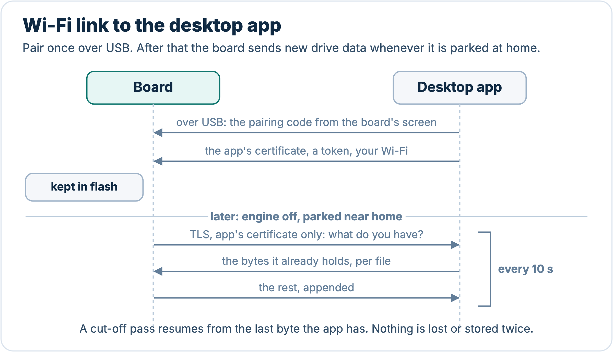
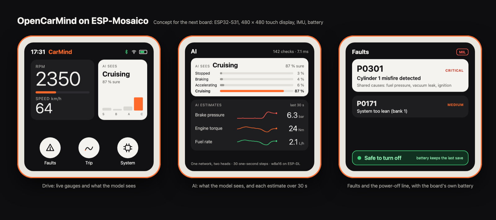

<p align="center"></p>

<p align="center">
<a href="https://github.com/AlveeeRahman/OpenCarMind/actions/workflows/ci.yml"></a>
<a href="https://scorecard.dev/viewer/?uri=github.com/AlveeeRahman/OpenCarMind"></a>
<a href="LICENSE"></a>


</p>

OpenCarMind turns an ESP32-S3 board and a Bluetooth OBD-II adapter into a car data logger that runs a neural network on the board. It needs no phone, no account and no internet connection. Everything it records goes to an SD card in the car and, if you pair the board, to the desktop app on your own computer.

Version 2.4.0, with CarMind GenEdge. Licence: MIT. Website: <https://alveeerahman.github.io/OpenCarMind/>. Downloads for the firmware and the desktop app are on the [Releases page](https://github.com/AlveeeRahman/OpenCarMind/releases/latest).

## What you get

- **Every standard Mode 01 field** the car reports (70 are decoded), battery voltage, the VIN, and stored, pending and permanent trouble codes. One CSV row is written per poll cycle.
- **A small neural network on the chip** (CarMind GenEdge). Each time a row arrives it classifies the last 5 seconds of driving as stopped, braking, accelerating or cruising. It also estimates three values the OBD port does not report: brake pressure, flywheel torque and fuel rate.
- **A save to the SD card every 10 seconds**, and a live **power-off line** on page 3: green "Safe to turn off" only once car data has stopped, everything is on the card and nothing is uploading, red with the reason (logging, saving, upload) otherwise. When the ignition goes off, the drive ends 15 seconds after the engine computer stops answering: the board saves and closes the session, even if the adapter stays powered, and starts a new session if the engine comes back.
- **Fuel economy** on the first screen: km/L, or mpg in the US and the UK. The fuel rate comes from the best source the car has: its own fuel-rate PID (common on newer cars), the airflow sensor with the commanded air-fuel ratio, or, on cars with neither, the on-board model's estimate, shown in amber. A car that gives nothing shows "--", never a made-up number.
- **Units that follow you.** The board starts in km. The first time it joins Wi-Fi it reads the country code the access point broadcasts, switches to miles and mpg in the US or the UK, and keeps that choice. Tested on the board: a US access point switched it to miles and mpg, and the choice stayed after a reboot. `units` in `config.json` overrides it.
- **A fault engine** that ranks trouble codes by severity and groups codes that share a cause.
- **Dark and light screen themes**, switched by time of day or fixed in a settings file.
- **A soft real-time scheduler** that times every job against its deadline and restarts the board if a step hangs.
- **Optional Wi-Fi**: it sets the clock and, once paired, sends new drives to the desktop app on your computer.
- **A desktop app** for Windows, macOS and Linux that receives the drives, charts them, shows fuel and economy per drive, and lists every value the car reported, including what the screen has no room for (odometer, oil temperature, hybrid battery and more on newer cars).

## Local-first

<p align="center"></p>

Most car loggers stream your driving to a server and do the thinking there. OpenCarMind does the thinking on the board, in the way TinyML work runs networks on microcontrollers<sup>[[1]](#ref-1)–[[3]](#ref-3)</sup>. The model is 89 KB, runs in a few milliseconds and needs no network. Your data is plain CSV, JSON and text on a card you hold. Nothing leaves the car unless you copy the card or pair the board with your own computer.

Wi-Fi is the only radio besides Bluetooth, and it is optional. It sets the clock from a public time server, and once you pair the board with the desktop app it sends new drive data to that app every 10 seconds while the car is parked at home. Nothing goes to a cloud. You can compile Wi-Fi out with one setting (`OCM_WIFI_CLOCK_SYNC`).

## How it works

<p align="center"></p>

The board asks the engine computer for every field it supports, shows the live values on its screen and writes each drive to the SD card as its own session. The model runs on the chip while you drive. At home, a paired board sends the new data to the desktop app over Wi-Fi. Without pairing, take the card out and open the files on your computer.

### On-board inference

<p align="center"></p>

When an OBD row arrives, the board cuts the last 5 seconds into five one-second bins that end at that moment. Each bin takes the latest value, held for up to 3 seconds if a channel was not read in time. The model runs in its own task, so logging never waits for it. Every row adds one line to the drive's `.ml.csv` file, and the newest answer shows on page 5.

On my car, a row arrives every 1.35 to 1.65 seconds, so a 5 s window holds about three rows. One run of the model takes about 3.5 ms on the ESP32-S3, measured at the boot self-test.

### Scheduler and safety

<p align="center"></p>

Open-source loggers usually treat timing as someone else's problem. Here every periodic job (the OBD poll and the model) has a period and a deadline. The scheduler in `main/sched_mon.c` records each run's response time and CPU time, counts misses and stalls (a job is stalled when it misses three periods, or for the model, which the car's row rate paces, a whole 10-second window), and once a minute checks per-core load against the rate-monotonic bound of Liu and Layland<sup>[[4]](#ref-4)</sup> and the worst-case response time of each job from the analysis of Joseph and Pandya<sup>[[5]](#ref-5)</sup>. Steps that talk to the adapter feed the task watchdog, so a step that never returns resets the board. After three abnormal resets in a row the board starts in safe mode: the model stays off and logging keeps going.

## The screens

<p align="center">


</p>
<p align="center">


</p>

Pages 1, 3, 4 and 5 in the dark and light themes. Page 2 is plain text (adapter, VIN, protocol, codes, clock and SD state) and has its own picture at [docs/images/details.png](docs/images/details.png). Page 3 turns its power line green only when car data has stopped, everything is on the card and no upload is running, and red with the reason otherwise ([red example](docs/images/internals-logging.png)).

By default the screen switches by time of day. It is light from 06:00 to 17:00 and dark otherwise, in the board's time zone. Set `timezone` in `config.json` (the desktop app fills it in from your computer), because the build default is UTC. Before the clock is known the screen stays dark. Set `theme_mode` in `config.json` to 1 for always dark or 2 for always light, and `day_start_hour` and `day_end_hour` to change the hours (see [docs/CONFIGURATION.md](docs/CONFIGURATION.md)). The pictures are renders, not photographs of a panel. They come from `docs/screens/screens.html` with `sh docs/screens/render.sh`, which applies the same light colour table the firmware uses.

Tap BOOT to change page. Hold it for 2 seconds to power off: logging stops as soon as the hold reaches 2 seconds, and on release the board saves and closes the drive before it turns off. Hold it for 8 seconds to forget the saved adapter instead, and logging carries on.

1. Dashboard: RPM, speed, engine temperature, battery, fuel economy and fuel level, plus Bluetooth, SD and Wi-Fi icons.
2. Details: adapter, VIN, protocol, trouble codes, clock and SD state, session counters.
3. Internals: twelve extra fields (timing, fuel trims, engine load, boost, catalyst temperature, rail pressure, fuel rate and more), up to eight custom PIDs, and the recent events, including "Safe to turn off".
4. Faults: ranked trouble codes with severity, description and likely cause.
5. System: CPU and memory, link states, the job list with deadlines, what the model sees and its three estimates.

## Dashboard

`tools/ocm_report.py` reads a session folder from the SD card and writes one HTML report per drive (charts of speed, engine speed, coolant and throttle, and the model's manoeuvre classes) plus a summary. [Dashy](https://github.com/Lissy93/dashy), an open-source self-hosted dashboard, shows the latest drive and links to every report. Both run on your own computer or home server with Docker, and nothing is sent to the internet.

```sh
python3 tools/ocm_report.py /Volumes/<card name>/obd dashboard/site
cd dashboard && docker compose up -d      # Dashy on http://localhost:4000
```

The board never talks to Dashy. Data reaches your computer by SD card or through the desktop app.

## Desktop app

<p align="center"></p>

The app in [desktop/](desktop/README.md) runs on Windows, macOS and Linux. Over the board's USB cable it pairs with the board (you type a code from the board's screen once), sets its Wi-Fi networks, time zone and settings, imports drives from the card and flashes new firmware, so the SD card never has to come out. After that, the board sends new data to the app over TLS every 10 seconds while the car is parked at home, and the app shows the drives and their charts. GitHub Actions builds the installers. [docs/DASHBOARD.md](docs/DASHBOARD.md) has the setup, the details of how the data reaches Dashy, and what has and has not been tested.

## Hardware

- Board: Waveshare ESP32-S3-LCD-1.47B (the pin map in `main/board.h` matches it). Other ESP32-S3 boards need that file edited. There is no build without the display yet.
- Adapter: a Bluetooth LE adapter that speaks ELM327 commands (see the table below). Classic Bluetooth adapters will not work, because the S3 has no classic radio.
- A FAT-formatted SD card.

### Adapter compatibility

The firmware has built-in profiles for the serial layouts below. Other BLE adapters are found by name or advertised service, and the board falls back to any service it can subscribe to and write. It pairs only when the adapter asks. Only the LELink has been driven with this board. The other rows come from vendor documents and other open-source OBD projects. [docs/ADAPTERS.md](docs/ADAPTERS.md) has prices and sources. Every Amazon link below is a plain product page with no affiliate tag. All of them were opened on 3 November 2026 and showed the product named in the row. Where the page title does not name the model, or the page showed the item unavailable, the Status column says so.

| Adapter | Bluetooth | Built-in profile | Status | Amazon |
|---|---|---|---|---|
| LELink², LELink | LE | FFE0 / FFE1 | tested | [B0755N61PW](https://www.amazon.com/dp/B0755N61PW), [B00QJRYMFC](https://www.amazon.com/dp/B00QJRYMFC) |
| Veepeak OBDCheck BLE+, BLE | LE | FFF0 / FFF1 / FFF2 | expected | [B076XVQMVS](https://www.amazon.com/dp/B076XVQMVS), [B073XKQQQW](https://www.amazon.com/dp/B073XKQQQW) |
| OBDLink CX (sold as the Bimmercode edition, which is the only CX model) | LE 5.1, encrypted | FFF0 / FFF1 / FFF2, pairs on demand | expected | [B08NFLL3NT](https://www.amazon.com/dp/B08NFLL3NT) |
| Carista OBD2, Carista EVO | LE | FFF0 / FFF1 / FFF2 | expected | [B00YVHGTBM](https://www.amazon.com/dp/B00YVHGTBM), [B0CM9W4MCW](https://www.amazon.com/dp/B0CM9W4MCW) |
| Vgate iCar Pro BLE 4.0 | LE | 18F0 / 2AF0 / 2AF1 | expected | [B06XGB4873](https://www.amazon.com/dp/B06XGB4873) |
| Vgate vLinker MC+ | LE and Classic | E7810A71 / BEF8D6C9 | expected | [B088LW211V](https://www.amazon.com/dp/B088LW211V) |
| Vgate vLinker FS, MS | LE and Classic | E7810A71 / BEF8D6C9 | switch to "BLE+BT" in the VgateFwUpdater app first | [B0BZTXV6MZ](https://www.amazon.com/dp/B0BZTXV6MZ), [B0D6YQX4R8](https://www.amazon.com/dp/B0D6YQX4R8) |
| Panlong OBD2 Scanner (PL-B04) | LE, works with Car Scanner on iOS | generic fallback | expected for the "For iOS Android" option only. The "For Android Only" option is likely Classic. The page title does not name the model | [B0C1GDJ9ZJ](https://www.amazon.com/dp/B0C1GDJ9ZJ) |
| DA200 (Bluetooth 5.4, "AI Repair Tips") | LE, PIC18F25K80 ELM327-type chip (maker's spec sheet) | generic fallback | expected. The page title does not name the model, check for DA200 on the box | [B0FH2GJTP8](https://www.amazon.com/dp/B0FH2GJTP8) |
| ELM327 BLE clones (for example RODEDIO) | LE on iOS | FFF0 or FFE0 | expected for most. Buy one whose listing says Bluetooth LE for iOS | [B0GWQKLTMR](https://www.amazon.com/dp/B0GWQKLTMR) |
| Adapters running the Deep OBD firmware | LE | FFE0 / FFE1 / FFE2 | expected | not sold on Amazon. Layout from the Deep OBD source, [BtLeGattSppAndroid.cs](https://github.com/uholeschak/ediabaslib/blob/master/EdiabasLib/EdiabasLib/BtLeGattSppAndroid.cs) |
| FIXD | Bluetooth | unknown | unverified | [B013RIQMEO](https://www.amazon.com/dp/B013RIQMEO) |
| BlueDriver | Bluetooth | private protocol | not expected | [B00652G4TS](https://www.amazon.com/dp/B00652G4TS) |
| V800 full-system scanners (Panlong PL-V800 and white-label copies) | Bluetooth | private app (INNOOBD+) | not expected. The title says "Engine Transmission ABS SRS", not V800 | [B0GQ3D57PK](https://www.amazon.com/dp/B0GQ3D57PK) |
| OBDLink MX+, OBDLink LX, KONNWEI KW902 | Classic only (LX: Bluetooth 3.0, KW902: Android and Windows only) | none | will not work. The KW902 listing showed "currently unavailable" on 3 Nov 2026 | [B07JFRFJG6](https://www.amazon.com/dp/B07JFRFJG6), [B00H9S71LW](https://www.amazon.com/dp/B00H9S71LW), [B073F57QT3](https://www.amazon.com/dp/B073F57QT3) |

## Build and flash

You need ESP-IDF v6.1 and Python 3.

```sh
. $IDF_PATH/export.sh
idf.py set-target esp32s3
idf.py build
idf.py -p /dev/cu.usbmodemXXXX flash monitor
```

The first build downloads ESP-DL, LVGL, led_strip and cJSON through the IDF component manager. The NimBLE helper comes from the `examples` folder of your ESP-IDF install, so keep that folder. If you built an earlier version in the same folder, delete `sdkconfig` first. If the board stays in download mode after flashing, reset it with `python -m esptool --chip esp32s3 -p <port> --after watchdog-reset chip-id`.

On first boot the board looks for adapters for 1.5 seconds and connects to the strongest one whose name looks like an OBD adapter, starts with an entry of `OBD_BLE_NAME_PREFIXES`, or that advertises a service OBD adapters use. It stores the address once the adapter answers the ELM327 reset and uses only that adapter afterwards. Devices that turn out not to be adapters are skipped for 10 minutes. If your adapter is not found, add its name to that list in `idf.py menuconfig` under OBD Logger Configuration. Only the LELink has been tested.

Settings, SD card files, the Wi-Fi list and the CSV columns are in [docs/CONFIGURATION.md](docs/CONFIGURATION.md).

## The model

CarMind GenEdge runs on the chip. With every OBD row it classifies the last 5 seconds as stopped, braking, accelerating or cruising, and estimates brake pressure, flywheel torque and fuel rate, which OBD does not report. It is a small quantised 1-D convolutional network run by ESP-DL<sup>[[6]](#ref-6)</sup>. It takes about 89 KB on the chip and about 3.5 ms per run on the ESP32-S3.

Scores of the version on the chip, on data held out from training:

| Test set | Manoeuvre | Fuel R² |
|---|---|---|
| Public KIA drives | macro-F1 0.887 | 0.947 |
| Two drives of the author's car | 98.5 % in an allowed class | 0.884 |
| 37 VED cars the model never saw | 96.1 % in an allowed class | 0.940 (0.688 with MAF hidden) |

Limits:

- Outside one data set there is no brake-switch signal, so braking and cruising are partly ambiguous.
- No diesel car is in the data.
- Brake pressure (R² 0.46) is the weakest estimate.

Trained on public data, the HCRL Driving Dataset (Kwak, Woo and Kim, PST 2016)<sup>[[7]](#ref-7)</sup> and the Vehicle Energy Dataset (Oh, LeBlanc and Peng, 2020, Apache-2.0)<sup>[[8]](#ref-8)</sup>, plus drives from my own car.

The shipped files are in [ml/onboard](ml/onboard). `tools/gen_ml_params.py` turns them into `main/ml_params.h`, which holds the channel order, normalisation, class names and the model's hash. [docs/MODEL.md](docs/MODEL.md) lists the inputs and outputs.

## Status

What has been checked, on the bench or in the code: the build (with Wi-Fi clock sync on and off), the model's identity hash, the host unit tests (317 checks, including a simulated drive for the power-off line, the adapter profile chooser, and the fuel, economy and units logic), the automatic switch to miles and mpg with a US Wi-Fi access point, kept after a reboot, the 10-second save and the "Safe to turn off" event on a board with an SD card, and the Wi-Fi upload to a stand-in receiver with resume after a cut-off pass. CI builds the desktop app and runs its unit tests on Windows, macOS and Linux. Nobody has opened the app on a real machine yet.

Known security limits are listed in [SECURITY.md](SECURITY.md#known-limits).

The author has driven the board with the drive-end, power-off, fuel economy and units features and reported them all working. What has not been checked: other boards, any adapter other than the LELink, CarMind GenEdge on the road (it was flashed after that drive), and what the screens do on a board without a panel. The checks that need a car or a card are listed in [docs/FIELD_CHECKS.md](docs/FIELD_CHECKS.md), with empty result tables for users to fill in.

## Next board: ESP-Mosaico with the ESP32-S31

<p align="center"></p>

The next board is Espressif's ESP-Mosaico<sup>[[9]](#ref-9),[[10]](#ref-10)</sup>. The author has one on order, and the concept above shows how the screens would look on its square display.

If you build things with the ESP32, this is a good board to get, and the port will be easier with more people testing it. The Vision Combo Kit (Core Unit v1.2, camera module and interaction module) is 59 USD on the [ESP-Mosaico Store](https://store.mosaico.ai/products/esp-mosaico). It was on pre-order with an estimated 15-day dispatch on 3 November 2026. If you have one, open an issue or a pull request with what you find: pin maps, screen layouts, NAND logging and S31 model exports are all open. It is built on the ESP32-S31<sup>[[11]](#ref-11)</sup>: two 32-bit RISC-V cores at 320 MHz, one with a 128-bit SIMD data path, 512 KB of SRAM, Wi-Fi 6, and Bluetooth 5.4 with both LE and Classic (BR/EDR).

What the Mosaico adds for a car logger:

| | Waveshare ESP32-S3-LCD-1.47B (today) | ESP-Mosaico (next) |
|---|---|---|
| Chip | ESP32-S3, two Xtensa LX7 cores at 240 MHz | ESP32-S31, two RISC-V cores at 320 MHz, 128-bit SIMD path |
| Screen | 1.47 in, 172 × 320 LCD | 2.16 in, 480 × 480 AMOLED touch |
| Bluetooth | LE only, so Classic adapters cannot connect | LE and Classic (BR/EDR), so OBDLink MX+ and LX class adapters become possible |
| CAN | TWAI on the S3, needs an external transceiver | TWAI, CAN 2.0 compatible, with a transceiver on the 2 × 10-pin module headers |
| Motion | 6-axis IMU on the board, not used by the firmware yet | BMI270 6-axis IMU and BMM150 magnetometer |
| Power cut | relies on the 10-second save | 65 mAh battery to finish the last save |
| Memory | 8 MB PSRAM, 16 MB flash | 16 MB PSRAM, 16 MB NOR flash, 128 MB SPI NAND |
| Storage for drives | microSD | no microSD slot. Drives would go to the 128 MB NAND, or to a card on the expansion headers |
| Price | 12.99 to 13.99 USD from [Waveshare](https://www.waveshare.com/esp32-s3-lcd-1.47b.htm), about 15 EUR in the EU from [OpenELAB](https://openelab.io/pl/products/waveshare-esp32-s3-lcd-1-47b) | 59 USD for the Vision Combo Kit from the [ESP-Mosaico Store](https://store.mosaico.ai/products/esp-mosaico) |

Sources for this table: Espressif and Waveshare documentation, the Circuit Rocks review and the store pages, prices seen on 3 November 2026<sup>[[9]](#ref-9)–[[14]](#ref-14)</sup>.

For the model, the most useful step is motion data. An accelerometer measures braking and acceleration directly, so it can check the labels the network predicts from OBD data. The S3 board has an IMU the firmware does not read yet, and the Mosaico adds a magnetometer for heading. Bluetooth Classic matters for compatibility: the adapters that fail today because they only speak Classic SPP could work, once an SPP client is written. TWAI with a transceiver on the headers is the route to reading the CAN bus directly, for the faults OBD-II cannot see.

### How the S3 and the S31 are compatible

The two chips do not share machine code. The S3 uses Xtensa LX7 cores and the S31 uses RISC-V, so a binary built for one will not run on the other. Compatibility is at the source level, through ESP-IDF: FreeRTOS, NimBLE, LVGL, the Wi-Fi and TLS stacks, FAT and ESP-DL all build for both chips from the same code.

This was tested, not assumed. ESP-IDF v6.1 lists `esp32s31` as a preview target, and OpenCarMind was built for it with `idf.py --preview set-target esp32s31`. All the libraries compiled unchanged. Two board-level lines needed changes. The S3 board's pin numbers do not exist on the S31 (GPIO41 is not a valid pin there), and `esp_sleep_enable_ext0_wakeup` is not available on the S31, so the power-off button has to use the ext1 wakeup. With placeholder pins and that one call changed, the firmware compiled and linked into an ESP32-S31 image of 4.27 MB. That is larger than the S3 image (3.0 MB) and slightly over the current 4 MB app partition. Both boards have 16 MB of flash, so a larger partition fits.

The model also needs one step. ESP-PPQ quantises for the S3 with its first SIMD extension and for the S31 with the newer one shared with the ESP32-P4, so the shipped `.espdl` file must be exported again with the S31 as target. The trained weights stay the same. ESP-DL 3.3.14 lists `esp32s31` among its supported targets<sup>[[6]](#ref-6)</sup>.

### Continual learning on the S31

The network on the board today is fixed. It was trained on a laptop, quantised, and never changes in the car. Learning on the board needs two things the car rarely gives you: a label for each window, and room to keep past windows so that new drives do not erase what the model knew (catastrophic forgetting<sup>[[15]](#ref-15)</sup>).

The private CarMind line already learns on the board, in a narrow way. A small linear forecaster predicts the next OBD row. When that row arrives, the error is its own label. It keeps only running statistics with forgetting, never the raw data, stays close to a factory prior, and swaps in new weights only while parked, and only if they beat the current weights on recent rows. That code is plain C with no chip-specific parts, built the same way as the public firmware, so it should move to the S31 unchanged. The same work found that the two heads of the CNN have no ground truth in the car, so they stay as trained. That is the gap the S31 board could close.

How the two heads could learn on a Mosaico:

- Labels for the manoeuvre head. An accelerometer measures braking and acceleration directly, so stopped, braking, accelerating and cruising can be labelled in the car. The Mosaico has a BMI270<sup>[[10]](#ref-10)</sup>. The S3 board has an IMU too<sup>[[13]](#ref-13)</sup>, which the firmware does not read yet, so this part could start on today's board.
- Labels for two of the three estimates, on some cars. The firmware already reads PID 0x5E (fuel rate) and PIDs 0x62 and 0x63 (torque) when the car reports them. Brake pressure has no label in any car, so that head stays fixed.
- Only the heads would train. ESP-DL runs inference only, so the int8 trunk stays frozen, and the heads (a 64-wide feature into 4 classes and 3 estimates, a few hundred weights) are updated in plain C on the CPU. That is the approach of TinyOL<sup>[[16]](#ref-16)</sup> and TinyTL<sup>[[17]](#ref-17)</sup>. Updating parts of the trunk as well, as in<sup>[[18]](#ref-18)</sup>, is where the S31's extra speed and memory would count.
- A replay buffer against forgetting. One 30-step window of 30 features is 3.6 KB in float. The S31's 16 MB of PSRAM (8 MB on the S3 board) holds thousands of past windows to mix into each update, and its 128 MB NAND keeps them between drives.
- Time to finish. The 65 mAh battery lets an update and its save complete after the ignition is off.

Both chips have hardware single-precision floating point and emulate double precision in software. The ESP-IDF RISC-V toolchain ships only single-float libraries (`rv32imafc`, `ilp32f`), and the S3 compiler reports no double-precision unit. So the S31 is not faster per double operation by design. Its gains are the 320 MHz clock, the memory, the battery and the motion sensor. None of this is built or measured yet.

### A release for the Mosaico

OpenCarMind will ship a release for the ESP-Mosaico. It will build from the same source tree as the S3 version, which stays supported, and it will handle the board differences covered above. Work starts when the author's board arrives.

The Mosaico also changes how you use the logger. Your adapter lives in the car, and the Mosaico rides in your pocket. Get in, and it finds the adapter it already paired with and starts logging. Walk back inside, and it sends the drive to the desktop app over your Wi-Fi. For a long drive, power it from the car's USB port or add the Mosaico Battery Module, because the built-in 65 mAh cell is sized for finishing a save, not for a whole trip.

## Planned

- The ESP-Mosaico (ESP32-S31) port described above, and a build without a display.
- Code-signed installers.
- More regularised models, released by this project, to fit more cars.
- A faster version built on a Jetson.

## References

<a id="ref-1"></a>[1] J. Lin, W.-M. Chen, Y. Lin, J. Cohn, C. Gan and S. Han, "MCUNet: Tiny deep learning on IoT devices," in *Advances in Neural Information Processing Systems (NeurIPS)*, 2020. [arXiv:2007.10319](https://arxiv.org/abs/2007.10319)

<a id="ref-2"></a>[2] R. David *et al.*, "TensorFlow Lite Micro: Embedded machine learning on TinyML systems," in *Proc. Machine Learning and Systems (MLSys)*, 2021. [arXiv:2010.08678](https://arxiv.org/abs/2010.08678)

<a id="ref-3"></a>[3] C. Banbury *et al.*, "MLPerf Tiny benchmark," in *Proc. NeurIPS Datasets and Benchmarks Track*, 2021. [arXiv:2106.07597](https://arxiv.org/abs/2106.07597)

<a id="ref-4"></a>[4] C. L. Liu and J. W. Layland, "Scheduling algorithms for multiprogramming in a hard-real-time environment," *Journal of the ACM*, vol. 20, no. 1, pp. 46–61, 1973. [doi:10.1145/321738.321743](https://doi.org/10.1145/321738.321743)

<a id="ref-5"></a>[5] M. Joseph and P. Pandya, "Finding response times in a real-time system," *The Computer Journal*, vol. 29, no. 5, pp. 390–395, 1986. [doi:10.1093/comjnl/29.5.390](https://doi.org/10.1093/comjnl/29.5.390)

<a id="ref-6"></a>[6] Espressif Systems, "ESP-DL: Espressif deep-learning library for AIoT applications." [github.com/espressif/esp-dl](https://github.com/espressif/esp-dl)

<a id="ref-7"></a>[7] B. I. Kwak, J. Woo and H. K. Kim, "Know your master: Driver profiling-based anti-theft method," in *Proc. 14th Annual Conf. on Privacy, Security and Trust (PST)*, 2016, pp. 211–218. [arXiv:1704.05223](https://arxiv.org/abs/1704.05223)

<a id="ref-8"></a>[8] G. Oh, D. J. LeBlanc and H. Peng, "Vehicle Energy Dataset (VED), a large-scale dataset for vehicle energy consumption research," *IEEE Transactions on Intelligent Transportation Systems*, 2020. [arXiv:1905.02081](https://arxiv.org/abs/1905.02081), data and licence (Apache-2.0) at [github.com/gsoh/VED](https://github.com/gsoh/VED)

<a id="ref-9"></a>[9] Espressif Systems, "ESP-Mosaico," esp-dev-kits documentation. [docs.espressif.com](https://docs.espressif.com/projects/esp-dev-kits/en/latest/esp32s31/esp-mosaico/index.html)

<a id="ref-10"></a>[10] Espressif Systems, "ESP-Mosaico V1.0," ESP Board Manager guide. [docs.espressif.com](https://docs.espressif.com/projects/esp-board-manager/en/latest/references/boards/esp_mosaico.html)

<a id="ref-11"></a>[11] Espressif Systems, "Espressif unveils ESP32-S31: a dual-core RISC-V SoC with Wi-Fi 6, Bluetooth 5.4, and advanced HMI capabilities," press release, 26 March 2026. [espressif.com](https://www.espressif.com/en/news/ESP32_S31_Release)

<a id="ref-12"></a>[12] Circuit Rocks, "ESP-Mosaico: ESP32-S31 board for AI-written firmware," 2026. [blog.circuit.rocks](https://blog.circuit.rocks/esp-mosaico-espressifs-59-board-where-ai-writes-the-firmware)

<a id="ref-13"></a>[13] Waveshare, "ESP32-S3-LCD-1.47B," product page. [waveshare.com](https://www.waveshare.com/ESP32-S3-LCD-1.47B.htm)

<a id="ref-14"></a>[14] OpenELAB, "Waveshare ESP32-S3-LCD-1.47B," listing, price seen 3 November 2026. [openelab.io](https://openelab.io/pl/products/waveshare-esp32-s3-lcd-1-47b)

<a id="ref-15"></a>[15] J. Kirkpatrick *et al.*, "Overcoming catastrophic forgetting in neural networks," *Proc. National Academy of Sciences*, vol. 114, no. 13, pp. 3521–3526, 2017. [arXiv:1612.00796](https://arxiv.org/abs/1612.00796)

<a id="ref-16"></a>[16] H. Ren, D. Anicic and T. A. Runkler, "TinyOL: TinyML with online-learning on microcontrollers," in *Proc. Int. Joint Conf. Neural Networks (IJCNN)*, 2021. [arXiv:2103.08295](https://arxiv.org/abs/2103.08295)

<a id="ref-17"></a>[17] H. Cai, C. Gan, L. Zhu and S. Han, "TinyTL: Reduce activations, not trainable parameters for efficient on-device learning," in *Advances in Neural Information Processing Systems (NeurIPS)*, 2020. [arXiv:2007.11622](https://arxiv.org/abs/2007.11622)

<a id="ref-18"></a>[18] J. Lin, L. Zhu, W.-M. Chen, W.-C. Wang, C. Gan and S. Han, "On-device training under 256KB memory," in *Advances in Neural Information Processing Systems (NeurIPS)*, 2022. [arXiv:2206.15472](https://arxiv.org/abs/2206.15472)

## Repository layout

| Path | What it holds |
|---|---|
| `main/` | firmware source |
| `ml/onboard/` | the shipped model, its normalisation and export record |
| `samples/replay/` | two replay sessions from a public dataset, in the board's file format |
| `schema/` | JSON schema of the session files |
| `tests/host/` | unit tests that run on a computer |
| `tools/` | `ocm_report.py` (SD card sessions to reports) and the generator for `main/ml_params.h` |
| `desktop/` | the desktop app (Rust and Tauri), its icons and design previews |
| `dashboard/` | Docker Compose file and Dashy configuration |
| `docs/` | configuration, model notes, field checks, screen designs and figures |

## Credits and licence

OpenCarMind is released under the MIT licence (see `LICENSE`). ESP-IDF, ESP-DL, LVGL and NimBLE keep their own licences.

The shipped model's training data is not part of this repository.

- The replay samples also use the carOBD dataset, <https://github.com/eron93br/carOBD>. See `samples/replay/README.md` for its terms.
