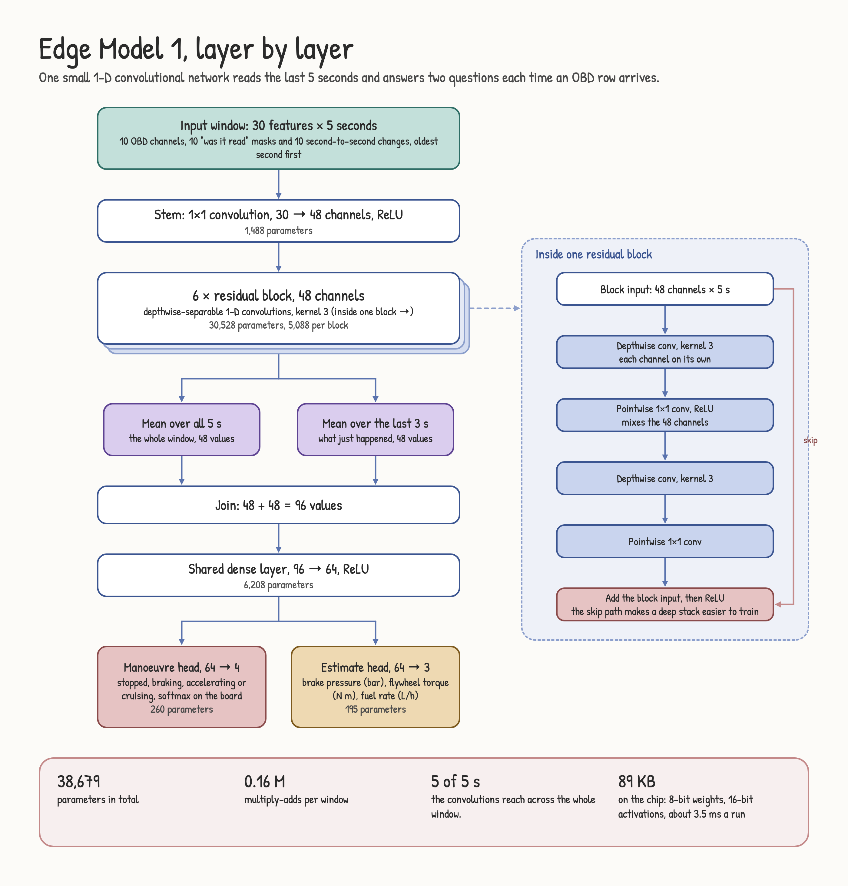
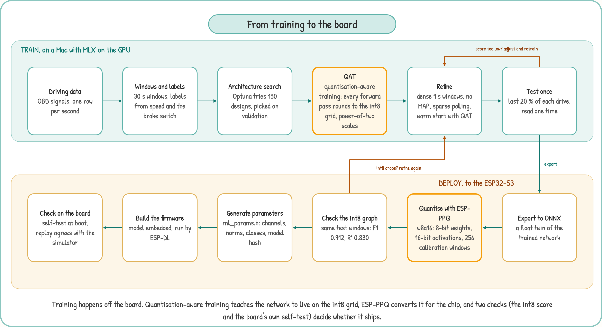

<p align="center"></p>

<p align="center">
<a href="https://github.com/AlveeeRahman/OpenCarMind/actions/workflows/ci.yml"></a>
<a href="https://scorecard.dev/viewer/?uri=github.com/AlveeeRahman/OpenCarMind"></a>
<a href="LICENSE"></a>


</p>

OpenCarMind turns an ESP32-S3 board and a Bluetooth OBD-II adapter into a car data logger that runs a neural network on the board. It needs no phone, no account and no internet connection. Everything it records goes to an SD card in the car and, if you pair the board, to the desktop app on your own computer.

Version 2.3.0. Licence: MIT. Downloads for the firmware and the desktop app are on the [Releases page](https://github.com/AlveeeRahman/OpenCarMind/releases/latest).

## What you get

- Every standard Mode 01 field the car reports (70 are decoded), battery voltage, the VIN, and stored, pending and permanent trouble codes. One CSV row is written per poll cycle.
- A small neural network on the chip. Each time a row arrives it classifies the last 30 seconds of driving as stopped, braking, accelerating or cruising. It also estimates three values the OBD port does not report: brake pressure, flywheel torque and fuel rate.
- A save to the SD card every 10 seconds, and a live power-off line on page 3: green "Safe to turn off" only once car data has stopped, everything is on the card and nothing is uploading, red with the reason (logging, saving, upload) otherwise.
- A fault engine that ranks trouble codes by severity and groups codes that share a cause.
- Dark and light screen themes, switched by time of day or fixed in a settings file.
- A soft real-time scheduler that times every job against its deadline and restarts the board if a step hangs.
- Optional Wi-Fi: it sets the clock and, once paired, sends new drives to the desktop app on your computer.
- A desktop app for Windows, macOS and Linux that receives the drives and charts them, and a local Dashy dashboard.

## Local-first

<p align="center"></p>

Most car loggers stream your driving to a server and do the thinking there. OpenCarMind does the thinking on the board. The model is 93 KB, runs in a few milliseconds and needs no network. Your data is plain CSV, JSON and text on a card you hold. Nothing leaves the car unless you copy the card or pair the board with your own computer.

Wi-Fi is the only radio besides Bluetooth, and it is optional. It sets the clock from a public time server, and once you pair the board with the desktop app it sends new drive data to that app every 10 seconds while the car is parked at home. Nothing goes to a cloud. You can compile Wi-Fi out with one setting (`OCM_WIFI_CLOCK_SYNC`).

## How it works

<p align="center"></p>

The board asks the engine computer for every field it supports, shows the live values on its screen and writes each drive to the SD card as its own session. The model runs on the chip while you drive. At home, a paired board sends the new data to the desktop app over Wi-Fi. Without pairing, take the card out and open the files on your computer.

### On-board inference

<p align="center"></p>

When an OBD row arrives, the board cuts the last 30 seconds into thirty one-second bins that end at that moment. Each bin takes the latest value, held for up to 3 seconds if a channel was not read in time. The model runs in its own task, so logging never waits for it. Every row adds one line to the drive's `.ml.csv` file, and the newest answer shows on page 5.

On the author's car, a row arrived every 1.35 to 1.65 seconds and one model run took about 9 ms on average (6 ms on the bench, 180 ms at worst), which is about 0.6 % of one core. These numbers come from one car and one adapter. Yours will differ.

### Scheduler and safety

<p align="center"></p>

Open-source loggers usually treat timing as someone else's problem. Here every periodic job (the OBD poll and the model) has a period and a deadline. The scheduler in `main/sched_mon.c` records each run's response time and CPU time, counts misses and stalls, and once a minute checks per-core load against the rate-monotonic bound (Liu and Layland, 1973) and the worst-case response time of each job (Joseph and Pandya, 1986). Steps that talk to the adapter feed the task watchdog, so a step that never returns resets the board. After three abnormal resets in a row the board starts in safe mode: the model stays off and logging keeps going.

## The screens

<p align="center">


</p>
<p align="center">


</p>

Pages 1, 3, 4 and 5 in the dark and light themes. Page 2 is plain text (adapter, VIN, protocol, codes, clock and SD state) and has its own picture at [docs/images/details.png](docs/images/details.png). Page 3 turns its power line green only when car data has stopped, everything is on the card and no upload is running, and red with the reason otherwise ([red example](docs/images/internals-logging.png)).

By default the screen switches by time of day. It is light from 06:00 to 17:00 and dark otherwise, in the board's time zone. Set `timezone` in `config.json` (the desktop app fills it in from your computer), because the build default is UTC. Before the clock is known the screen stays dark. Set `theme_mode` in `config.json` to 1 for always dark or 2 for always light, and `day_start_hour` and `day_end_hour` to change the hours (see [docs/CONFIGURATION.md](docs/CONFIGURATION.md)). The pictures are renders, not photographs of a panel. They come from `docs/screens/screens.html` with `sh docs/screens/render.sh`, which applies the same light colour table the firmware uses.

Tap BOOT to change page. Hold it for 2 seconds to power off, or for 8 seconds to forget the saved adapter.

1. Dashboard: RPM, speed, coolant, battery, load and fuel, plus Bluetooth, SD and Wi-Fi icons.
2. Details: adapter, VIN, protocol, trouble codes, clock and SD state, session counters.
3. Internals: twelve extra fields (timing, fuel trims, baro, boost, catalyst temperature, rail pressure, fuel rate and more), up to eight custom PIDs, and the recent events, including "Safe to turn off".
4. Faults: ranked trouble codes with severity, description and likely cause.
5. System: CPU and memory, link states, the job list with deadlines, what the model sees and its three estimates.

## Dashboard

`tools/ocm_report.py` reads a session folder from the SD card and writes one HTML report per drive (charts of speed, engine speed, coolant and throttle, and the model's manoeuvre classes) plus a summary. [Dashy](https://github.com/Lissy93/dashy), an open-source self-hosted dashboard, shows the latest drive and links to every report. Both run on your own computer or home server with Docker, and nothing is sent to the internet.

```sh
python3 tools/ocm_report.py /Volumes/<card name>/obd dashboard/site
cd dashboard && docker compose up -d      # Dashy on http://localhost:4000
```

The board never talks to Dashy. Data reaches your computer by SD card or through the desktop app.

## Desktop app

<p align="center"></p>

The app in [desktop/](desktop/README.md) runs on Windows, macOS and Linux. Over the board's USB cable it pairs with the board (you type a code from the board's screen once), sets its Wi-Fi networks, time zone and settings, imports drives from the card and flashes new firmware, so the SD card never has to come out. After that, the board sends new data to the app over TLS every 10 seconds while the car is parked at home, and the app shows the drives and their charts. GitHub Actions builds the installers. [docs/DASHBOARD.md](docs/DASHBOARD.md) has the setup, the details of how the data reaches Dashy, and what has and has not been tested.

## Hardware

- Board: Waveshare ESP32-S3-LCD-1.47B (the pin map in `main/board.h` matches it). Other ESP32-S3 boards need that file edited. There is no build without the display yet.
- Adapter: a Bluetooth LE adapter that speaks ELM327 commands (see the table below). Classic Bluetooth adapters will not work, because the S3 has no classic radio.
- A FAT-formatted SD card.

### Adapter compatibility

The firmware has built-in profiles for the serial layouts below. Other BLE adapters are found by name or advertised service, and the board falls back to any service it can subscribe to and write. It pairs only when the adapter asks. Only the LELink has been driven with this board. The other rows come from vendor documents and other open-source OBD projects. [docs/ADAPTERS.md](docs/ADAPTERS.md) has prices and sources. Every Amazon link below is a plain product page with no affiliate tag. All of them were opened on 3 November 2026 and showed the product named in the row. Where the page title does not name the model, or the page showed the item unavailable, the Status column says so.

| Adapter | Bluetooth | Built-in profile | Status | Amazon |
|---|---|---|---|---|
| LELink², LELink | LE | FFE0 / FFE1 | tested | [B0755N61PW](https://www.amazon.com/dp/B0755N61PW), [B00QJRYMFC](https://www.amazon.com/dp/B00QJRYMFC) |
| Veepeak OBDCheck BLE+, BLE | LE | FFF0 / FFF1 / FFF2 | expected | [B076XVQMVS](https://www.amazon.com/dp/B076XVQMVS), [B073XKQQQW](https://www.amazon.com/dp/B073XKQQQW) |
| OBDLink CX (sold as the Bimmercode edition, which is the only CX model) | LE 5.1, encrypted | FFF0 / FFF1 / FFF2, pairs on demand | expected | [B08NFLL3NT](https://www.amazon.com/dp/B08NFLL3NT) |
| Carista OBD2, Carista EVO | LE | FFF0 / FFF1 / FFF2 | expected | [B00YVHGTBM](https://www.amazon.com/dp/B00YVHGTBM), [B0CM9W4MCW](https://www.amazon.com/dp/B0CM9W4MCW) |
| Vgate iCar Pro BLE 4.0 | LE | 18F0 / 2AF0 / 2AF1 | expected | [B06XGB4873](https://www.amazon.com/dp/B06XGB4873) |
| Vgate vLinker MC+ | LE and Classic | E7810A71 / BEF8D6C9 | expected | [B088LW211V](https://www.amazon.com/dp/B088LW211V) |
| Vgate vLinker FS, MS | LE and Classic | E7810A71 / BEF8D6C9 | switch to "BLE+BT" in the VgateFwUpdater app first | [B0BZTXV6MZ](https://www.amazon.com/dp/B0BZTXV6MZ), [B0D6YQX4R8](https://www.amazon.com/dp/B0D6YQX4R8) |
| Panlong OBD2 Scanner (PL-B04) | LE, works with Car Scanner on iOS | generic fallback | expected for the "For iOS Android" option only. The "For Android Only" option is likely Classic. The page title does not name the model | [B0C1GDJ9ZJ](https://www.amazon.com/dp/B0C1GDJ9ZJ) |
| DA200 (Bluetooth 5.4, "AI Repair Tips") | LE, PIC18F25K80 ELM327-type chip (maker's spec sheet) | generic fallback | expected. The page title does not name the model, check for DA200 on the box | [B0FH2GJTP8](https://www.amazon.com/dp/B0FH2GJTP8) |
| ELM327 BLE clones (for example RODEDIO) | LE on iOS | FFF0 or FFE0 | expected for most. Buy one whose listing says Bluetooth LE for iOS | [B0GWQKLTMR](https://www.amazon.com/dp/B0GWQKLTMR) |
| Adapters running the Deep OBD firmware | LE | FFE0 / FFE1 / FFE2 | expected | not sold on Amazon. Layout from the Deep OBD source, [BtLeGattSppAndroid.cs](https://github.com/uholeschak/ediabaslib/blob/master/EdiabasLib/EdiabasLib/BtLeGattSppAndroid.cs) |
| FIXD | Bluetooth | unknown | unverified | [B013RIQMEO](https://www.amazon.com/dp/B013RIQMEO) |
| BlueDriver | Bluetooth | private protocol | not expected | [B00652G4TS](https://www.amazon.com/dp/B00652G4TS) |
| V800 full-system scanners (Panlong PL-V800 and white-label copies) | Bluetooth | private app (INNOOBD+) | not expected. The title says "Engine Transmission ABS SRS", not V800 | [B0GQ3D57PK](https://www.amazon.com/dp/B0GQ3D57PK) |
| OBDLink MX+, OBDLink LX, KONNWEI KW902 | Classic only (LX: Bluetooth 3.0, KW902: Android and Windows only) | none | will not work. The KW902 listing showed "currently unavailable" on 3 Nov 2026 | [B07JFRFJG6](https://www.amazon.com/dp/B07JFRFJG6), [B00H9S71LW](https://www.amazon.com/dp/B00H9S71LW), [B073F57QT3](https://www.amazon.com/dp/B073F57QT3) |

## Build and flash

You need ESP-IDF v6.1 and Python 3.

```sh
. $IDF_PATH/export.sh
idf.py set-target esp32s3
idf.py build
idf.py -p /dev/cu.usbmodemXXXX flash monitor
```

The first build downloads ESP-DL, LVGL, led_strip and cJSON through the IDF component manager. The NimBLE helper comes from the `examples` folder of your ESP-IDF install, so keep that folder. If you built an earlier version in the same folder, delete `sdkconfig` first. If the board stays in download mode after flashing, reset it with `python -m esptool --chip esp32s3 -p <port> --after watchdog-reset chip-id`.

On first boot the board looks for adapters for 1.5 seconds and connects to the strongest one whose name looks like an OBD adapter, starts with an entry of `OBD_BLE_NAME_PREFIXES`, or that advertises a service OBD adapters use. It stores the address once the adapter answers the ELM327 reset and uses only that adapter afterwards. Devices that turn out not to be adapters are skipped for 10 minutes. If your adapter is not found, add its name to that list in `idf.py menuconfig` under OBD Logger Configuration. Only the LELink has been tested.

Settings, SD card files, the Wi-Fi list and the CSV columns are in [docs/CONFIGURATION.md](docs/CONFIGURATION.md).

## The model

<p align="center"></p>

A 1-D convolutional network with 38,679 parameters, quantised to 8-bit weights and 16-bit activations (`w8a16`) and run by ESP-DL. It reads thirty one-second steps of seven channels (rpm, speed, load, throttle, both fuel trims and coolant temperature) and feeds two heads that share one trunk. On held-out drives, the version on the chip scores a manoeuvre macro-F1 of 0.912 and a mean estimator R² of 0.830 (brake pressure 0.56, flywheel torque 0.94, fuel rate 0.99). When the test windows are thinned to mimic a slow adapter, the refined model scored 0.874 and 0.792 in the training evaluation, which is not published here. The other scores are in `ml/onboard/export.json`. [docs/MODEL.md](docs/MODEL.md) has the inputs, outputs, labels and limits. The shipped files are in [ml/onboard](ml/onboard).

### From training to the board

<p align="center"></p>

The network is trained quantisation-aware (QAT) from the start: in every forward pass its weights and activations are rounded to the int8 grid with power-of-two scales. ESP-DL uses the same scheme, so the float network that reaches the converter already lives on that grid. A second training stage continues from those weights, still with QAT, on dense one-second windows that mimic a slow adapter. The test split is read once.

Deployment is a chain with two checks. The trained network is exported to ONNX and quantised by ESP-PPQ (`w8a16`, calibrated on 256 windows). The exporter scores the int8 graph on the same test windows, and if the score drops you go back to refinement. `tools/gen_ml_params.py` then writes `main/ml_params.h` with the channel order, normalisation, class names and the model's hash, the firmware embeds the model, and the board runs its own self-test at boot. The training code and data are not part of this repository.

What the model does not do yet:

- It was trained on one car. Other cars shift the input distributions, and nobody has measured accuracy on them. The training data is not published here.
- Brake pressure is the weakest estimate. Torque and fuel rate are strong.

## Status

What has been checked, on the bench or in the code: the build (with Wi-Fi clock sync on and off), the model's identity hash, the host unit tests (273 checks, including a simulated drive for the power-off line and the adapter profile chooser), the 10-second save and the "Safe to turn off" event on a board with an SD card, and the Wi-Fi upload to a stand-in receiver with resume after a cut-off pass. CI builds the desktop app and runs its unit tests on Windows, macOS and Linux. Nobody has opened the app on a real machine yet.

Known security limits are listed in [SECURITY.md](SECURITY.md#known-limits).

What has not been checked: other boards, any adapter other than the LELink, a power-off test during a real drive, and what the screens do on a board without a panel. The checks that need a car or a card are listed in [docs/FIELD_CHECKS.md](docs/FIELD_CHECKS.md), with empty result tables for users to fill in.

## Planned

- Support for more boards, including one without a display.
- Code-signed installers.
- More regularised models, released by this project, to fit more cars.
- A faster version built on a Jetson.

## References

The model and its deployment follow published work on small networks and integer inference:

- Jacob, B. et al. (2018). Quantization and training of neural networks for efficient integer-arithmetic-only inference. CVPR 2018. [arXiv:1712.05877](https://arxiv.org/abs/1712.05877). The basis of quantisation-aware training.
- Krishnamoorthi, R. (2018). Quantizing deep convolutional networks for efficient inference: a whitepaper. [arXiv:1806.08342](https://arxiv.org/abs/1806.08342). A practical guide to post-training quantisation and quantisation-aware training.
- Howard, A. G. et al. (2017). MobileNets: efficient convolutional neural networks for mobile vision applications. [arXiv:1704.04861](https://arxiv.org/abs/1704.04861). Depthwise-separable convolutions, used in every block of the trunk.
- Sandler, M. et al. (2018). MobileNetV2: inverted residuals and linear bottlenecks. CVPR 2018. [arXiv:1801.04381](https://arxiv.org/abs/1801.04381). Residual depthwise blocks.
- Wang, Z., Yan, W. and Oates, T. (2017). Time series classification from scratch with deep neural networks: a strong baseline. IJCNN 2017. [arXiv:1611.06455](https://arxiv.org/abs/1611.06455). 1-D convolution with global pooling for sensor sequences.
- Lin, J. et al. (2020). MCUNet: tiny deep learning on IoT devices. NeurIPS 2020. [arXiv:2007.10319](https://arxiv.org/abs/2007.10319). Fitting networks to microcontroller memory.
- David, R. et al. (2021). TensorFlow Lite Micro: embedded machine learning on TinyML systems. MLSys 2021. [arXiv:2010.08678](https://arxiv.org/abs/2010.08678). Interpreter design for microcontrollers.
- Banbury, C. et al. (2021). MLPerf Tiny benchmark. NeurIPS 2021 Datasets and Benchmarks. [arXiv:2106.07597](https://arxiv.org/abs/2106.07597). How tiny models are measured.
- Liu, C. L. and Layland, J. W. (1973). Scheduling algorithms for multiprogramming in a hard-real-time environment. Journal of the ACM 20(1). The rate-monotonic bound in `main/sched_mon.c`.
- Joseph, M. and Pandya, P. (1986). Finding response times in a real-time system. The Computer Journal 29(5). The response-time check in `main/sched_mon.c`.
- Espressif [ESP-DL](https://github.com/espressif/esp-dl) runs the model, and [ESP-PPQ](https://github.com/espressif/esp-ppq) quantises it.

## Repository layout

| Path | What it holds |
|---|---|
| `main/` | firmware source |
| `ml/onboard/` | the shipped model, its normalisation and export record |
| `samples/replay/` | two replay sessions from a public dataset, in the board's file format |
| `schema/` | JSON schema of the session files |
| `tests/host/` | unit tests that run on a computer |
| `tools/` | `ocm_report.py` (SD card sessions to reports) and the generator for `main/ml_params.h` |
| `desktop/` | the desktop app (Rust and Tauri), its icons and design previews |
| `dashboard/` | Docker Compose file and Dashy configuration |
| `docs/` | configuration, model notes, field checks, screen designs and figures |

## Credits and licence

OpenCarMind is released under the MIT licence (see `LICENSE`). ESP-IDF, ESP-DL, LVGL and NimBLE keep their own licences.

The shipped model's training data is not part of this repository.

- The replay samples also use the carOBD dataset, <https://github.com/eron93br/carOBD>. See `samples/replay/README.md` for its terms.
