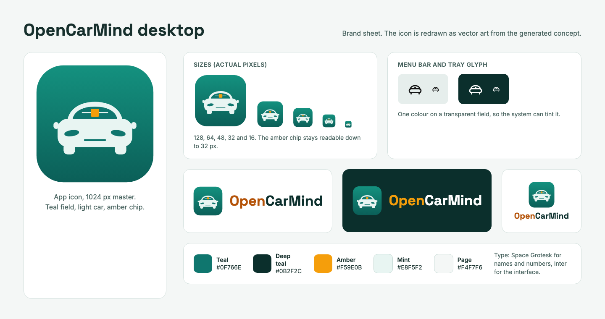
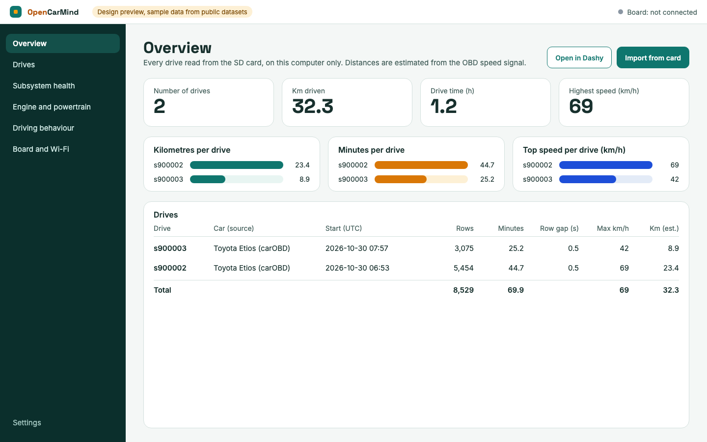
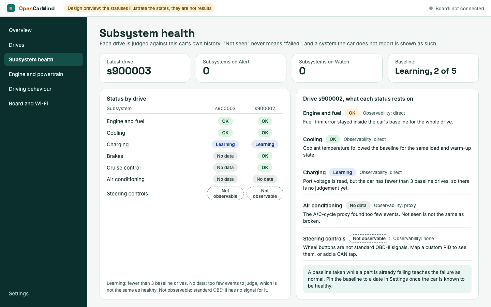
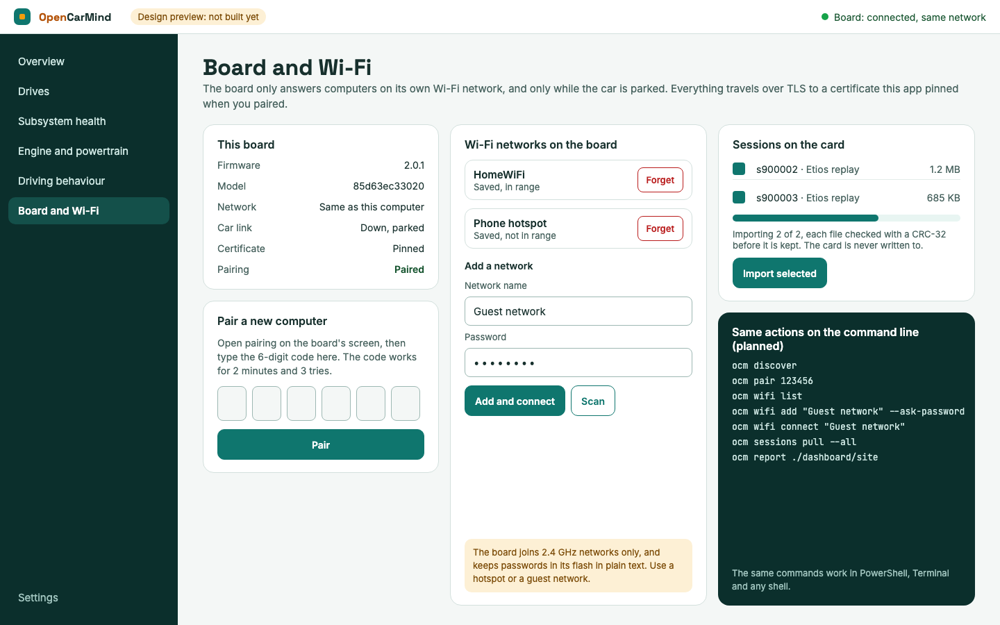
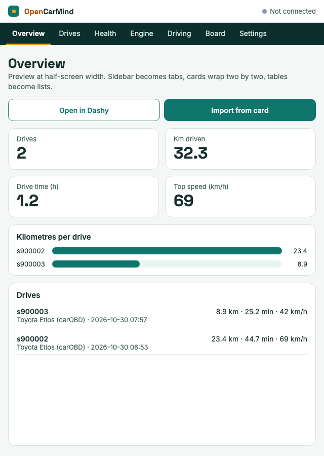

# Desktop app

Status: preview, version 0.3.0. The board sends its drives to the app over your Wi-Fi every 10 seconds while the car is parked, and the app shows them. It can also open an SD card directly.

Built with Rust and Tauri for Windows, macOS (Apple silicon and Intel) and Linux. All the setup lives in the app: it writes the board's Wi-Fi networks, settings and pairing file to the SD card. The board itself has no console and accepts no incoming connections.

## Get the installers

Open the Actions tab on GitHub, choose the `desktop` workflow, open the latest successful run and download the artifact for your system. The installers are not code-signed, so macOS asks you to confirm the first launch (right-click the app and choose Open) and Windows SmartScreen shows a warning (choose More info, then Run anyway).

| System | File |
|---|---|
| Mac with Apple silicon | `opencarmind-desktop-macos-apple-silicon`: a `.dmg` |
| Mac with an Intel chip | `opencarmind-desktop-macos-intel`: a `.dmg` |
| Windows | `opencarmind-desktop-windows`: a `-setup.exe` and a `.msi` |
| Linux | `opencarmind-desktop-linux`: a `.deb`, an `.rpm` and an `.AppImage` (needs FUSE) |

Each build runs the Rust unit tests on its own system first. They check the session summary maths against `tools/ocm_report.py`, the receiver's resume-by-offset rules, and the Wi-Fi and time zone checks.

## Use it

1. Open the Card and Wi-Fi page. The receiver starts with the app and shows the address and port it listens on (8787).
2. Take the SD card out of the board, put it in the computer, choose it, add your Wi-Fi network, check the time zone the app filled in, keep "Pair the board with this computer" ticked, and choose Write to the card.
3. Put the card back and switch the board on. It stores the Wi-Fi and pairing details, deletes those two files from the card, and from then on sends new data every 10 seconds whenever the car is parked within reach of that network.
4. On the Overview page, pick "Received over Wi-Fi" in the source list. The page refreshes itself while new data arrives.

To read a card without Wi-Fi, choose Open card folder and pick the card's `obd` folder, its `sessions` folder, or any folder of `sNNNNNN.csv` files.

## How the Wi-Fi link works

The board is the client and the app is the server. The app makes a self-signed certificate and a random token on first run and keeps them in its data folder. Pairing copies the certificate and the token to the board through the SD card, so they never cross the network in the clear. The board then trusts only that certificate (TLS 1.2), sends the token with every request, and appends each session file from the point the app already has. A pass that is cut off resumes where it stopped, and no byte is stored twice. Details and the protocol are in `main/uploader.h`.

Your firewall must let the app accept connections on port 8787. Allow it for private networks only. Windows normally asks the first time. macOS can block an app it has not approved without asking, so if no drives arrive, add OpenCarMind under System Settings, Network, Firewall, Options. On Linux, open the port if a firewall is active, for example `sudo ufw allow from 192.168.0.0/16 to any port 8787 proto tcp`.

If the computer's address changes, pair again. A board paired with another computer, or with a reinstalled app, is refused until it is paired again.

## Window behaviour

One window, native frame, resizable down to 480 by 360. Below 640 px the margins shrink, cards and charts wrap to the width, and wide tables scroll sideways. A second launch focuses the running window instead of opening another. Closing the window quits the app. Every control is reachable from the keyboard.

## Contents

- `app/`: the Tauri app (`src-tauri` for Rust, `ui` for the window).
- `icons/`: the app icon in the sizes Tauri expects (`32x32.png`, `128x128.png`, `128x128@2x.png`, `icon.png`, `icon.icns`, `icon.ico`), the 1024 px master, and the tray glyphs (`tray-template` is black on transparent so macOS can tint it, `tray-light` is white for dark panels).
- `design/`: five preview screens. They are mockups for later versions: the app does not have the health page or the board screen they show. The numbers on the overview come from the replay sessions in `samples/replay`, and the statuses on the health screen illustrate the possible states. They are not results from any car.

## Design previews

The same overview in a half-screen tile, as a tiling window manager or Windows snap layout would give it:

## The health states

The planned health screen uses six states so that a missing signal is never shown as a healthy one: OK, Watch, Alert, Learning (fewer than three baseline drives), No data (too few events to judge) and Not observable (standard OBD-II has no signal for it). A system the car does not report, such as the steering-wheel buttons, stays "Not observable" until you map a custom PID or add a CAN tap.

## Window management and tiling

One Tauri codebase builds the Windows, macOS and Linux apps, so the same rules apply to all three. The app follows these rules.

- Use the operating system's own window frame, with no custom title bar. Windows snap layouts, macOS full screen and split view, and Linux tiling window managers (i3, sway, Hyprland, and the tiling modes of GNOME and KDE) then treat it as an ordinary window.
- Make it resizable with a small minimum size (480 by 360 pixels), and reflow the layout. Pages are tabs at the top, cards and charts wrap to the width, and wide tables scroll.
- Do not remember the window's position. Wayland clients cannot place their own windows, and a tiling window manager decides position anyway.
- Give the app a stable identifier so tiling rules can target it.
- Closing the window quits the app. The tray icon is optional, because some Linux desktops have no tray and a hidden window would be lost there.
- Allow one instance. Starting the app again, or running a command that needs the window, focuses the one that is open.
- Make everything reachable from the keyboard.

Tested: CI builds the app and runs its unit tests on each system. No CI job opens the window, and tiling has not been tried on any desktop yet. That check is in [docs/FIELD_CHECKS.md](../docs/FIELD_CHECKS.md).

## Not built yet

- Flashing firmware from the app. Flash with `idf.py flash` as described in the main README.
- Code signing for the installers.
- Finding the computer again when its address changes. Today that needs a new pairing.
- The health page and the subsystem states from the design previews.
