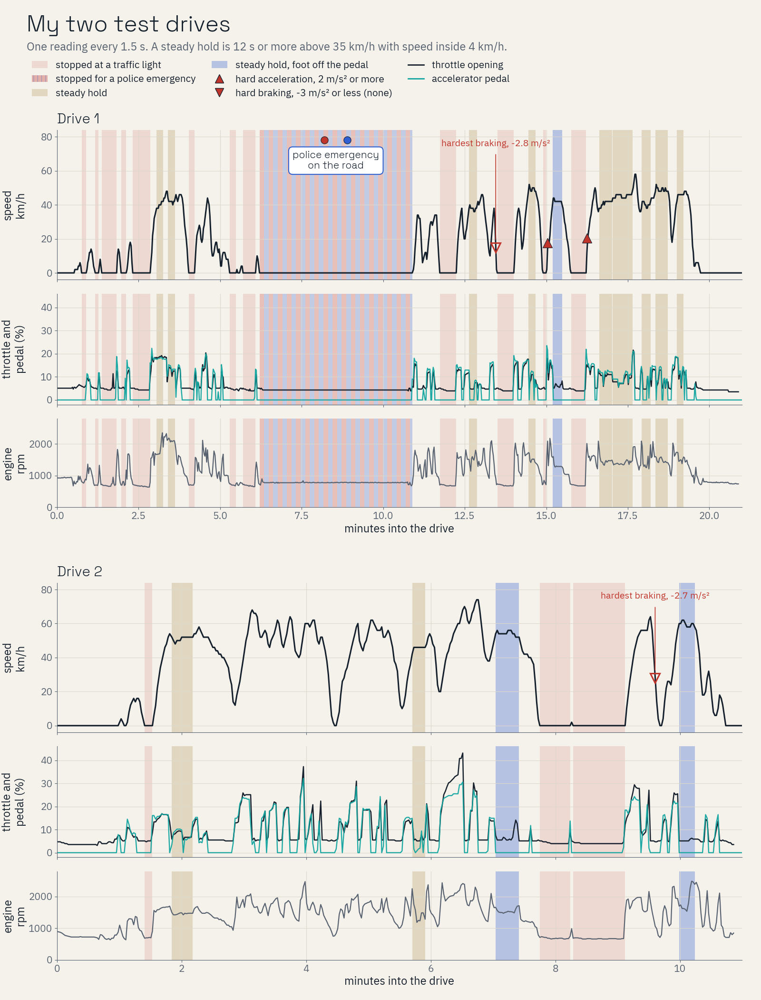
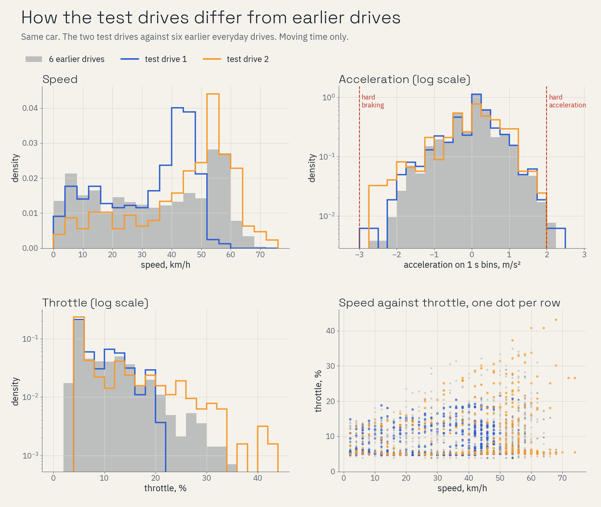

# Test drives

I drove my car twice to test the models, and not the way I usually drive. I drove rough, switched cruise control on and off at speed, and did sudden acceleration and brake checks between traffic lights. In the first drive, police were dealing with an emergency on the road and I sat with the engine idling until it cleared. None of the models on `main` had seen these drives.

## What the plots show

The timeline shows speed, throttle, accelerator pedal and engine rpm. Red bands are stops at traffic lights, and the red and blue stripes are the stop for the police emergency. Sand bands are steady holds, and blue bands are holds with my foot off the pedal. Red triangles mark hard acceleration and hard braking.

The second figure sets the test drives against six of my everyday drives: speed, acceleration, throttle, and speed against throttle.

## Why these drives make a fair test

A model that only works on the drives it learned from is no use in your car. These two drives put the models in situations my everyday drives rarely show:

- **A long idle.** The police stop was about three times longer than the longest stop in my everyday drives. The model has to keep saying "stopped" minute after minute while the engine runs.
- **Stop and go.** Many short stops at traffic lights, each followed by a launch.
- **Rough throttle and higher speeds.** The second drive spent more of its moving time above 20 % throttle than any of my everyday drives, and went faster than all of them.
- **Cruise control on and off.** With cruise on, the car holds speed with my foot off the pedal, so the throttle moves while the pedal reads zero. A model that leans on the pedal would misread this.
- **Sudden acceleration and brake checks.**

## How the drives are scored

I score these drives as if they came from a car the models never met. Nothing carries over from my earlier drives, and every learner starts from its factory state.
