<!-- OpenCarMind EdgeOS 2.1.0 manual, the source of its pages on the documentation site (docs-src). -->

# OpenCarMind EdgeOS 2.1.0 on the ESP-Mosaico

*OpenCarMind EdgeOS 2.1.0 user manual · ESP-Mosaico. For drivers and test users.*

OpenCarMind EdgeOS 2.1.0 is the OpenCarMind firmware for Espressif's ESP-Mosaico board. It reads your car over Bluetooth, logs every drive and runs a small neural network on the chip. It also checks its own health after every start and holds back changes that could disturb a drive. Everything stays on the board. There is no account and no cloud.

- **Screen:** 2.16 in AMOLED, 480 x 480, touch
- **Chip:** ESP32-S31, 2 cores, 320 MHz
- **Drive store:** 128 MB NAND
- **Models:** CarMind R.E.V and E.V

## Contents

1. [What OpenCarMind EdgeOS is](#what)
2. [Getting started](#start)
3. [Getting around](#nav)
4. [The 17 apps](#apps)
5. [Settings](#settings)
6. [Wi-Fi](#wifi)
7. [The two models](#models)
8. [Health checks and messages](#os)
9. [Alarms and faults](#alarms)
10. [Storage and power](#power)
11. [Desktop app and updates](#desktop)
12. [Troubleshooting](#trouble)
13. [Coming next](#next)
14. [Licences](#licences)

<a id="what"></a>

## A small instrument for your dash

OpenCarMind EdgeOS turns the ESP-Mosaico into a car computer. It comes from the same source as the OpenCarMind firmware for the ESP32-S3 board and does the same job, on a bigger touch screen with more memory. Up to version 1.2.0 this firmware was called mossREV.

### It reads the car

A Bluetooth LE OBD-II adapter plugs into the car's diagnostic port. OBD-II is the standard port under the dash. It reports engine speed, road speed, temperatures and trouble codes. The board talks to the adapter over Bluetooth LE.

### It logs every drive

The board saves each drive as its own session on its 128 MB drive store. You copy drives to your computer over the USB cable with the desktop app. Nothing has to come out of the board.

### It runs AI on the chip

A small neural network, called the model, watches the last few seconds of driving. It says what you are doing: stopped, braking, accelerating or cruising. It also estimates brake pressure, engine torque and fuel rate, which most cars do not report.

> [!NOTE]
> **What 2.1.0 adds**
>
> Version 2.1.0 adds a Health app with three pages: the battery, the network guard and the AI services. Three new AI services run on the chip: a state-of-health estimate from your charges, a battery anomaly detector and a network guard for Bluetooth and Wi-Fi. They only watch and warn. The battery detector never touches the power, and the guard never cuts your car link or transmits anything. [The 17 apps](#apps) explains the Health app and [Health checks and messages](#os) the guard's messages. These parts are built and checked on a computer and are being checked on the board.

> **What 2.0.0 added**
>
> Version 2.0.0 adds a small operating-system layer. You do not have to set anything up for it. About a minute after every start the board rates its own health and shows it on the Board page. While you drive it refuses changes that could spoil the drive, such as a model switch, and tells you why. It watches the battery's temperature and voltage. It pairs a new OBD adapter only when you say yes. [Health checks and messages](#os) explains every line and message it shows.

> [!NOTE]
> **Local first**
>
> The board keeps your drives in its own storage. Wi-Fi is optional and has one job. While the car is parked, it sets the clock from a time server, and then the radio stops. A value the car does not give shows as a dash, never as a made-up figure.

### The hardware

- **Board:** Espressif ESP-Mosaico V1.2
- **Chip:** ESP32-S31, dual core, run at 320 MHz
- **Memory:** 32 MB PSRAM, measured on the board
- **Flash:** 16 MB, for the firmware and the state files
- **Drive store:** 128 MB SPI NAND, for the drive logs
- **Screen:** 2.16 inch AMOLED, 480 x 480, touch
- **Battery:** a 3.7 V, 65 mAh cell with a fuel gauge
- **Radio:** Wi-Fi and Bluetooth. The adapter uses Bluetooth LE.
- **USB:** one USB-C port for power, the desktop app and updates

### Words used in this manual

- **App:** one full screen with its own job, opened from the launcher
- **Launcher:** Home plus four pages of app tiles
- **Drive:** one session, from the car connecting to the drive ending
- **Model:** the on-board AI: CarMind R.E.V or CarMind E.V
- **Learning:** R.E.V correcting its own fuel figures from what your car reports
- **Board state:** what the board is doing right now, such as Parked or Driving. The firmware calls these runlevels.
- **Health:** the board's own verdict after a start: good, degraded or bad
- **NAND:** the board's 128 MB drive store
- **MIL:** the check-engine light
- **DTC:** a diagnostic trouble code, such as P0300

> [!WARNING]
> **About the captures in this manual.**
>
> Most come from an OpenCarMind EdgeOS 2.0.0 board (build 06ddf1d), taken on a bench with no car connected. Eight screens had no clean board capture: Home, Learning with E.V in use, Live, Fuel, Brakes and torque, Trip, Engine and the alarm banner. Those are rendered on a computer from the 2.0.0 screen code with example values, and their captions say so. They are not photos of the board.
>
> The pairing sheet for a new adapter (see Pairing your OBD adapter) has no capture yet.

<a id="start"></a>

## First boot and the orange key

Power the board from the car's USB port. A new board starts on CarMind R.E.V and opens on Home.

### What Home shows

<p>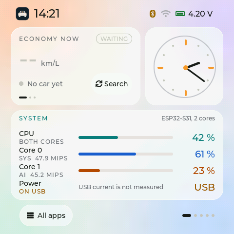</p>

*Home, light theme, before a car is connected. Host render of the 2.0.0 screen code with example values.*

- **Status bar:** the time, Bluetooth, Wi-Fi and the battery voltage (4.20 V here). Inside an app it also shows CPU, AI, MIPS (millions of instructions per second) and the power source.
- **Economy:** your fuel economy while you drive. Before a car connects it says "No car yet" and offers Search.
- **Clock:** an analogue clock. It shows the right time once you set the clock (see Settings).
- **System:** how busy each of the two cores is, in % and MIPS, and the power source. "USB current is not measured" is expected.
- **All apps:** opens the app pages.

### The orange key is Home

Press the orange Function key once to go to Home from any app. If the screen is off, the same press wakes it first. If a critical-fault banner is showing, the press clears the banner.

A press counts when you let go within 1 second. A longer hold does nothing.

### Before the first drive

1. Check that Settings > FIRMWARE AND BOARD shows OpenCarMind EdgeOS 2.1.0.
2. Wait about a minute after the start. The top right of the Board page then says "Parked, health good" in green. See [Health checks and messages](#os) if it says something else.
3. Check that Settings > MODEL shows R.E.V.
4. Set the clock. Join Wi-Fi, or use Settings > Set clock. The clock line then says "From Wi-Fi" or "Set by hand".
5. Open Files and check that the storage bar shows the 128 MB NAND.
6. Plug the adapter into the OBD-II port and switch the ignition on. The first time, the board asks before it pairs (see below). Tap Use this adapter.
7. Within about a minute the Drive app shows speed and rpm. If it does not, open Settings > OBD ADAPTER and tap Find OBD adapter.

### Pairing your OBD adapter

The board pairs with one adapter, and after that it connects to it by itself. It never saves an adapter without asking you.

1. Plug the adapter in, switch the ignition on and keep the board in the car, near the adapter.
2. The board offers only an adapter with a strong signal, -70 dBm or better. An adapter in a car parked next to yours is usually weaker, so it is not offered.
3. When an adapter answers, a sheet asks "OBD adapter found: &lt;name>, signal strong. Use this adapter?" A weaker one says "signal good". Under it you see "Nothing is saved unless you choose." and the seconds left.
4. Tap Use this adapter. The events say "OBD adapter paired: &lt;name>".

- **Not this one:** the board skips that adapter until its next start
- **No answer in 30 s:** nothing is saved, and the events say "OBD adapter not paired". The board does not offer that adapter again until you tap Find OBD adapter or restart.
- **Switching to another adapter:** open Settings > OBD ADAPTER and tap Find OBD adapter. For the next 90 s the board offers a new adapter with a strong signal, even though one is paired. The automatic search never replaces your paired adapter.
- **At the edge of range:** once paired, your adapter also connects at a weaker signal, down to -90 dBm

This pairing sheet is new in 2.0.0. It is built and checked on a computer, not yet tested on the board.

### When the adapter looks different, or asks to pair again

After pairing, the board remembers a fingerprint of your adapter: its name, what it advertises, its serial line and its answers to two identity questions. It keeps no VIN and shows no address. Two more questions can then appear, in the same sheet as the pairing question, with 30 s to answer.

- **"This adapter looks different. Use it?"** The adapter at your adapter's address does not match the fingerprint. Under the question you see "Its data is kept apart until you choose." The drive is still logged but marked, and the learning gets none of it.
  - **Use it:** the board learns this adapter as yours. Tap it after a firmware update of the adapter, for example.
  - **Not this one:** the link is dropped, and the board leaves that address alone for 10 minutes.
  - **No answer:** the data stays apart until the link ends. The next link is checked again.
  - **While driving** the link is never cut and the question waits until you park.
- **"The adapter asks to pair again. Allow?"** Your adapter refused the saved key and wants a new one. That is normal after an adapter reset, and suspicious otherwise. No data flows while the question is open.
  - **Allow:** the new key is kept and the board goes on.
  - **Don't allow, or no answer:** the old key stays, the link is dropped, and the board waits 10 minutes.
  - **While driving** the board refuses at once, keeps the link and marks the rows. The events say "Re-pair refused (driving)".

These two questions are built and checked on a computer, not yet tested on the board.

<a id="nav"></a>

## The launcher, apps and Back

The launcher has Home and 17 apps on five more pages, four tiles per page. Health sits right after Board, and Settings is alone on the last page. Swipe left or right between pages and tap a tile to open its app.

<p>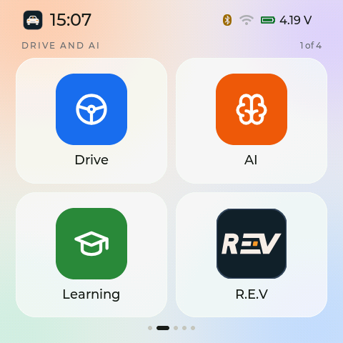 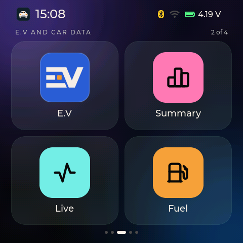</p>

*Left:* Page 1 of 4, Drive and AI. Light theme. *Right:* Page 2 of 4, E.V and car data. Dark theme.

### The pages, in the default order

- **Page 1:** Drive, AI, Learning, R.E.V
- **Page 2:** E.V, Summary, Live, Fuel
- **Page 3:** Brakes, Trip, Engine, Faults
- **Page 4:** Board, Files, Wi-Fi, Settings

You can change the order in Settings. Every app always stays on the launcher.

### Leaving an app

- **Back** is the round arrow at the top left. It is drawn as a 44 px circle. Its touch area is 104 px wide and reaches from the screen corner down to the first card, so a thumb from the corner always hits it.
- **Swipe down** to leave the app.
- **Swipe left or right** inside an app to step to the next or previous app.
- **Press the orange key** to go to Home.

### Smart swipe and Smart UI

Two small helpers try to make the screen feel faster. Smart swipe guesses where a launcher swipe is going and gets the next picture ready. Smart UI starts building an app the moment your finger lands on its tile, instead of when it lifts. Neither one ever moves a page by itself.

Each helper measures your real use. It stays on only if it makes the screen faster, and switches itself off otherwise. In 2.0.0 one shared test in the firmware judges both helpers with the same rule. A new board, or a board that just got new firmware, has no verdict yet, so the helpers wait until they have one. Settings shows how Smart swipe's test is going.

<a id="apps"></a>

## All 17 apps and what their numbers mean

Every number carries its unit. Two dashes (--) mean there is no value yet, usually because no drive is running. The board captures were taken on a bench with no car connected, so most of their values are dashes. The host renders show example values from a drive.

### Drive

<p>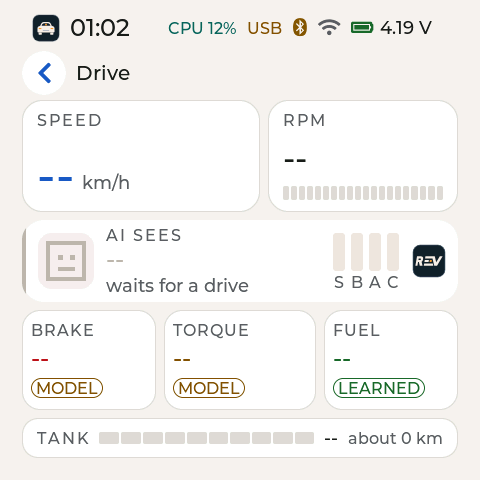</p>

*Drive, light theme, with R.E.V in use, before a car is connected.*

The live view for the road.

- **Speed:** road speed in km/h
- **RPM:** engine speed, with a bar
- **AI sees:** the model's call on the last few seconds. Its four bars are S (stopped), B (braking), A (accelerating) and C (cruising). A mark at the right shows which model is in use.
- **Brake, Torque, Fuel:** the model's three estimates. A tag says where each number comes from. MODEL is the model's estimate. LEARNED is a fuel figure R.E.V has learned in your car, shown only while R.E.V is in use.
- **Tank:** the fuel level as a bar, and the range in km
- **End drive:** hold it for 1 second. The drive ends and the Summary opens.

### AI

<p>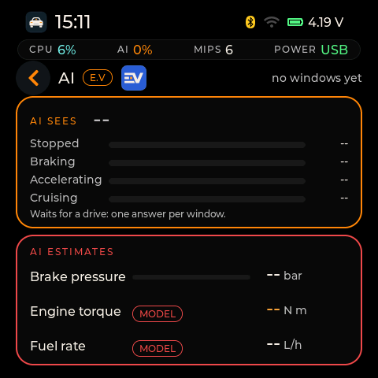</p>

*AI, dark theme, with R.E.V in use, before the first window.*

What the model in use sees, in more detail.

- **AI sees:** one bar each for Stopped, Braking, Accelerating and Cruising. The model gives one answer per window, a short slice of the drive. "No windows yet" means it has had no driving to look at.
- **Brake pressure:** estimated brake pressure in bar
- **Engine torque:** estimated engine torque in N m
- **Fuel rate:** estimated fuel use in L/h (litres per hour)

### Learning

<p>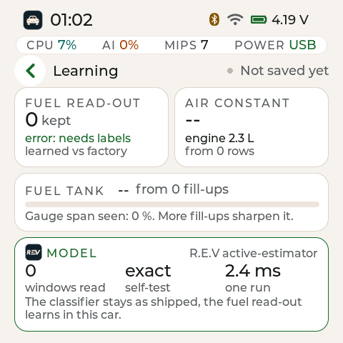 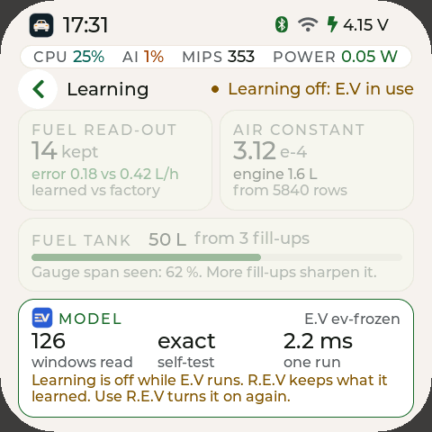</p>

*Left:* Learning with R.E.V in use, on a new board: nothing learned yet. *Right:* Learning with E.V in use. Learning is off. Host render of the 2.0.0 screen code with example values.

What R.E.V has learned in your car so far.

- **Fuel read-out:** how many learned updates R.E.V has kept for its fuel figure, and how it compares with the factory figure
- **Airflow constant:** a number R.E.V learns from your engine, shown as an engine size in litres, and how many rows it came from
- **Fuel tank:** the tank size learned from your fill-ups, and how much of the fuel gauge's range it has seen. More fill-ups make it sharper.
- **Model:** the model in use, the windows it has read, its self-test result and the time for one run in ms
- **Saved:** the top right says "Saved on the board" or "Not saved yet"

While E.V runs, the cards are dimmed and the page says "Learning off: E.V in use". R.E.V keeps what it learned.

### R.E.V and E.V

<p>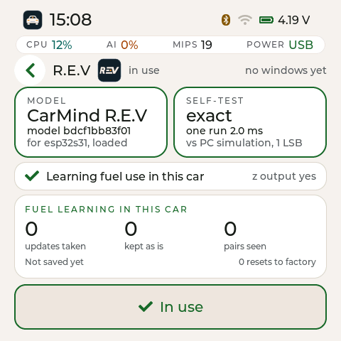 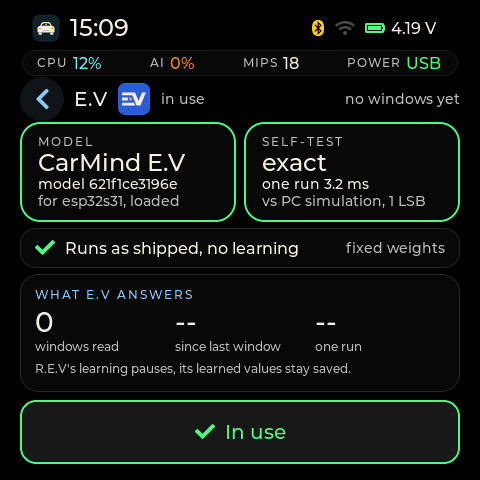</p>

*Left:* R.E.V, in use, on a new board. *Right:* E.V, dark theme, while R.E.V is in use.

One app per model, side by side on the launcher. Each shows the model's name, its file, its self-test and its own figures. The file shows by name: "active-estimator" for R.E.V and "ev-frozen" for E.V.

- **Self-test:** at start the board checks the model against known answers. "exact" means it matched. "One run" is how long one answer takes.
- **R.E.V figures:** fuel learning in this car: updates taken, updates kept as is, pairs seen and resets to factory
- **E.V figures:** what E.V answers: windows read, time since the last window and one run. E.V runs as shipped, with no learning.
- **Use button:** a 64 px "Use R.E.V" or "Use E.V" button. It reads "In use" for the model running. It works only while parked (see The two models).

### Summary

<p>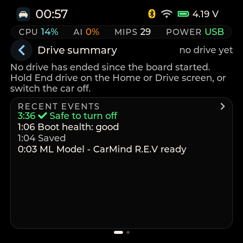</p>

*Summary before the first drive, dark theme.*

The last drive, and the board's events.

- **The drive:** distance, time, economy and the hard-brake count
- **Charts:** a speed and fuel chart, and what the AI saw every 10 seconds
- **History:** charts of the last drives, oldest at the left: L/100 km and km per drive
- **Recent events:** the board's event list, newest first. Errors are red, warnings amber, and "Safe to turn off" is green.

**The events log.** Tap the events card to open the full list. Filter it with the chips All, Warnings, Errors, Wi-Fi and Drive. Tap a row to open its detail. The list keeps the newest 10 events since the board started. Each drive also keeps its own newest 24 events in its files, so the Drive filter still shows them after a long drive or a restart. The health check and the battery protection write their messages here too (see [Health checks and messages](#os)).

After a restart the Summary shows the last drive again, read back from its files. The charts are not kept.

### Live

<p>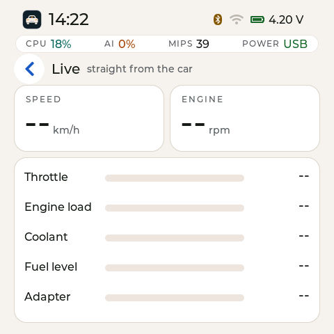</p>

*Live, light theme, during a drive. Host render of the 2.0.0 screen code with example values.*

Values straight from the car, with no model in between.

- **Speed, Engine:** road speed in km/h and engine speed in rpm
- **Throttle:** how far the throttle is open, in %
- **Engine load:** how hard the engine is working, in %, as the car reports it
- **Coolant:** engine coolant temperature in °C
- **Fuel level:** the tank level the car reports, in %
- **Adapter:** the voltage the adapter measures at the OBD-II port, in V
- **Row rate:** how many rows per second the board logs, in Hz, or "no data"

### Fuel

<p>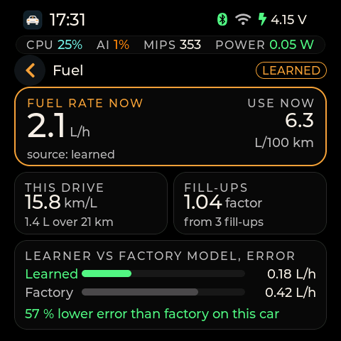</p>

*Fuel, dark theme, with R.E.V in use. Host render of the 2.0.0 screen code with example values.*

Fuel use now and for this drive, and how your fill-ups correct it.

- **Source tag:** top right: where the fuel figure comes from. NO SOURCE means there is none yet.
- **Fuel rate now:** fuel use in L/h
- **Use now:** the same figure as economy, in L/100 km
- **This drive:** economy for this drive in your chosen unit (km/L here)
- **Fill-ups:** the correction factor from your fill-ups. 1.00 means no correction yet.
- **Learner vs factory:** how far R.E.V's learned fuel figure and the factory figure are from the car's own reading. It is off while E.V runs.

### Brakes

<p>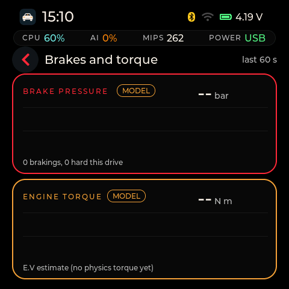</p>

*Brakes and torque, dark theme, after a minute of driving. Host render of the 2.0.0 screen code with example values.*

The app title reads "Brakes and torque". Two traces cover the last 60 s.

- **Brake pressure:** the model's estimate in bar, with the count of brakings and hard brakings this drive
- **Engine torque:** the estimate in N m. The tag says MODEL for the model's estimate, or PHYSICS when the board works torque out from the fuel and the engine size R.E.V learned.
- **Source line:** the line under the torque trace names the source, for example "E.V estimate (no physics torque yet)"

### Trip

<p>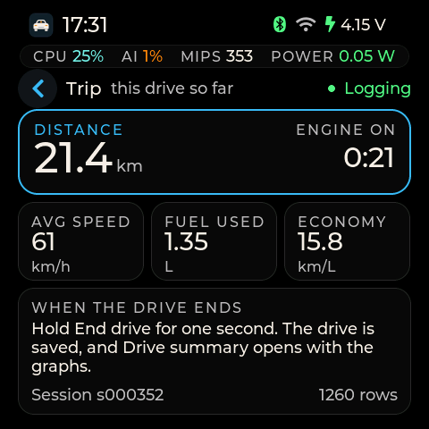</p>

*Trip, dark theme, during a drive. Host render of the 2.0.0 screen code with example values.*

This drive so far. The top right says "Logging" during a drive and "Not in a drive" between drives.

- **Distance:** km driven this drive
- **Engine on:** how long the engine has run
- **Avg speed:** average speed in km/h
- **Fuel used:** litres used this drive
- **Economy:** this drive's economy, in your chosen unit
- **Session:** the drive's number (sNNNNNN) and how many rows it has logged
- **When the drive ends:** a reminder: hold End drive for 1 second, and the Summary opens with the graphs

### Engine

<p>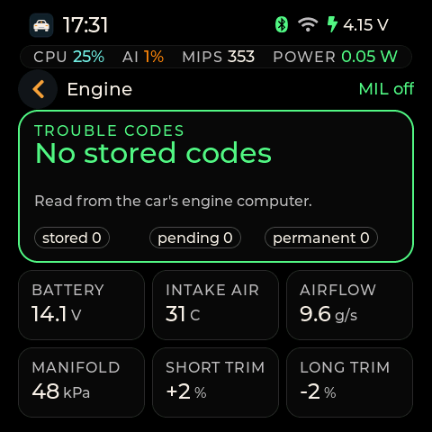</p>

*Engine, dark theme, during a drive. Host render of the 2.0.0 screen code with example values.*

The engine computer's own sensor readings.

- **Trouble codes:** the count of stored, pending and permanent codes, read once the car answers. The top right shows the MIL (check-engine light) state.
- **Battery:** the car's battery voltage in V
- **Intake air:** intake air temperature in °C
- **Airflow:** the airflow sensor reading in g/s
- **Manifold:** intake manifold pressure in kPa
- **Short and long trim:** the engine computer's fuel corrections in %

### Faults

<p>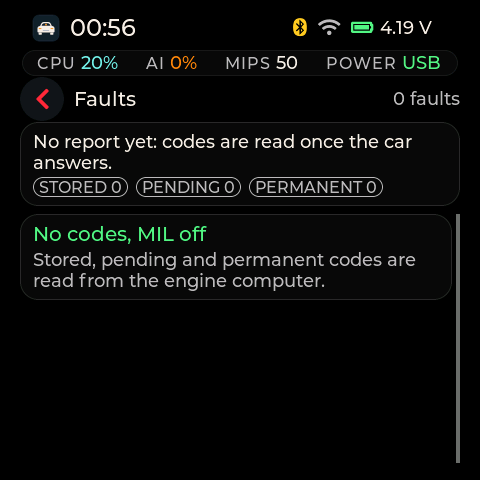</p>

*Faults, dark theme, no codes.*

The trouble codes from the engine computer, in three kinds.

- **Stored:** confirmed faults
- **Pending:** faults seen once but not confirmed yet
- **Permanent:** codes the car keeps until its own checks pass
- **Status line:** "No codes" or the code count, and the MIL state

The board ranks the codes by severity and groups codes that share a cause, so several codes from one problem show together. See Alarms and faults.

### Board

<p>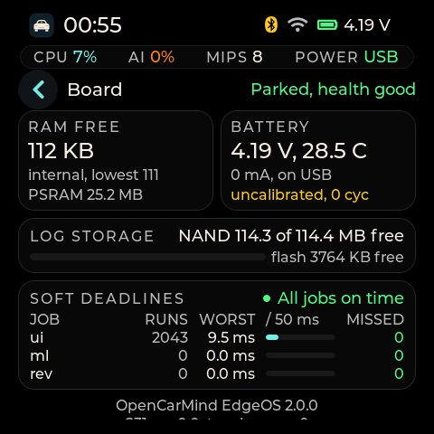</p>

*Board, dark theme, parked with health good.*

The board's own health, for checks and bug reports. The page scrolls: the RAM and battery cards, log storage and the first deadline rows fill the screen, and the rest of the table and the footer follow below.

- **Firmware:** the firmware version, and the chip with its revision ("S31 rev" and a number)
- **RAM free:** free internal memory in KB, the lowest it has been since start, and free PSRAM in MB
- **Battery:** the cell's voltage in V, its current in mA, "on USB" or "on battery", and the temperature the fuel gauge measures, in °C. The line below says "uncalibrated" with the charge cycle count until the gauge is set up for this cell. It shows a battery protection state instead when one is active (see [Health checks and messages](#os)).
- **Log storage:** free space on the NAND in MB, and on the flash in KB
- **Soft deadlines:** the scheduler's job table: each job's runs, its worst run and how many times it missed its deadline. "All jobs on time" means no misses.
- **Touch errors:** how often the touch controller failed to answer
- **Header:** at the top right, the board state and its health, for example "Parked, health good". Green means good, amber degraded, red bad. During the first minute after a start it says "health pending". [Health checks and messages](#os) explains it.
- **Footer:** two centred lines at the end of the scroll: the firmware version and the touch errors

### Health

<p>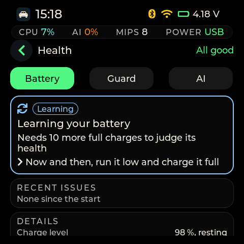 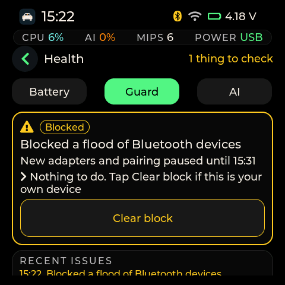</p>

*Health on the board: the Battery page while it learns the cell (left), and the Guard page in a test state that shows a block (right).*

Health shows how the board itself is doing, on three pages. Tap **Battery**, **Guard** or **AI** under the title to switch pages. Swipe left or right to go to the next app, as everywhere. Nothing on this app changes a setting. The one button, **Clear block**, appears only while the guard is blocking.

**The header** counts what needs you: "All good" in green, or "1 thing to check" and "2 things to check". The count is amber when the worst one can wait and red when it needs you now. Learning and slowing down on purpose are not counted.

**The status card.** Each page opens with one card:
- A colour, an icon and a word: green "Good", blue "Learning" (or "Starting", "Slowed"), amber "Check soon", red "Act now". The word is there so you do not have to rely on the colour.
- A headline, for example "Battery is healthy".
- One line on what it means, for example "Holds 98 % of its rated charge".
- One line on what to do, or "Nothing to do".

**Recent issues.** The last five issues of the page with their time, newest first, and the line that says when one ended, for example "Block lifted". It says "None since the start" until there is one. The list starts again after a restart.

**Details** below the card are for checks and bug reports. Scroll down to see them all.

**Battery: what the card can say**

| Card | What it means | What to do |
|---|---|---|
| Battery is healthy | Holds 98 % of its rated charge (counted on a full charge), or "about 97 % of its starting charge" from the small model | Nothing |
| Learning your battery | It needs n more full charges to judge its health | Now and then, run it low and charge it full. A charge counts when it starts below about 3.6 V and ends full. A top-up does not count |
| Battery is wearing out (amber) | It holds less than 80 % of its charge, so it runs shorter on battery | Plan to replace the cell |
| Battery is worn out (red) | It holds less than 70 % | Replace the cell soon |
| Battery warms up more than usual (red) | It runs warmer than its load explains | Let it cool, keep it out of the sun |
| Battery loses charge while resting | Its voltage falls with nothing drawing power | If it keeps happening, replace the cell |
| Battery current reading looks wrong | A current shows while the board rests | Check the battery connector |
| Voltage drops more under load | The battery's resistance went up | If it keeps happening, replace the cell |
| Board draws more power than usual | The battery empties faster than it learnt | Check what is plugged into the board |
| Connection to the battery glitches | Some battery readings jump or go missing | Check the battery connector |
| Battery charge reading drifts | The charge level and the voltage disagree | Charge it fully once so it can reset |

The last seven come from the anomaly detector. It learns your cell's normal for 24 hours, then looks at nine things once a minute. When it raises an alarm, the card names the one that looks most unusual. It never switches anything off.

Battery details: the charge level and mode (resting, on battery, charging, topping up), the current ("resting, 0 mA", "charging +12 mA" or "on battery -118 mA"), power and temperature, the health estimate and where it comes from, the resistance against its first value, the unusual-behaviour check ("learning, 3.2 of 24 h", "normal" or the alarm), its score against the alarm level, and the detector's last message.

**Guard: what the card can say**

| Card | What it means | What to do |
|---|---|---|
| Learning this place (1.2 of 2 h) | The first two hours after a start | Nothing. It blocks nothing yet |
| No threats seen | Watching Bluetooth and Wi-Fi around the car | Nothing |
| Blocked a flood of Bluetooth devices (amber) | New adapters and pairing paused until 14:12 | Nothing. Tap Clear block if this is your own device |
| Blocked a flood of Wi-Fi networks, or a Wi-Fi disconnect attack (amber) | Clock sync over Wi-Fi paused until 14:12 | The same |
| An adapter that looks like yours behaved differently (amber) | Its data is kept out of learning | Check that the adapter in the car is yours |
| Car link answers slower than usual | Its data is kept out of learning | Nothing |
| Saw a flood of ... | Blocking is off in Settings, so nothing was paused | Turn on blocking in Settings to pause it |

Guard details: the mode, adapter checks, re-pair requests refused, clock jumps refused and blocks today, one score bar per check (Bluetooth, car link, Wi-Fi, the mark is the limit, "no data" when the check has nothing right now), and the guard log with its last three messages. The first Wi-Fi scan after a start has nothing to compare with, so it is not scored.

**AI: what the card can say**

| Card | What it means | What to do |
|---|---|---|
| All AI features on time | Battery and guard checks run in the background | Nothing |
| Board busy: AI features slowed (or paused) | Keeps the screen and the drive log smooth | Nothing |
| AI features mostly on time | n runs finished late since the start | Nothing |
| Some AI features are off (amber) | One of them did not pass its start check | Restart the board once |
| AI features starting | They start once the board has booted well, about a minute after a start | Nothing |

AI details: the degradation ladder, the worker's core, and one card per feature (Battery charge, Battery check, Network guard) with its runs, late runs and skipped runs, "worst time 12.9 ms (limit 1,000 ms)", the longest a run took from its start time to its end, against its deadline, and "work per run 0.23 ms (budget 2 ms)", the longest a run computed, against its time budget.

**The banner.** When a battery wear, a battery alarm, a guard block or an adapter question starts, the banner shows "Check soon" or "Act now", the headline and **Open Health**. Tap it to open the right page. Swipe it away to just close it. While you drive, amber issues only go into the list, and red ones show for 10 seconds. On Home, the Health icon gets an amber or red dot while an issue is active.

### Files

<p>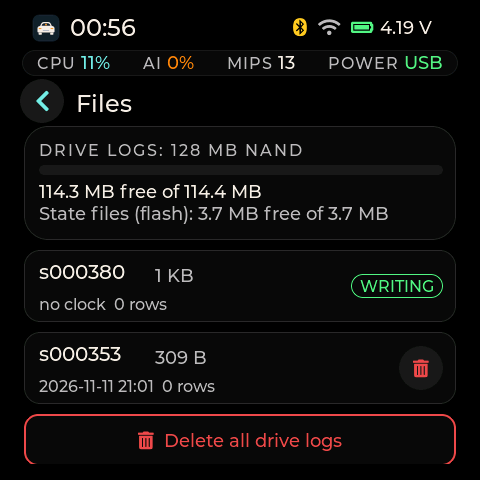</p>

*Files, dark theme, with the drive logs on the 128 MB NAND.*

The drive logs on the board.

- **Storage:** free space on the drive store
- **Each drive:** its session number, size, rows and date. "no clock" stands in for the date when the clock was not set during that drive.
- **WRITING:** the drive being written now. You cannot delete it.
- **Delete:** the bin button. A confirm sheet always asks first.
- **Delete all:** removes every drive log. It asks twice, because you cannot undo it.

### Wi-Fi

<p>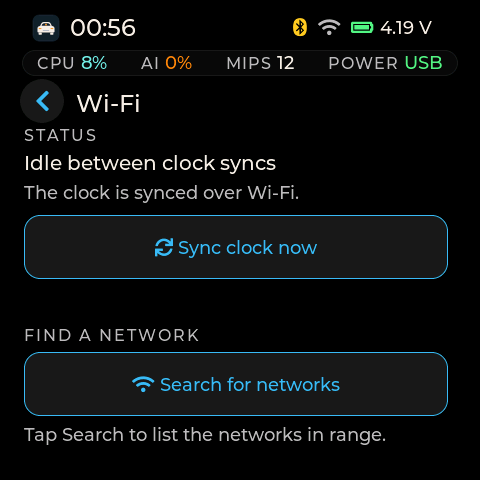</p>

*Wi-Fi, dark theme, idle between clock syncs.*

Search, join and the clock sync. The radio is off unless one of these is running.

- **Status:** what Wi-Fi is doing, and whether the clock has been synced over Wi-Fi
- **Sync clock now:** sets the clock now from a saved network. With none saved it says "No saved network yet: search and join one first."
- **Search for networks:** lists the networks in range so you can join one
- **Saved networks:** the networks the board knows (up to 8), each with Forget. The note under the list says "The board uses them only to set its clock."

[Wi-Fi](#wifi) covers searching and joining.

### Settings

<p>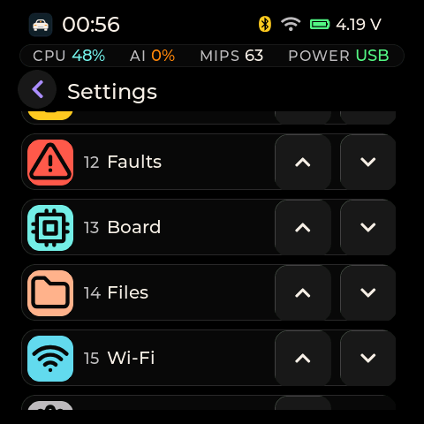</p>

*Settings, dark theme: the Home apps order.*

One scrolling list of everything you can change.

- **Look:** brightness and the theme (Auto, Light or Dark)
- **Model:** R.E.V or E.V, switched only while parked
- **Clock:** where the time came from, and Set clock
- **Units:** economy in km/L or L/100 km
- **Screen:** screen off after a time, and the order of the apps
- **OBD adapter:** Find OBD adapter and Forget adapter
- **Storage:** Format storage
- **Firmware:** the version, the chip, the flash and PSRAM size

[Settings](#settings) goes through each one.

<a id="settings"></a>

## Settings in detail

Every control is at least 64 x 64 px. A tap shows the new choice at once. The board saves when you stop tapping: 500 ms after the last change, and at most 3 seconds after the first.

### Brightness

A slider from 10 to 100 %. On an AMOLED the brightness is a command to the panel itself. There is no backlight.

### Theme

Auto, Light or Dark, for Home and every app. Auto is light from 06:00 to 17:00 once the clock is set, and dark at other times. With no clock set, Auto stays dark.

A theme change redraws the screen once, so it pauses for a moment. The change waits while the Wi-Fi password page or the clock picker is open.

### Model

R.E.V or E.V. The line below names the model in use, its file and its self-test, for example "CarMind R.E.V active-estimator, self-test exact." A switch works only while parked. If the board refuses a switch, the line starts with "Not switched" and gives the reason. See The two models.

### Clock

The clock line shows the time and date and where the time came from: "Not set", "Estimated, not synced", "Set by hand" or "From Wi-Fi".

Tap Set clock to open the picker. It has day, month, year, hour and minute rollers and a time zone list. Back cancels. During a drive the board refuses a new time and says "A drive is active. End the drive first, then set the clock."

### Economy units

km/L or L/100 km. This changes only how economy is shown.

### Screen off after

Never, 10 s, 20 s or 60 s without a touch. A touch or the orange key turns the screen back on.

### Home apps order

Each app has Up and Down buttons that move it one place. The launcher follows the list. You cannot hide an app.

### OBD adapter

Find OBD adapter searches for the adapter again. For 90 s it also offers a new adapter with a strong signal, so you can switch. Forget adapter drops the saved one. Either way, the board asks before it pairs (see Pairing your OBD adapter in [Getting started](#start)).

### Smart swipe

A status line shows how Smart swipe's test is going, and its verdict once it has one. It keeps itself only if it makes swipes faster.

### Network guard

Network guard: blocking on or off. On by default. With blocking on, the guard acts after its two-hour shadow. With blocking off it still watches and writes "would block" into the events, but changes nothing. [Health checks and messages](#os) says what a block does.

### Storage and firmware

Format storage erases the drive store after a confirm sheet (see Storage and power). It works only while parked or in safe mode. FIRMWARE AND BOARD shows the version, OpenCarMind EdgeOS 2.1.0, with the chip, the flash and PSRAM size and the board name.

<a id="wifi"></a>

## Wi-Fi sets the clock, and nothing else

The board has no battery-backed clock chip, so Wi-Fi is how it learns the time. While the car is parked, it asks one HTTPS time server for the date and sets the clock. It sends nothing else. Drives come over the USB cable. There is no Wi-Fi upload.

> [!NOTE]
> **The radio runs only while you use it**
>
> Wi-Fi starts for a clock sync, a search or a join, and stops when that ends. A sync never starts during a drive. If one is running when a drive starts, it stops. This keeps memory free for the Bluetooth link to the adapter.

> [!NOTE]
> **No Wi-Fi in the first minute after a start**
>
> The first minute after a start is when the board has the least memory to spare, so it keeps Wi-Fi off until its health check ([Health checks and messages](#os)). When the check says good or degraded, the automatic clock sync goes ahead. If the clock is not set yet, the first sync follows about 20 seconds later. When the check says bad, Wi-Fi stays off until you start it, and the events say "Wi-Fi held (boot health bad): start it in Wi-Fi". Sync clock now, Search for networks and Join always work, at any time while parked.

### Search and join

1. Open Wi-Fi and tap Search for networks. The board lists up to 20 networks, strongest first, with signal bars and a padlock on secured ones.
2. For a secured network, tap it, type its password on the on-screen keyboard (8 to 64 characters, the eye shows what you typed), then tap Join.
3. For an open network, tap it. A confirm sheet warns that it has no password and that anyone nearby can read what it carries. Tap Join.
4. The board saves the network (up to 8), connects once and says what happened: connected, wrong password, or can't reach it.

The board does not keep a wrong password for a new network. Network names show on the screen only and never in the board's log.

### A network you saved before

In the search list it reads "Saved, secured" or "Saved, open". Tap it. The Join page opens with "Saved password" in the field, so you do not type it again. Tap Join. To change the password, type a new one first.

To remove a network, tap Forget next to it under Saved networks. During a drive the board refuses and says "Not forgotten: a drive is running." The desktop app can add networks too.

### Networks it cannot join

Enhanced-open (OWE) networks show as secured and ask for a password. WEP and WPA-TKIP-only networks end with "Can't join: the board does not support this network's security type."

<a id="models"></a>

## CarMind R.E.V and CarMind E.V

OpenCarMind EdgeOS carries both on-board models. Both answer the same questions: what you are doing (stopped, braking, accelerating or cruising) and the three estimates (brake pressure, engine torque and fuel rate). One model runs at a time.

### CarMind R.E.V, the default

R.E.V learns in your car. It corrects its fuel figure from what your car reports while you drive. It also learns an airflow constant that gives your engine size. The rest of the model stays as shipped. The board saves what it learned.

### CarMind E.V

E.V is fixed. It runs as shipped and never learns. While E.V runs, learning is off and the Learning app says so. What R.E.V learned stays saved, and switching back to R.E.V turns learning on again.

### Switching models

Switch only while parked. All three ways do the same thing:

- tap Use R.E.V or Use E.V in the model's app
- open Settings > MODEL and tap R.E.V or E.V
- use the model switch in the desktop app

During a drive the board refuses and says "A drive is active. End the drive first, then switch models." When the car's computer answers but no drive is recorded yet, it says "Not now: the car link is up. Try again later." While the board only searches for the adapter or connects to it, it stays Parked and the switch works. The board keeps your choice after a restart. Every model mark and name on the screen follows the model in use.

### The board checks that a model fits

A model has to give its answer within 1 second, while the board also reads the car and R.E.V learns. Before it loads a model, the board takes the model's measured run time from its self-test, doubles it for safety, and checks that every job on that core still finishes on time. If one would not, the board keeps the model it has and says, for example, "Not switched: CarMind E.V refused: ml would miss its deadline." Here "ml" is the name of the model's job.

You should not see this with the two models that ship. Measured on the board, OpenCarMind EdgeOS 2.0.0 4aeff43: the check gave R.E.V a worst case of 4.2 ms against its 1,000 ms deadline.

<a id="os"></a>

## The board looks after itself

OpenCarMind EdgeOS is the layer of the firmware that decides what may run and when. It runs by itself. This section explains what it shows you and what to do about it.

### The health check

About a minute (65 s) after every start, the board rates itself. It looks at the model's self-test, the storage check, the drive store, the first screen update, the touch controller and the job deadlines.

- **Good:** everything passed. Green on the Board page.
- **Degraded:** the board runs, but something is off. Amber. The events list names the reason, for example "Boot health: degraded: NAND not mounted".
- **Bad:** the screen never updated, or the board started in safe mode after three crashes in a row. Red.
- **Pending:** the first minute, before the check

The result shows at the top right of the Board page, for example "Parked, health good", and in the events list as "Boot health: good".

### What a degraded reason means

- **model self-test differs, model self-test not run:** the model did not match its known answers at start. Note it and send the Board page.
- **flash FAT repaired, flash FAT audit warning:** the board fixed or found a problem in its flash files at start. Your data is still there.
- **flash FAT not mounted, NAND not mounted:** a store did not open. See Troubleshooting.
- **touch failing:** the touch controller did not answer at start
- **deadline misses, job stalls, not schedulable:** a job was late, stopped, or would not fit in time
- **UI slow to start:** the first screen update took more than 15 s

### Board states

The board is always in one or more of these states. The Board page shows the main one.

- **Boot:** the first seconds after a start, until start-up has finished
- **Parked:** none of the others. Everything is allowed.
- **Driving:** a drive is being recorded, or the car's computer answers and the board logs rows. Searching for the adapter, connecting to it, or an adapter in a parked car with the engine off keep the board Parked.
- **Safe:** the board started in safe mode after three crashes in a row. Logging stays on, the model and R.E.V's learning stay off.
- **Update:** a restart, a firmware download or Format storage is running
- **Saving:** the battery is too warm, so the board saves power. The screen dims, Wi-Fi waits and R.E.V's learning pauses. The board goes back to Parked by itself when the battery has cooled. See Battery protection below.

Each action is allowed only in some states. If several states hold at once, the action has to be allowed in all of them.

| Action | Allowed when | Refused when |
|---|---|---|
| Switch models | Parked | Boot, Driving, Safe, Update, Saving |
| Format storage | Parked, Safe | Boot, Driving, Update, Saving |
| Set the clock by hand | Parked, Boot, Safe | Driving, Update, Saving |
| Wi-Fi: search, join, forget, clock sync | Parked, Boot, Safe | Driving, Update, Saving |
| Desktop app commands over USB, after pairing | Parked, Boot, Safe | Driving, Update, Saving |
| R.E.V's learning | Parked, Boot, Driving | Safe, Update, Saving |

### Messages when an action has to wait

- **"A drive is active. End the drive first, then switch models.":** a drive is being recorded. The same message ends with "set the clock" or "format" for those actions. Hold End drive, or switch the engine off and wait for the drive to end.
- **"Not now: a drive is running. Try again later.":** the same reason for the clock sync, Format and other actions. Wait until the drive ends.
- **"Not now: the car link is up. Try again later.":** the car's computer answers, but no drive is recorded yet. Switch the engine off, or wait for the drive to end.
- **"Not now: the board is starting. Try again later.":** start-up has not finished. Try again a few seconds later.
- **"Not now: an update or format is running. Try again later.":** wait for the format or the restart to finish
- **"Not now: safe mode is on. Try again later.":** the board is in safe mode. Restart it. If it stays in safe mode, send the Board page and the events.
- **"Not now: the board is saving power. Try again later.":** the battery is warm. Let the board cool down. If you tap Sync clock now while the board saves power, the sync waits until the battery has cooled.
- **"Not forgotten: a drive is running.":** Forget for a Wi-Fi network waits until you park
- **"ERR busy: ..., try again when parked":** the board answers the desktop app with this during a drive

### When the model falls behind

If the model starts missing its 1-second deadline, the board gives up comfort before function. It takes one step every 10 seconds while the misses go on:

1. The screen draws half as many frames. Events: "Model deadlines: UI slowed".
2. R.E.V's learning pauses. What it learned is kept. Events: "Model deadlines: learner paused".
3. The model pauses. The same model stays loaded. Events: "Model deadlines: model paused".

A minute without misses takes one step back, and the events say so. The last step is undone only when you park, so the model does not go on and off during one drive. The board never switches to the other model by itself.

### Battery protection

Every 2 seconds the board reads the cell's voltage, current and temperature from its fuel gauge. The temperature comes from the gauge chip next to the cell, not from the cell itself.

- **"Battery hot (45.0 C on USB): load shed":** at 45 °C on USB power, Wi-Fi and R.E.V's learning stop, the screen dims and changes wait. "Battery cooled" follows at 42 °C.
- **"Battery too hot (60 C): stopped":** at 60 °C the board saves its logs and stops writing. After 30 seconds at 57 °C or below it restarts by itself.
- **"Battery over-voltage (4250 mV): charger fault, stopped":** the cell reached 4.25 V or more, which points to a charger fault. The board saves and stops until you restart it. Unplug it and have the board checked.

These limits are placeholders until the cell's datasheet is known. The board cannot stop or limit charging: the charger has no control line. A cell kept full in a hot car ages faster, so keep the board out of direct sun.

### One safe restart

Every restart the firmware asks for, such as the restart after Format storage or the firmware download door, takes the same path. It saves and closes the flash files and the drive store first, then restarts. The next start writes in its log which requested restart ended the last run.

### Faster screen drawing

The chip has a pixel accelerator and a 2D copy engine. OpenCarMind EdgeOS uses them to copy the page pictures while you swipe and to fill large areas of the screen. If an engine fails three times in a row, or its start-up test does not match the processor's result, the board turns that engine off until the next start and draws with the processor instead.

On the board (OpenCarMind EdgeOS 2.0.0 4aeff43) both engines stayed on with no failures. How much faster the screen draws is not yet verified on the board.

### The network guard

The guard watches the radio traffic the board already receives. It counts Bluetooth adverts, the car link's response times and what a Wi-Fi round sees, and it never stores an address or a network name. For the first two hours after a start it only learns ("shadow").

A block means:
- no new adapter is offered and a re-pair request is refused without asking you,
- the Bluetooth scan listens to your paired adapter only,
- a Wi-Fi round stops before it sets the clock, and the clock is kept,
- rows are kept out of the learning while the block runs.

A block never cuts the car link, never sends anything, never pairs on its own and never changes the clock. It lifts by itself 10 minutes after the last suspicious window. You can end it with **Clear block** in Health.

The messages:
- **"Network guard: shadow over, now watching"**: the two hours are over.
- **"Network guard blocking: radio flood nearby (p1a2b)"**: many new Bluetooth addresses that each appear once, as an attack tool makes them. The code after "p" is a short pattern number, not an address.
- **"Network guard blocking: Wi-Fi beacon flood"** or **"Wi-Fi deauth attack"**: the Wi-Fi round stopped.
- **"Clock kept: network guard, ..."** and **"Wi-Fi round stopped: network guard, ..."**: the round stopped because of a block. Run Sync clock now later, or clear the block first.
- **"Network guard would block: ..."**: during the shadow, or with blocking off.
- **"Network guard: block lifted, 10 min clean"** and **"block cleared by the user"**.
- **"Car link slower than usual: rows kept out"**: the car link answers much slower than its normal, which can mean a relay between the car and the board. It is a note only: the drive goes on, and the rows are kept out of the learning until **"Car link timing normal again"**.

<a id="alarms"></a>

## A banner for what is urgent, an app for the rest

### The critical-fault banner

<p>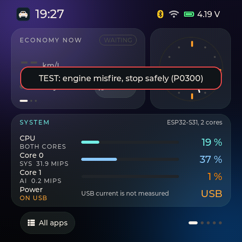</p>

*A critical alarm on Home, dark theme, for an example fault (P0300). Host render of the 2.0.0 screen code with example values.*

A critical fault shows as a red-edged banner across the top of the screen, over any app. Its headline is 32 px text, so you can read it at a glance.

To clear it, tap the banner, swipe up or sideways on it, or press the orange key. The swipe does not move the page underneath. The fault itself stays in the Faults app and on the Home card.

### Other faults

Faults that are not critical never pop up. They show in the Faults app and on the Home card. The Faults app ranks every code by severity and groups codes that share a cause.

### The Health banner

When a new health issue starts, the same banner shows it with an amber edge ("Check soon") or a red one ("Act now"), the plain headline, for example "Battery is wearing out", and **Open Health**. Tap it to open Health on the right page. Swipe it up or sideways, or press the orange key, to just close it. It shows for a battery that wears out, a battery alarm, a guard block and an adapter that looks different. While you drive, amber issues only go into Health's recent list, and red ones show for 10 seconds so they never stay over the Drive screen. When the issue ends, its banner goes too.

### The green banner

When you pair the desktop app, the 6-digit pairing code shows in a green banner, because you need to read it off the screen. It goes away by itself when it times out. A tap does not clear it.

<a id="power"></a>

## What is saved where, and when to unplug

### Where things live

- **128 MB NAND:** the drive logs, and the clock file
- **Flash files:** what R.E.V learned, the settings files and the Wi-Fi list
- **Internal settings:** the pairing with the desktop app, the saved networks, the settings, the model choice and the session counter. Flashing a new firmware image erases these (see [Desktop app and updates](#desktop)).

There is no SD card. Without a working NAND, the board logs to the flash as before.

### Safe to turn off

The drive ends when you hold End drive for 1 second. It also ends by itself about 15 seconds after the car stops answering, when you switch the engine off.

Wait for the green **Safe to turn off** line in the events, then unplug the board. When it is not safe, a red "Not safe" line gives the reason.

The board saves its last known time at most once a minute. After a power cut it starts from that time, and Wi-Fi corrects it later.

### Storage that repairs itself

Before every restart the board finishes its writes. At start it checks its storage and repairs a damaged copy from the good one. It never formats a store that holds data on its own. If a store will not open, use Settings > Format storage.

Format storage erases the 128 MB NAND in about 15 seconds and removes drive logs left on the flash. What R.E.V learned and your settings stay. Import your drives first.

### The battery

The board has a small 3.7 V, 65 mAh cell with a fuel gauge, and it is meant to run on the car's USB power. The status bar shows the cell's voltage. The Board page shows its current and temperature and marks the gauge as uncalibrated, because the gauge is not set up for this cell yet.

Battery protection is on ([Health checks and messages](#os)). Running on the battery when the car's USB power drops, and finishing the save before turning off, is prepared but switched off in this release.

> [!NOTE]
> **Dark saves power on an AMOLED**
>
> On an AMOLED every lit pixel draws current and black pixels almost none. So at the same brightness the Light theme costs more battery than Dark. Nobody has measured how much yet. To make the screen use less power, choose Dark, lower the brightness or set Screen off.

<a id="desktop"></a>

## The desktop app, and flashing new firmware

### The desktop app works as with the S3

The OpenCarMind desktop app (Windows, macOS, Linux) talks to the Mosaico over its USB cable, the same way it talks to the ESP32-S3 board. Pairing, the drive list and import, the model switch and adding Wi-Fi networks all work the same. During a drive the board answers the app's commands with "busy" until you park.

Two things in the app are written for the S3:

- Its **Flash firmware** button is for the ESP32-S3 only. Do not use it for the Mosaico. Follow the steps below instead.
- Where the app says "SD card", on the Mosaico it means the board's own storage.

> [!WARNING]
> **Before you flash, copy your drives off and expect to pair again.**
>
> The firmware image covers the board's internal settings. Flashing it erases the pairing with the desktop app, the saved Wi-Fi networks, the settings, the Smart swipe and Smart UI verdicts, the model choice and the session counter.
>
> Flashing does not write the drive store or the flash files. New drives continue after the highest session number found, so old drives are not overwritten. Import your drives anyway. Never flash while Format storage is running.

### Flashing version 2.1.0

You need the image `OpenCarMind-EdgeOS-2.1.0-ESP-Mosaico-ESP32-S31-merged.bin` and the `SHA256SUMS` file, a USB-C cable, Python with pyserial (`pip install pyserial`) and esptool 5.6.0 or later (`pip install "esptool>=5.6.0"`). You press no buttons.

The 2.1.0 image is not published yet. Check it against `SHA256SUMS`.

1. Plug the board into the computer. It shows up as a USB serial port: `/dev/cu.usbmodem...` on macOS, `/dev/ttyACM...` on Linux, `COMx` on Windows.
2. Open that port at 1200 baud and close it again. This is the download door. The board finishes its writes and restarts into the chip's download mode.

   ```sh
   python -c "import serial; serial.Serial('/dev/cu.usbmodemXXXX', 1200).close()"
   ```
3. A new port appears. Write the image to it.

   ```sh
   esptool --chip esp32s31 --port <new port> --before no-reset --after hard-reset \
       write-flash --flash-mode dio --flash-freq 80m --flash-size 16MB 0x0 OpenCarMind-EdgeOS-2.1.0-ESP-Mosaico-ESP32-S31-merged.bin
   ```
4. The board restarts into the new firmware. Settings > FIRMWARE AND BOARD shows OpenCarMind EdgeOS 2.1.0. Pair it again from the desktop app.

The download door needs no pairing. Anyone with the cable can put the board into download mode. That is how flashing works without buttons.

### Going back to mossREV 1.2.0

Follow the same four steps with the image `mossREV-1.2.0-esp32s31-merged.bin`. Flashing it erases the internal settings again, so pair again afterwards. The drive logs on the NAND and what R.E.V learned stay on the board.

Going back is not yet verified on the board.

<a id="trouble"></a>

## When something looks wrong

### The Board page says health degraded or bad

Open the events list on the Summary page. The "Boot health" line names the reason. [Health checks and messages](#os) says what each one means. A restart often clears a one-off problem. If it comes back, send a photo of the Board page and the events.

### A change says "Not now"

The board refuses changes while it drives, starts, formats or saves power. The message names the reason. Park, wait for the drive to end, then try again ([Health checks and messages](#os)).

### Wi-Fi did not start after a restart

Wi-Fi waits for the health check, about a minute after a start. To start it now, open Wi-Fi and tap Sync clock now.

### Touch stops answering

The board notices and opens the touch controller again by itself. On the bench that took about 1 second. Wait a moment and touch again.

### No speed or rpm

Check that the ignition is on and the adapter is in the port. Open Settings > OBD ADAPTER, tap Find OBD adapter and note what the screen says. If the pairing sheet appears, check the adapter's name before you tap Use this adapter.

### The board never offers my adapter

The board offers a new adapter only at a strong signal. Bring the board close to the adapter, then tap Find OBD adapter. If you tapped Not this one by mistake, restart the board.

### The clock is wrong

If Settings says "Not set" or "Estimated, not synced", join Wi-Fi and tap Sync clock now, or set it by hand in Settings > Set clock. Auto theme needs the clock.

If the events say "Clock sync refused: N min ahead" (or behind), the time server's answer was more than a day ahead of the clock, or more than 10 minutes behind it, and the board kept its own time. If you know the clock is wrong, set it by hand. The next sync then sets it.

### A storage error after a restart

The board checks and repairs its storage at start. If a store still will not open, import what you can, then use Settings > Format storage.

### The screen pauses on a theme change

A theme change redraws the launcher and the open app once. On the bench that took up to about 0.7 seconds. This is expected.

### Known limits

- A crash in the middle of a write can still damage one file. The storage itself survives.
- A real power cut is not tested yet. A setting changed less than 500 ms before one is lost.
- The events list keeps the newest 10 events since start.

### After a test drive, send back

1. Photos of the Summary page, of the Drive filter in the events list, and of the Board page.
2. In the desktop app, connect, pair if asked, then Import. Send the new drive's files and `drives.csv`. They hold your car's data, so send them only to the person checking the release.
3. A note of anything odd, with the time of day. For example a speed that does not match the speedometer, an AI class that does not follow what you did, any red or amber banner, any "Not now" message you did not expect, any freeze, restart or touch that stopped, and how readable the screen was in daylight.
4. If the board restarted, the time it happened and a photo of the Board page after it.

<a id="next"></a>

## Coming next

These parts are built into 2.0.0 but switched off. Each waits for a measurement or a decision.

### Battery as a backup supply

*Prepared, off.*

When the car's USB power drops, the board would run on its cell, finish saving and then turn itself off. Cranking the engine drops USB for a few seconds, so it waits 15 seconds first. It stays off until the board's power draw is measured.

### Going back by itself

*Prepared, off.*

The flash has room for two firmware images. A new image would get one start to prove itself, and the board would go back to the old one if the health check says bad. This needs a change to how the board is flashed.

### A calibrated battery gauge

*Coming.*

Setting the fuel gauge up for the 65 mAh cell, so that the charge % and the battery health mean something.

Work has also started on a model that keeps learning more of your car on the board.

<a id="licences"></a>

## Licences

- **OpenCarMind:** MIT
- **Icons:** Tabler Icons v3.51.0, for 14 of the launcher's app icons (the R.E.V and E.V apps show their own marks). MIT, Copyright (c) 2020-2026 Paweł Kuna.
- **Screen fonts:** LVGL's built-in Montserrat fonts, under the SIL Open Font License 1.1, with the Font Awesome 5 symbols LVGL merges into them, under the Font Awesome Free licence

No Inter font ships in the firmware. The full notices are in `THIRD_PARTY_NOTICES.md` in the OpenCarMind repository at [github.com/AlveeeRahman/OpenCarMind](https://github.com/AlveeeRahman/OpenCarMind).

The screen captures in this manual are real captures from boards running mossREV 1.2.0 release candidates and test builds, taken on a bench with no car connected. There is also a manual for [OpenCarMind 2.5.1 on the ESP32-S3 board](esp32-s3.md).

---

**Open**CarMind EdgeOS 2.1.0 manual · alveeerahman.github.io/OpenCarMind · Version 2.1.0

