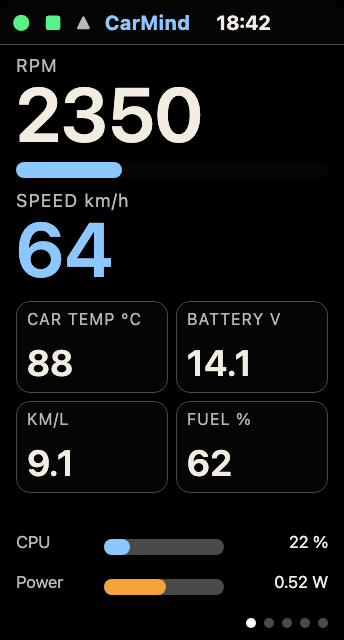
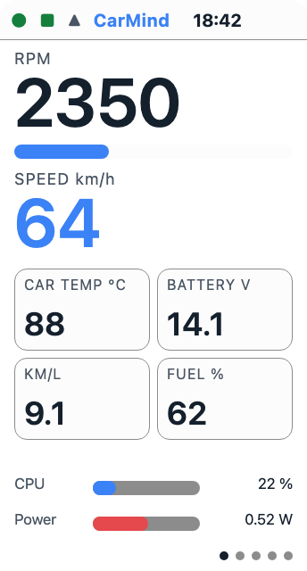
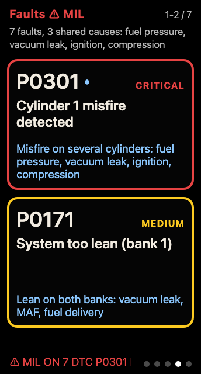
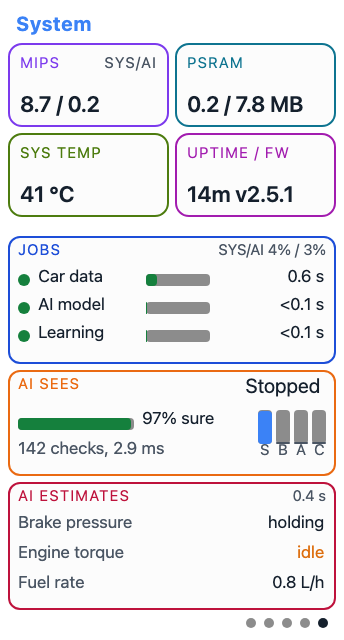

<!-- Generated by docs/manual/build.py from docs/manual/src/esp32-s3.src.html. Edit the source and run the script, not this file. -->

# OpenCarMind on the ESP32-S3 LCD board

*OpenCarMind 2.5.1 user manual · ESP32-S3 LCD. For drivers and test users.*

OpenCarMind turns a small ESP32-S3 display board and a Bluetooth OBD-II adapter into a car data logger that runs a neural network on the chip. It needs no phone, no account and no internet connection.

- **Board:** Waveshare ESP32-S3-LCD-1.47B
- **Screen:** 1.47 inch LCD
- **Storage:** a FAT-formatted SD card
- **Firmware:** OpenCarMind 2.5.1

## Contents

1. [What it is](#what)
2. [What you need](#hardware)
3. [The five pages](#pages)
4. [The BOOT button](#button)
5. [Themes](#themes)
6. [Safe to turn off](#safe)
7. [The two models](#models)
8. [Fuel and fill-ups](#fuel)
9. [The fault engine](#faults)
10. [Wi-Fi, for the clock](#wifi)
11. [The desktop app](#desktop)
12. [Updating the firmware](#update)
13. [Troubleshooting](#trouble)
14. [Licences](#licences)

<a id="what"></a>

## A logger and dashboard that thinks on the board

OpenCarMind reads your car through its OBD-II port, shows the live values on its screen and writes each drive to the SD card as its own session. OBD-II is the standard diagnostic port under the dash of every car sold in the US since 1996.

### It reads the car

The board reads every standard field the car reports (70 are decoded), plus the battery voltage, the VIN, and stored, pending and permanent trouble codes. Each poll cycle adds one row to the log.

### It runs AI on the chip

A small neural network, called the model, looks at the last 5 seconds of driving. It says whether you are stopped, braking, accelerating or cruising. It also estimates brake pressure, engine torque and fuel rate, which the port does not report.

### It keeps your data with you

Your drives are plain CSV, JSON and text files on a card you hold. At home the desktop app imports new drives over the USB cable, or you take the card out.

> [!NOTE]
> **Open source**
>
> The firmware, the desktop app and the on-board models are MIT-licensed at github.com/AlveeeRahman/OpenCarMind.
>
> **No data collection**
>
> There is no account and no cloud. Wi-Fi is optional and only sets the clock from one time server. It sends nothing else.
>
> **Your stats, on your computer**
>
> The free desktop app imports drives over the USB cable and charts them on your own computer.

> [!WARNING]
> **Which firmware this manual covers.**
>
> This manual follows the firmware on the repository's main branch. That build still reports version 2.5.1, but it is newer than the 2.5.1 release on the Releases page. The 2.5.1 release has no BOOT double-click or automatic connection search and no "Turning off" screen, and a new board starts on CarMind E.V instead of R.E.V.

<a id="hardware"></a>

## The board, an adapter and a card

### The parts

- **Board:** Waveshare ESP32-S3-LCD-1.47B
- **Adapter:** a Bluetooth LE OBD-II adapter that speaks ELM327 commands, the common adapter command set
- **Card:** a FAT-formatted SD card
- **Power:** the car's USB port

### Why Bluetooth LE only

The ESP32-S3 has no Classic Bluetooth radio, so Classic-only adapters will not pair. Check that your adapter's listing says Bluetooth LE.

### First boot

The board connects to the strongest nearby device that looks like an OBD adapter and remembers it.

**Planned for a later S3 release, off in this source by default (`CONFIG_OBD_BLE_PAIR_CONFIRM`):** the board asks first. It offers only an adapter with a strong signal, -70 dBm or better, and shows "Use &lt;name>?" with "Strong. Tap = use it" (or "Good" for a weaker signal). Tap BOOT within 5 seconds to pair it. If you do nothing, nothing is saved. Once paired, the adapter also connects at a weaker signal, down to -90 dBm.

| Adapter | Bluetooth | Status |
|---|---|---|
| LELink², LELink | LE | tested |
| Veepeak OBDCheck BLE+, BLE | LE | expected |
| OBDLink CX | LE 5.1, encrypted | expected |
| Carista OBD2, Carista EVO | LE | expected |
| Vgate iCar Pro BLE 4.0 | LE | expected |
| Vgate vLinker MC+ | LE and Classic | expected |
| Vgate vLinker FS, MS | LE and Classic | switch to "BLE+BT" in the VgateFwUpdater app first |
| Panlong OBD2 Scanner (PL-B04) | LE | expected for the "For iOS Android" option only |
| DA200 | LE | expected |
| ELM327 BLE clones | LE on iOS | expected for most. Buy one whose listing says Bluetooth LE for iOS. |
| Adapters running the Deep OBD firmware | LE | expected |
| FIXD | Bluetooth | unverified |
| BlueDriver | Bluetooth, private protocol | not expected |
| V800 full-system scanners | Bluetooth, private app | not expected |
| OBDLink MX+, OBDLink LX, KONNWEI KW902 | Classic only | will not work |

Only the LELink has been driven with this board. The other rows come from vendor documents and other open-source OBD projects.

<a id="pages"></a>

## Five pages

Tap BOOT to turn the page. Every number carries its unit, every status colour comes with a word, and a value the car does not give shows as a dash, never as a made-up figure. The pictures are renders with example values, not photos.

### 1 · Dashboard

<p> </p>

*Left:* Dashboard, dark theme. Render, example values. *Right:* Dashboard, light theme.

- **RPM:** engine speed, with a bar
- **Speed:** road speed in km/h (mph in the US and the UK)
- **Car temp:** engine coolant temperature in °C (°F in the US)
- **Battery:** the car's battery voltage in V
- **Economy:** fuel economy in km/L (mpg in the US and the UK)
- **Fuel:** the fuel level in %
- **CPU, Power:** how busy both cores are, out of 100 %, and an estimate of the board's own power draw in W
- **Top row:** status dots, the CarMind name and the time

### 2 · Details

*[Capture coming] Details: no picture without a VIN on it yet.*

Plain text about the link and the drive.

- **Adapter:** the adapter's name, its address, "(saved)" once it is remembered, and its signal strength. Planned for a later S3 release, off in this source by default (`CONFIG_OBD_BLE_PAIR_CONFIRM`): "paired" or "not paired" in place of the address.
- **VIN:** the car's vehicle identification number, if it reports one
- **Protocol:** the OBD protocol the car uses
- **Trouble codes:** the MIL (check-engine light) state and the stored and pending codes
- **Clock, SD:** whether the clock is synced, and the SD card's state
- **Fuel used:** fuel used this drive

### 3 · Internals

*[Capture coming] Internals: no picture without a network name on it yet.*

Twelve extra engine fields and up to eight custom PIDs. A custom PID is an extra value your car offers that you add yourself, in `custom_pids.csv` on the card.

- **Timing:** ignition timing in °
- **STFT, LTFT:** short and long fuel trims in %
- **Load:** engine load in %
- **Boost:** manifold pressure in kPa, shown above the outside air pressure when the car reports both
- **Cat:** catalyst temperature in °C
- **Rail:** fuel rail pressure in kPa
- **Fuel:** fuel rate in L/h
- **Run:** engine run time in minutes
- **MIL km:** distance driven with the check-engine light on (MIL mi in miles)
- **Pedal:** accelerator pedal position in %
- **Odo:** the odometer in km

Below the fields are the recent events: Wi-Fi joined, clock set, and the "Safe to turn off" line.

### 4 · Faults

<p></p>

*Faults, dark theme. Render, example codes.*

Trouble codes ranked by severity. Each one has its severity in words (CRITICAL, MEDIUM and so on), a plain description and its likely cause. The page groups codes that share a cause, and the top line names the shared causes.

The bottom line shows the connection and MIL status.

### 5 · System and AI

<p></p>

*System with R.E.V, light theme. Render, example values.*

- **MIPS:** millions of instructions per second on each core, from the chip's hardware counters. SYS runs Bluetooth, the Wi-Fi clock and the display. AI runs the car data, the model and the learner.
- **PSRAM:** the external memory in use, out of the total
- **Sys temp:** the chip's own temperature
- **Uptime, FW:** time since start and the firmware version
- **Jobs:** each job (Car data, AI model and, with R.E.V, Learning) against its deadline. A green dot means it is on time.
- **AI sees:** the model's call on the last 5 seconds, how sure it is, and a bar for each class: S (stopped), B (braking), A (accelerating) and C (cruising)
- **AI estimates:** brake pressure, engine torque and fuel rate. An estimate in amber means the car gave no reading to check it against.

<a id="button"></a>

## One button does everything

The board has one button for you, BOOT. How you press it decides what it does.

**Tap.** Next page. If a critical alarm or a pop-up is showing, the tap clears it first.

**Double-click.** Two taps within 0.45 s. When the car link is not working, this starts a connection search now. When the link works, the screen shows what it is doing.

**Hold 2 seconds.** Power off. Let go after 2 seconds. The screen says "Turning off" while it saves and closes the drive, then "Off, safe to unplug". The backlight and LED go dark. Press BOOT to wake it.

**Hold 8 seconds.** Forget the saved adapter. The screen asks "Forget paired adapter?". Tap BOOT within 5 seconds to forget it, or wait to cancel. The board can then pick another adapter.

### Pairing prompt

**Planned for a later S3 release, off in this source by default (`CONFIG_OBD_BLE_PAIR_CONFIRM`):** when the board finds a new adapter with a strong signal, it shows "Use &lt;name>?" and "Strong. Tap = use it" for 5 seconds. A tap on BOOT pairs it. If an alarm is showing, the first tap clears the alarm. If you wait, nothing is saved, and the board offers that adapter again only after your next double-click or a restart. The automatic search never replaces a paired adapter. To switch to another adapter, double-click BOOT while the car link is not working, or forget the paired one first.

### The connection search

Some cars have several computers that answer at once, such as the engine and the transmission. The board picks the engine computer. With no engine data for a minute, it searches by itself. It tries every protocol and each computer in turn, and keeps the one that works. It only reads. Nothing is written to the car or the adapter. With no adapter in range, it lets a different adapter be found for 90 seconds.

<a id="themes"></a>

## Light by day, black at night

### When it changes

The screen is light from 06:00 to 17:00 and dark at other times. You can also fix it to light or dark. The mode, the hours and the time zone are settings in the board's `config.json` file on the SD card. The repository's `docs/CONFIGURATION.md` lists them.

### Why the dark theme is pure black

On an LCD any tint in the background glows through the backlight. So the dark theme uses pure black, and text and colours are bright enough to read at a glance.

<a id="safe"></a>

## Saved every 10 seconds

### The power-off line

The board saves the drive to the SD card every 10 seconds. Page 3 shows the result. A green **Safe to turn off** line appears once everything is on the card. When it is not, a red line gives the reason.

### When a drive ends

A drive ends by itself 15 seconds after the engine computer stops answering. To turn the board off on purpose, hold BOOT for 2 seconds and wait for "Off, safe to unplug".

<a id="models"></a>

## CarMind R.E.V and CarMind E.V

The firmware ships two on-board models. Both say what you are doing and give the three estimates. You choose which one runs in the desktop app.

### CarMind R.E.V

R.E.V keeps learning in your car. The board corrects R.E.V's fuel estimate from what your car reports while you drive. It also learns an airflow constant that gives your engine size. The model's core never changes in the car. What R.E.V learned is saved on the SD card.

On the main-branch firmware, a new board starts on R.E.V. A board that already chose a model keeps it.

### CarMind E.V

E.V is fixed and tested. It never learns. The tank size and the fill-up calibration still learn with either model.

### Switching models

1. Park, then connect the board to the desktop app with its USB cable.
2. Open the Board page and pick the model under "On-board model".

The board keeps the choice after a restart. What R.E.V learned stays on the SD card while E.V runs. With R.E.V, page 5 shows a third job, Learning.

<a id="fuel"></a>

## Fuel economy and fill-up calibration

### Economy

Shown in km/L, or mpg in the US and the UK, from the best source your car has. A car that gives nothing shows "--".

### Fill-ups

Enter each fill-up on the desktop app's Fuel page. The app sends them to the board, and the board corrects its fuel figures from what you pumped.

### Tank size

The board learns your tank size from the fuel used against the drop in the fuel level. This works with either model.

When the car reports neither a fuel rate nor airflow, the board uses whichever estimate has been most accurate on your car so far, and shows it in amber.

<a id="faults"></a>

## The fault engine

### Ranked and grouped

The board reads stored, pending and permanent trouble codes. Stored codes are confirmed faults. Pending codes were seen but not confirmed yet. Permanent codes stay until the car's own checks pass. The fault engine ranks them by severity and groups codes that share a cause, so one problem shows as one group.

### Where to look

Page 4 lists the codes with their severity, a plain description and the likely cause. Page 2 shows the MIL state and the codes. A critical alarm stays on the screen until you tap BOOT.

<a id="wifi"></a>

## Wi-Fi is for the clock only

### What it does

While the car is parked on a known network, the board makes one HTTPS request to one time server. It checks the server's certificate, reads the date and sets the clock. It sends nothing else and listens on no port. You can choose the time server.

### Set it up

In the desktop app, add your Wi-Fi network and check the time zone it filled in. If you want your own time server, type one you trust ("default" uses the built-in one). Then send them to the board.

The first time the board joins Wi-Fi, it reads the country of the access point and switches to miles and mpg in the US or the UK.

There is no Wi-Fi upload of drives yet. Drives come over the USB cable.

<a id="desktop"></a>

## Your drives, on your computer

The OpenCarMind desktop app runs on Windows, macOS and Linux. Download it from the Releases page of the OpenCarMind repository.

### Getting connected

1. Connect the board with its USB cable. Open the Board page, pick the port (the app marks the one that looks like the board) and choose Connect.
2. The first time, choose Show a code on the board, type the 6-digit code from the board's screen and choose Pair. Later connections need no code.
3. Add Wi-Fi, the time zone and the time server, and send them to the board.
4. After a drive, connect again and choose Import drives over USB.

### What it does

- **Import** copies new drives from the card into the app's drives folder, at about 15 KB/s.
- **Charts** show each drive, with fuel and economy per drive and in total.
- **Fill-ups** live on the Fuel page. The app sends them to the board.
- **On-board model** shows which model runs and switches it.
- **Flash the firmware** installs the firmware that ships with the app. This button is for the ESP32-S3 board.
- **Open card folder**, on the Overview, reads an SD card directly, without the board.

### First launch

The installers are not code-signed yet. On macOS, right-click the app and choose Open the first time. On Windows, SmartScreen shows a warning. Choose More info, then Run anyway.

<a id="update"></a>

## Updating the firmware

### With the desktop app

1. Install the desktop app of the version you want. It carries the matching firmware image and its own copy of esptool, so you need no other tools.
2. Connect the board over USB and choose Flash the firmware on the Board page.

The board keeps its Wi-Fi networks and its pairing, because they live in a separate flash partition.

### Building it yourself

You need ESP-IDF v6.1 and Python 3.

```sh
. $IDF_PATH/export.sh
idf.py set-target esp32s3
idf.py build
idf.py -p /dev/cu.usbmodemXXXX flash monitor
```

If you built an earlier version in the same folder, delete `sdkconfig` first.

<a id="trouble"></a>

## When something looks wrong

### No engine data

Check that the ignition is on and the adapter is in the port. Double-click BOOT to start a connection search now. The board also starts one by itself after a minute without engine data.

### It found the wrong adapter

Hold BOOT for 8 seconds, then tap BOOT to confirm. The board forgets the saved adapter and connects to the strongest nearby adapter again. Planned for a later S3 release, off in this source by default (`CONFIG_OBD_BLE_PAIR_CONFIRM`): it asks first ("Use &lt;name>?"), and you tap BOOT within 5 seconds only for the right one.

### A value shows "--"

Either the car does not report it, or the drive has not started. The board shows a dash rather than guess.

### The clock is wrong

The clock needs a known Wi-Fi network within reach while parked, and it is exact to about one second. Check the time zone in the desktop app.

### The board stays in download mode after flashing

Reset it with this command.

```sh
python -m esptool --chip esp32s3 -p <port> --after watchdog-reset chip-id
```

### Reporting a problem

Note what you saw and when, with your car's make, model and year. The field checks in the repository's `docs/FIELD_CHECKS.md` have tables you can fill in.

<a id="licences"></a>

## Licences

- **OpenCarMind:** MIT
- **Libraries:** ESP-IDF, ESP-DL, LVGL and NimBLE keep their own licences
- **esptool:** ships with the desktop app. It is free software under the GNU GPL version 2, and its licence ships as `esptool-LICENSE.txt`.

The source is at [github.com/AlveeeRahman/OpenCarMind](https://github.com/AlveeeRahman/OpenCarMind). The screen pictures in this manual are renders from the repository with example values.

There is also a manual for [OpenCarMind EdgeOS 2.0.0](edgeos-2.0.0.html), the firmware for the Espressif ESP-Mosaico board.

---

**Open**CarMind S3 manual · alveeerahman.github.io/OpenCarMind · OpenCarMind 2.5.1

<!--@script-->
